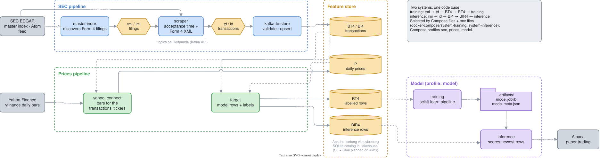
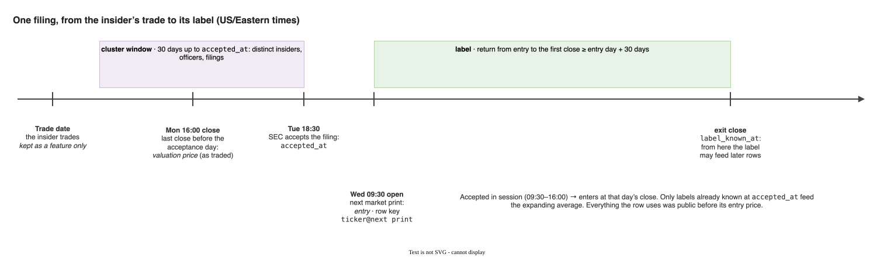
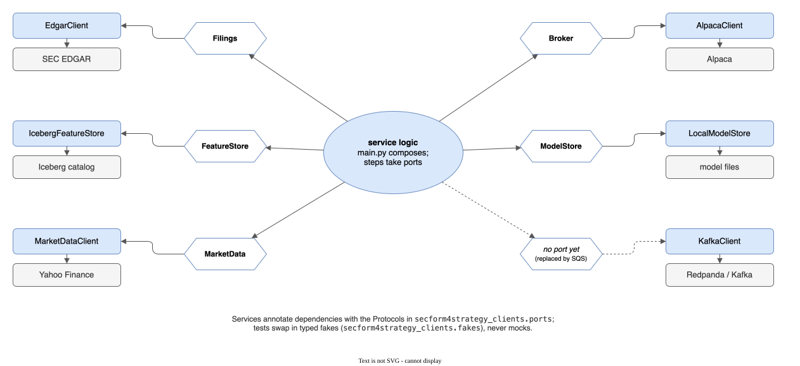

# SecForm4Strategy

**A microservice ML system that turns SEC Form 4 insider-trading filings into a short-side equity signal.**

When a corporate insider sells their own company's stock, they must disclose it to the SEC on a Form 4 within two business days. SecForm4Strategy ingests those filings as they are published, joins each one to the stock's price action *after it became public*, trains a model to predict the return that follows, and shorts the names it expects to fall, paper-traded through Alpaca.

> **Project status: portfolio / research.** An end-to-end systems-and-ML engineering showcase, not a production trading system or investment advice. It runs locally (Docker Compose, Redpanda, an Apache Iceberg feature store on a SQLite catalog) against paper trading; the migration to AWS serverless is the next stage.

---

## Why it's interesting

**The motivating question:** do corporate insiders actually beat the market? Insiders trade their own company's stock with an information advantage no one else has. SecForm4Strategy is the apparatus built to settle empirically whether their sales precede real underperformance or whether the signal is already priced in, and the engineering below is what makes that answer trustworthy.

- **Disclosure time, not trade time.** Every transaction is stamped with the moment SEC accepted its filing. A label enters at the first market price a trader could act on after that moment and exits at the first close a period later. The insider's trade date, often days earlier, is only a feature.
- **No look-ahead anywhere.** Positions are valued at the last close before the acceptance day; a ticker's past-return feature averages only labels already realised at acceptance, the same rule in training and inference; the train/test split is chronological and purged.
- **One row per trading opportunity.** Everything disclosed for a ticker before its next market price is one row, with the cluster of insiders who sold in the preceding 30 days, so several insiders selling together is visible to the model, and no label is counted twice.
- **Prices that stay honest.** Returns use split- and dividend-adjusted prices; values use the price as it traded that day; an incremental refresh detects when Yahoo has re-based past prices and fetches the history again.
- **Clean boundaries, tested.** Each microservice owns one stage; every external system sits behind a typed port in one shared package; unit tests run on real Form 4 submissions and typed fakes, never mocks.

---

## Architecture



Two pipelines feed one feature store, and the same services run as two systems, **training** and **inference**, selected by Compose files and env files:

- **SEC pipeline:** `master-index` discovers filings (EDGAR's quarterly master index for backfill, its current-filings Atom feed for live), `scraper` turns each into transaction records timed at acceptance, and `kafka-to-store` validates and upserts them, with Redpanda (Kafka) between the stages.
- **Prices pipeline:** `yahoo_connect` keeps daily bars for every ticker the transactions mention; `target` turns transactions and prices into model rows and labels.
- **Model:** `training` fits a scikit-learn pipeline on the labelled rows and saves it with its metadata; `inference` scores the newest rows and places short orders.

Kafka topics mirror the split: `tmi` / `imi` (training / inference filings) feed `td` / `id` (training / inference transactions).

### A filing's life



A filing accepted after the close enters at the next open; one accepted during the session enters at that day's close. Its row is keyed by ticker and that entry moment, carries the insiders of the preceding 30 days, and is valued at the previous close as traded. The label is the return from entry to the first close at least `DELTA_PERIOD` days later, and becomes usable by later rows only once that close has printed. The parsing rules are in [docs/form4-parsing.md](docs/form4-parsing.md).

### The data model

| Group | One row per | Key | Holds | Produced by | Read by |
| --- | --- | --- | --- | --- | --- |
| `BT4` / `BI4` | transaction (training / inference) | hash of accession, table, position | the parsed Form 4 transaction, `accepted_at` | kafka-to-store | yahoo_connect, target |
| `P` | ticker and day | `<ticker>@<date>` | adjusted open/close, close as traded, split, dividend | yahoo_connect | target |
| `RT4` | ticker and next market print | `<ticker>@<next print>` | features, label, `label_known_at` | target | training |
| `BIR4` | ticker and next market print | `<ticker>@<next print>` | the same features, no label yet | target | inference |

Keys are deterministic, so every redelivery (feed re-polls, Kafka retries, backfill reruns) upserts the same row. Formats and specs are in [docs/configuration.md](docs/configuration.md).

### Ports and adapters



Services depend on Protocols (`FeatureStore`, `Filings`, `MarketData`, `Broker`, `ModelStore`), never on concrete clients; each `main.py` is the only place that builds the adapters from config. Moving the feature store from a local catalog to S3 and Glue is a configuration change, and tests substitute typed in-memory fakes.

---

## Services

| Service | Role |
| --- | --- |
| **sec-feature-pipeline/master-index** | Discovers Form 4 filings, from the quarterly master index (backfill) or the current-filings Atom feed (live), and publishes one message per filing. |
| **sec-feature-pipeline/scraper** | Fetches each submission, reads its acceptance time and Form 4 XML into typed models, and publishes one record per transaction. |
| **sec-feature-pipeline/kafka-to-store** | Consumes transactions, casts and validates them, and upserts them into `BT4` / `BI4`. |
| **prices-feature-pipeline/yahoo_connect** | Refreshes daily bars for the transactions' tickers into `P`, never mixing price bases and never storing a provisional close. |
| **prices-feature-pipeline/target** | Collapses transactions into one row per ticker and next market print, adds insider clusters, company context and values, computes labels, and writes `RT4` / `BIR4`. |
| **training** | Purged chronological split, a scikit-learn pipeline (preprocessing + gradient-boosted regressor), baselines, a short-side simulation; saves the pipeline with its metadata. |
| **inference** | Loads the saved pipeline, scores the newest `BIR4` rows and places short orders through Alpaca. |
| **packages/secform4strategy-clients** | The ports, their adapters (EDGAR, Kafka, Iceberg, yfinance, Alpaca, model store) and typed fakes for tests. See its [README](packages/secform4strategy-clients/README.md). |

---

## Repository layout

```
.
├── sec-feature-pipeline/                # Form 4 ingestion: master-index, scraper, kafka-to-store
├── prices-feature-pipeline/             # yahoo_connect (prices), target (rows and labels)
├── training/                            # model training and evaluation
├── inference/                           # scoring and order placement
├── packages/secform4strategy-clients/   # ports, adapters and fakes shared by every service
├── docker-compose/                      # Redpanda, the training / inference stacks and the lakehouse summary tool
├── scripts/                             # lakehouse_summary.py, run in a container by make lakehouse-summary
├── docs/                                # configuration, development, Form 4 parsing, diagrams
├── Makefile                             # quality gate, tests and compose entry points
└── pyproject.toml                       # repo-wide ruff, mypy, pydoclint and bandit config
```

Each service is its own `uv` project (`pyproject.toml`, `uv.lock`, Dockerfile, `src/`, `tests/`) and builds from the repo root so it can install the shared clients package by path.

---

## Tech stack

- **Python 3.14** everywhere, managed with [`uv`](https://docs.astral.sh/uv/) (per-service lockfiles, `uv sync --frozen` in Docker).
- **Streaming:** Redpanda (Kafka API) via `quixstreams`.
- **Feature store:** Apache Iceberg via `pyiceberg` (a local SQLite catalog today, S3 + Glue on AWS).
- **Filings:** SEC EDGAR over `httpx`, rate-limited; Form 4 XML declared as `pydantic-xml` models.
- **Market data:** `yfinance`.
- **ML:** scikit-learn `HistGradientBoostingRegressor` in a `Pipeline` with its preprocessing.
- **Broker:** Alpaca (paper trading) via `alpaca-py`.
- **Config:** `pydantic-settings` for environment and secrets, one YAML `spec.yaml` per service for static specs.
- **Quality gate:** ruff (lint + format), pydoclint, bandit, mypy and pytest, from one shared config; run by `make`, the pre-commit hook and GitHub Actions.

---

## Running it locally

### Prerequisites

- Docker + Docker Compose
- [`uv`](https://docs.astral.sh/uv/getting-started/installation/)
- A contact for SEC's fair-access policy, and (for the inference system) Alpaca paper-trading credentials

### Secrets

Secrets are **never** committed, and services hold them as `SecretStr`, unwrapped only where an SDK needs them. The SEC pipeline reads `SEC_USER_AGENT` (a real name and contact email, e.g. `export SEC_USER_AGENT="Jane Doe jane@example.com"`) from the host environment; Compose refuses to start without it. Each stack reads a git-ignored `.credentials.env` (next to the Compose file) containing, as needed:

```dotenv
ALPACA_API_KEY=...
ALPACA_API_SECRET=...
ALPACA_BASE_URL=https://paper-api.alpaca.markets
```

### Bring up the pipeline

Each stage is one `make` target; images are rebuilt on every run, so code changes are picked up.

```bash
make start-redpanda      # Kafka (Redpanda), console at http://localhost:8080

# Training system
make training-sec        # master-index → scraper → kafka-to-store: BT4
make training-prices     # yahoo_connect, then target once prices are in: P, RT4
make training-model      # fits the model on RT4, saves it to .artifacts/

# Inference system
make inference-sec       # live filings from the Atom feed: BI4
make inference-prices    # P, BIR4
make inference-model     # scores BIR4 with the saved model, places paper orders

make lakehouse-summary   # row counts, time spans and the latest RT4/BIR4 rows, between any two stages
```

The feature store lives in `.lakehouse/` and the model in `.artifacts/` at the repo root (both git-ignored), shared by the containers through volumes; `rm -rf .lakehouse .artifacts` starts from scratch. Run settings sit in the env files next to each Compose file: master-index picks what the training scrape covers (`MODE` in `training-master.env`: the current quarter, the last `YEARS` years, or one `YEAR` / `QUARTER`; `SHUFFLE=True` publishes in random order, so a scrape stopped early is a random sample), and inference trades `QTY` shares below `PREDICTION_THRESHOLD` (`inference-model.env`). Only the SEC stacks need `SEC_USER_AGENT`, and only `inference-model` needs `.credentials.env`.

### Code quality and tests

```bash
make quality          # format, then lint, docstrings, security, config validation and unit tests, then mypy
make quality-static   # everything except formatting and mypy (also the pre-commit hook and CI)
make test-unit        # unit tests with coverage, each project in its own environment
make type-check       # mypy, one run per service
```

Development conventions (tests, fakes, comments, Docker builds) are in [docs/development.md](docs/development.md).

---

## License

Released under the MIT License.
