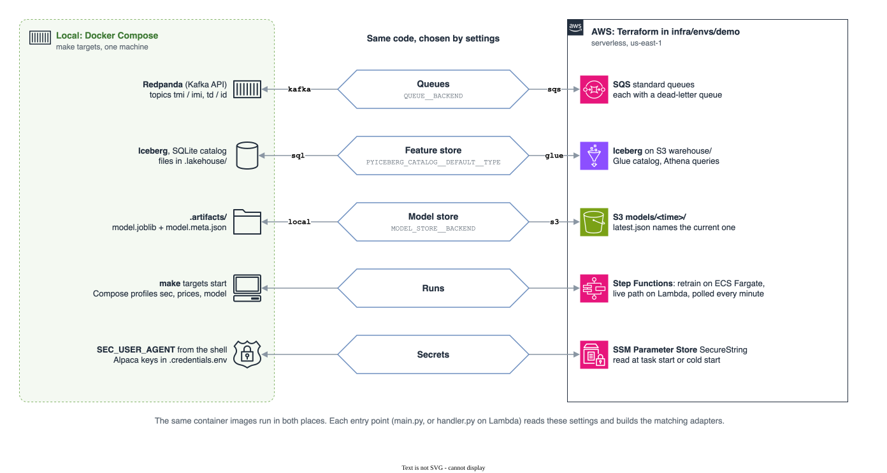

# SecForm4Strategy

**A serverless ML system on AWS that turns SEC Form 4 insider-trading filings into a short-side equity signal.**

When a corporate insider sells their own company's stock, they must disclose it to the SEC on a Form 4 within two business days. SecForm4Strategy ingests those filings as they are published, joins each one to the stock's price action *after it became public*, trains a classifier to estimate the chance that the stock falls by more than 5% over the next 30 days, and shorts the names it rates most likely to fall, paper-traded through Alpaca.

> **Project status: portfolio / research.** An end-to-end systems-and-ML engineering showcase, not a production trading system or investment advice. It runs on AWS (account `100118195151`, region `us-east-1`), defined entirely in Terraform: a weekly batch path on ECS Fargate, a per-minute live path on Lambda, and a password-protected study website on CloudFront. The same services also run locally on Docker Compose. Trading is paper only.


---

## Why it's interesting

**The motivating question:** do corporate insiders actually beat the market? Insiders trade their own company's stock with an information advantage no one else has. SecForm4Strategy is the apparatus built to settle empirically whether their sales precede real underperformance or whether the signal is already priced in, and the engineering below is what makes that answer trustworthy.

- **Disclosure time, not trade time.** Every transaction is stamped with the moment SEC accepted its filing. A label enters at the first market price a trader could act on after that moment and exits at the first close a period later. The insider's trade date, often days earlier, is only a feature.
- **No look-ahead anywhere.** Positions are valued at the last close before the acceptance day; a ticker's past-return feature averages only labels already realised at acceptance, the same rule in training and inference; the holdout and the walk-forward validation folds are split by time and purged.
- **One row per trading opportunity.** Everything disclosed for a ticker before its next market price is one row, with the cluster of insiders who sold in the preceding 30 days, so several insiders selling together is visible to the model, and no label is counted twice.
- **Prices that stay honest.** Returns use split- and dividend-adjusted prices; values use the price as it traded that day; an incremental refresh detects when Yahoo has re-based past prices and fetches the history again.
- **Speed from disclosure.** The live path polls SEC every minute of the trading day and trades as soon as it scores a filing. A poll at 07:55 ET collects the filings disclosed overnight, so they trade at the open. A filing reaches an Alpaca paper order within minutes of publication.
- **One feature implementation.** The live path runs the batch services as Lambda handlers on the same images, so training and live scoring compute features with the same code.
- **About $0 per day when idle.** Both paths are serverless. One Terraform switch creates the NAT gateway and enables the schedules (about $1.20 per day plus usage) and removes them again.
- **Clean boundaries, tested.** Each microservice owns one stage; every external system sits behind a typed port in one shared package; unit tests run on real Form 4 submissions and typed fakes, never mocks.

### Result so far

On five years of data, the classifier ranks short winners modestly but consistently better than chance: holdout average precision 0.418 against a 0.338 base rate. At its probability cutoff of 0.70, its 314 holdout shorts captured a median return of +9.9%, before borrow fees and costs. A naive per-ticker baseline reaches 0.404 average precision, so much of the signal is ticker persistence. The project delivers infrastructure that can test the insider-selling hypothesis rigorously, not a proven trading strategy. The full write-up is [docs/report/report.md](docs/report/report.md).

---

## Architecture on AWS


The system has two paths. Both share one Iceberg feature store in S3 (Glue catalog) and one model in S3.

| | Batch path | Live path |
| --- | --- | --- |
| Work | The first full load of years of filings, then a weekly retrain on the new filings | One filing at a time, as SEC publishes it |
| Compute | ECS tasks on Fargate ARM64, in private subnets | Lambda functions on the same images, outside the VPC |
| Trigger | EventBridge Scheduler starts the Step Functions state machine `retrain` every Saturday at 06:00 UTC | EventBridge Scheduler polls every minute from 08:00 to 15:59 ET and once at 07:55 ET, on weekdays; SQS and an EventBridge Pipe start the state machine `live-score` |
| Steps | master-index → scraper → kafka-to-store → yahoo-connect → target → training | master-index → scraper → kafka-to-store → `live-score`: yahoo-connect → target → inference |

Every queue has a dead-letter queue with a CloudWatch alarm that emails through SNS. A $5 monthly budget alerts on actual and forecast cost. The details, including network, identity, messaging and cost, are in [docs/aws.md](docs/aws.md).

### Study website


A static site on S3 behind CloudFront shows the project in five pages: Story, Live, Portfolio, Model and Explore. A CloudFront Function checks a password on every request. The `site-publisher` Lambda writes the pages' `data/*.json` every minute and after each `live-score` run. Viewers only read pre-built files: no request reaches the lakehouse, Step Functions or Alpaca. The design and its security are in [docs/site.md](docs/site.md).

### CI/CD


GitHub Actions authenticates to AWS with OIDC, so GitHub holds no AWS key. A merge to master runs the quality gate, then builds the `linux/arm64` image of each changed service and pushes it to ECR. A Terraform change runs in two stages: a `plan` job saves the plan and uploads it encrypted, and an `apply` job applies exactly that plan after a reviewer approves it. Details are in [docs/aws.md](docs/aws.md#cicd).

### One code base, two runtimes



Each service chooses its adapters from environment variables, so the same code runs on Docker Compose and on AWS ([docs/configuration.md](docs/configuration.md#backends-local-or-aws)).

---

## The model

### A filing's life


A filing accepted after the close enters at the next open; one accepted during the session enters at that day's close. Its row is keyed by ticker and that entry moment, carries the insiders of the preceding 30 days, and is valued at the previous close as traded. The label is the return from entry to the first close at least `DELTA_PERIOD` days later, and becomes usable by later rows only once that close has printed. The parsing rules are in [docs/form4-parsing.md](docs/form4-parsing.md).

### Validation


Training keeps the latest 20% of rows as a holdout and scores it once. A grid search runs over 4 expanding walk-forward folds of the earlier rows and picks the highest mean validation average precision. The probability cutoff is chosen on the same folds and stored with the model. Every split drops the rows whose 30-day label ends inside the period it is scored on. The rules are in [docs/training.md](docs/training.md).

### The data model

| Group | One row per | Key | Holds | Produced by | Read by |
| --- | --- | --- | --- | --- | --- |
| `BT4` / `BI4` | transaction (training / inference) | hash of accession, table, position | the parsed Form 4 transaction, `accepted_at` | kafka-to-store | yahoo_connect, target |
| `P` | ticker and day | `<ticker>@<date>` | adjusted open/close, close as traded, split, dividend | yahoo_connect | target |
| `RT4` | ticker and next market print | `<ticker>@<next print>` | features, label, `label_known_at` | target | training |
| `BIR4` | ticker and next market print | `<ticker>@<next print>` | the same features, no label yet | target | inference |

Keys are deterministic, so every redelivery (feed re-polls, queue retries, backfill reruns) upserts the same row. Formats and specs are in [docs/configuration.md](docs/configuration.md).

### Ports and adapters


Services depend on the Protocols in `secform4strategy_clients.ports`, never on concrete clients. Each `main.py`, or `handler.py` on Lambda, is the only place that builds the adapters from config. Tests substitute typed in-memory fakes.

---

## Services

| Service | Role |
| --- | --- |
| **sec-feature-pipeline/master-index** | Discovers Form 4 filings, from the quarterly master index (backfill) or the current-filings Atom feed (live), and publishes one message per filing. On the live path, DynamoDB records the filings it has already sent. |
| **sec-feature-pipeline/scraper** | Fetches each submission, reads its acceptance time and Form 4 XML into typed models, and publishes one record per transaction. |
| **sec-feature-pipeline/kafka-to-store** | Consumes transactions, casts and validates them, and upserts them into `BT4` / `BI4`. |
| **prices-feature-pipeline/yahoo_connect** | Refreshes daily bars for the transactions' tickers into `P`, never mixing price bases and never storing a provisional close. |
| **prices-feature-pipeline/target** | Collapses transactions into one row per ticker and next market print, adds insider clusters, company context and values, computes labels, and writes `RT4` / `BIR4`. |
| **training** | Purged walk-forward grid search with a time holdout ([docs/training.md](docs/training.md)), a scikit-learn pipeline (preprocessing + gradient-boosted classifier of short winners), baselines, a short-side simulation; saves the pipeline with its metadata as a new version, and promotes it only through a gate ([docs/training.md](docs/training.md#promotion)). |
| **inference** | Loads the saved pipeline, scores the newest `BIR4` rows and places short orders through Alpaca. On the live path it trades only rows accepted within the last 60 minutes, or since the last close while the market is closed and in the first hour of the session. |
| **site-publisher** | Reads the runs, queues, lakehouse, model and Alpaca paper account, and writes the study website's `data/*.json`. |
| **packages/secform4strategy-clients** | The ports, their adapters (EDGAR, SQS, Kafka, Iceberg, DynamoDB, yfinance, Alpaca, local and S3 model stores, SSM settings) and typed fakes for tests. See its [README](packages/secform4strategy-clients/README.md). |

---

## Repository layout

```text
.
├── sec-feature-pipeline/                # Form 4 ingestion: master-index, scraper, kafka-to-store
├── prices-feature-pipeline/             # yahoo_connect (prices), target (rows and labels)
├── training/                            # model training and evaluation
├── inference/                           # scoring and order placement
├── site-publisher/                      # Lambda that writes the study website's data files
├── site/                                # the static study website
├── packages/secform4strategy-clients/   # ports, adapters and fakes shared by every service
├── infra/                               # Terraform: bootstrap (state bucket), envs/demo, modules
├── .github/workflows/                   # quality, images and terraform
├── docker-compose/                      # Redpanda, the local training / inference stacks and the lakehouse summary tool
├── scripts/                             # make status, the lakehouse summary, model promotion and the site password
├── docs/                                # AWS, site, training, configuration, development, Form 4 parsing, report, diagrams
├── Makefile                             # quality gate, tests, local stacks, AWS status and switch
└── pyproject.toml                       # repo-wide ruff, mypy, pydoclint and bandit config
```

Each service is its own `uv` project (`pyproject.toml`, `uv.lock`, Dockerfile, `src/`, `tests/`) and builds from the repo root so it can install the shared clients package by path.

---

## Tech stack

- **Python 3.14** everywhere, managed with [`uv`](https://docs.astral.sh/uv/) (per-service lockfiles, `uv sync --frozen` in Docker).
- **AWS:** ECS Fargate (ARM64), Lambda container images, Step Functions, EventBridge Scheduler and Pipes, SQS, DynamoDB, S3, Glue, Athena, SSM Parameter Store, CloudFront, CloudWatch, SNS, Budgets.
- **Infrastructure as code:** Terraform with S3 state and native locking; GitHub Actions with OIDC roles and an approval gate.
- **Messaging:** SQS on AWS; Redpanda (Kafka API) via `quixstreams` locally.
- **Feature store:** Apache Iceberg via `pyiceberg`, on S3 with a Glue catalog (a SQLite catalog locally).
- **Filings:** SEC EDGAR over `httpx`, rate-limited; Form 4 XML declared as `pydantic-xml` models.
- **Market data:** `yfinance`.
- **ML:** scikit-learn `HistGradientBoostingClassifier` in a `Pipeline` with its preprocessing.
- **Broker:** Alpaca (paper trading) via `alpaca-py`.
- **Config:** `pydantic-settings` for environment and secrets, one YAML `spec.yaml` per service for static specs.
- **Quality gate:** ruff (lint + format), pydoclint, bandit, mypy and pytest, from one shared config; run by `make`, the pre-commit hook and GitHub Actions.

---

## Operating the AWS stack

CI applies master; nobody applies Terraform by hand. Three switches in `infra/envs/demo/switch.auto.tfvars` control what runs:

| Switch | While `true` |
| --- | --- |
| `switched_on` | The NAT gateway exists, and the schedules below may run. |
| `weekly_retrain_enabled` | The Saturday `retrain` schedule is enabled, if `switched_on` is `true`. |
| `live_enabled` | The live poller is enabled, if `switched_on` is `true`. |

```bash
make switch-on     # from master: sets switched_on = true, commits and pushes; approve the apply in GitHub
make switch-off    # the same, back to dormant
make status        # one read-only screen: switches, runs, queues with rates and ETAs, tasks, errors, model
```

The CloudWatch dashboard `secform4strategy` shows the same metrics as graphs. Secrets live in SSM Parameter Store and never in Terraform. The runbooks (secrets, manual runs, testing the live path with one filing) are in [docs/aws.md](docs/aws.md#operating).

---

## Running it locally


### Prerequisites

- Docker + Docker Compose
- [`uv`](https://docs.astral.sh/uv/getting-started/installation/)
- A contact for SEC's fair-access policy, and (for the inference system) Alpaca paper-trading credentials

### Secrets

Secrets are **never** committed, and services hold them as `SecretStr`, unwrapped only where an SDK needs them. The SEC pipeline reads `SEC_USER_AGENT` (a real name and contact email, e.g. `export SEC_USER_AGENT="Jane Doe jane@example.com"`) from the host environment; Compose refuses to start without it. Each stack reads a git-ignored `.credentials.env` (next to the Compose file) containing, as needed:

```dotenv
ALPACA_API_KEY=...
ALPACA_API_SECRET=...
ALPACA_BASE_URL=https://paper-api.alpaca.markets
```

### Bring up the pipeline

Each stage is one `make` target; images are rebuilt on every run, so code changes are picked up.

```bash
make start-redpanda      # Kafka (Redpanda), console at http://localhost:8080

# Training system
make training-sec        # master-index → scraper → kafka-to-store: BT4
make training-prices     # yahoo_connect, then target once prices are in: P, RT4
make training-model      # fits the model on RT4, saves it to .artifacts/

# Inference system
make inference-sec       # live filings from the Atom feed: BI4
make inference-prices    # P, BIR4
make inference-model     # scores BIR4 with the saved model, places paper orders

make lakehouse-summary   # row counts, time spans and the latest RT4/BIR4 rows, between any two stages
```

Kafka topics mirror the split: `tmi` / `imi` (training / inference filings) feed `td` / `id` (training / inference transactions). The feature store lives in `.lakehouse/` and the model in `.artifacts/` at the repo root (both git-ignored), shared by the containers through volumes; `rm -rf .lakehouse .artifacts` starts from scratch. Run settings sit in the env files next to each Compose file: master-index picks what the training scrape covers (`MODE` in `training-master.env`: the current quarter, the last `YEARS` years, one `YEAR` / `QUARTER`, or the last `DAYS_BACK` days with `recent`; `SHUFFLE=True` publishes in random order, so a scrape stopped early is a random sample), and inference shorts `QTY` shares of each row whose probability reaches the model's cutoff (`inference-model.env`). Only the SEC stacks need `SEC_USER_AGENT`, and only `inference-model` needs `.credentials.env`.

To preview the study website with sample data, run `python3 -m http.server -d site 8000` and open `http://localhost:8000/?fixtures`.

### Code quality and tests

```bash
make quality          # format, then lint, docstrings, security, config validation and unit tests, then mypy
make quality-static   # everything except formatting and mypy (also the pre-commit hook and CI)
make test-unit        # unit tests with coverage, each project in its own environment
make type-check       # mypy, one run per service
```

Development conventions (tests, fakes, comments, Docker builds) are in [docs/development.md](docs/development.md).

---

## Documentation

| Document | Covers |
| --- | --- |
| [docs/report/report.md](docs/report/report.md) | The full project report: hypothesis, data, model, results and cloud design |
| [docs/aws.md](docs/aws.md) | The AWS deployment: paths, network, identity, messaging, CI/CD, cost, operating, the 5-year backfill |
| [docs/site.md](docs/site.md) | The study website: architecture, publisher, network, security, rollout |
| [docs/training.md](docs/training.md) | Validation, grid search, evaluation, the model metadata and model promotion |
| [docs/configuration.md](docs/configuration.md) | Settings, backends, feature-group specs |
| [docs/form4-parsing.md](docs/form4-parsing.md) | How a Form 4 becomes transaction records |
| [docs/error-handling.md](docs/error-handling.md) | Retryable and permanent errors across the services |
| [docs/development.md](docs/development.md) | Conventions for code, tests and Docker builds |

---

## License

Released under the MIT License.
