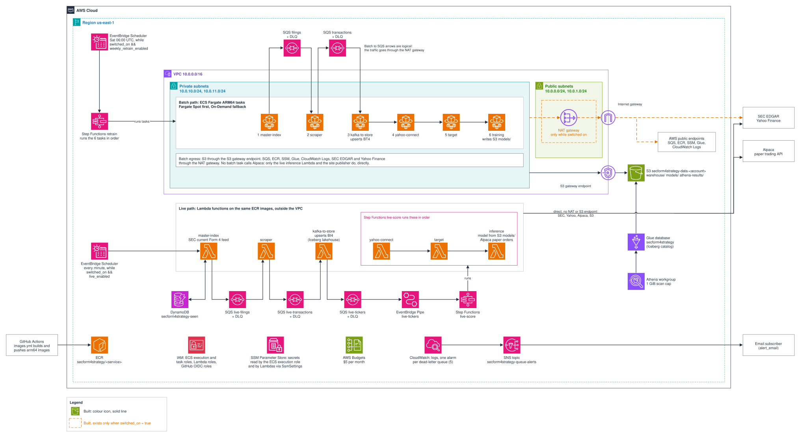
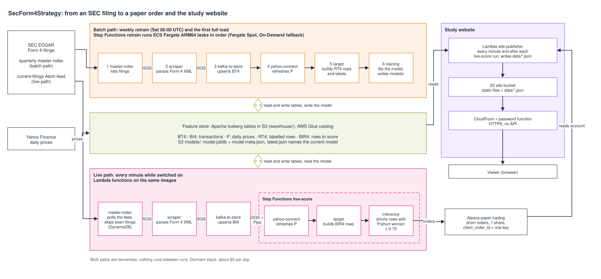
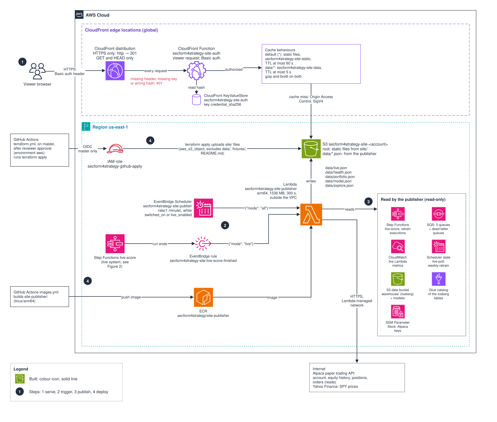
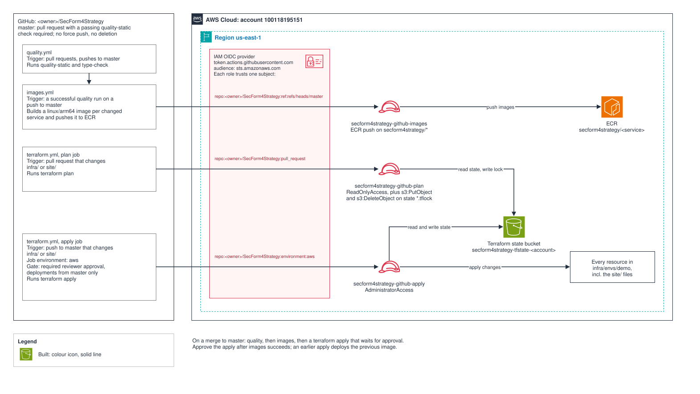
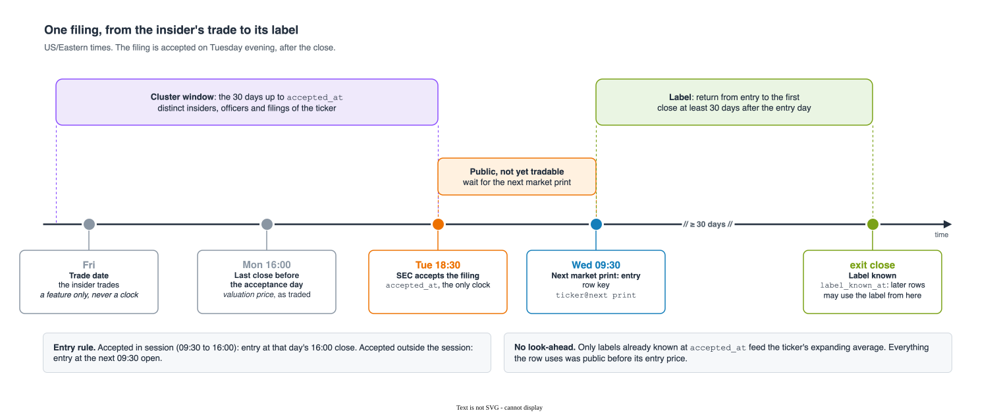
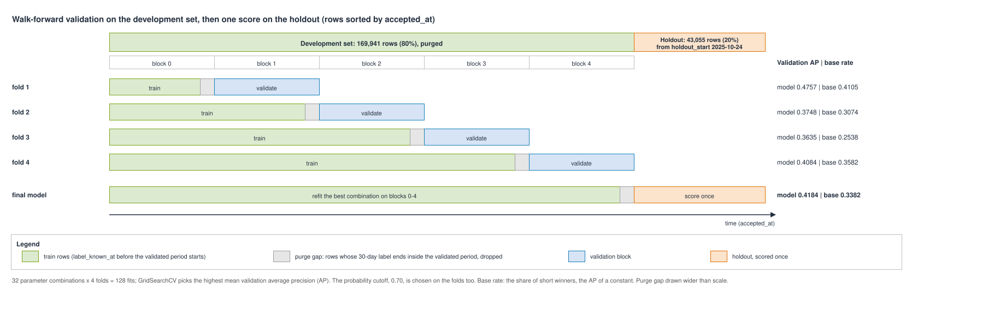
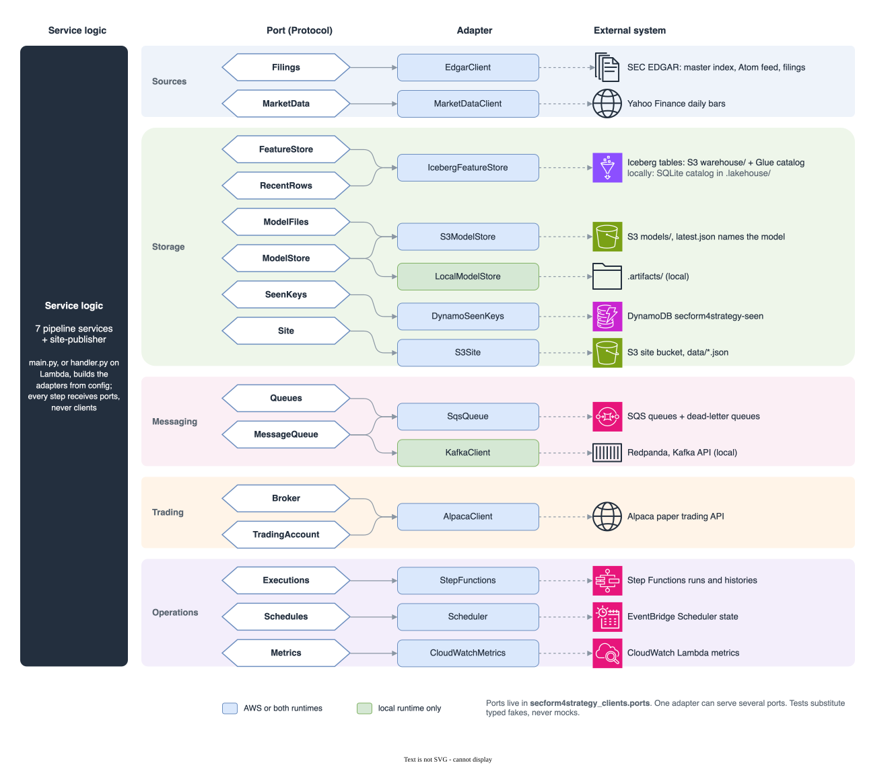
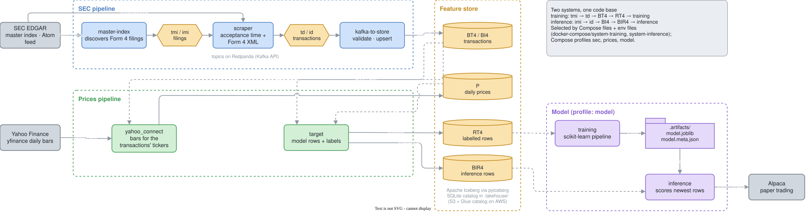

# SecForm4Strategy

**An end-to-end ML system on AWS that turns SEC Form 4 insider-trading filings into short trades on an Alpaca paper account.**

Corporate insiders must report their trades to the SEC on a Form 4. SecForm4Strategy reads each filing as EDGAR publishes it and joins it to the stock's prices after the filing became public. A gradient-boosted classifier then estimates the chance that the stock falls by more than 5% over the next 30 days, and the system shorts the names that score highest.

> **Status: portfolio and research project.** Trading is paper only, and nothing here is investment advice. Terraform defines the whole AWS stack in `us-east-1`. The same services also run locally on Docker Compose. A password-protected demo website is available on request.



## Highlights

- **A complete AWS system on a $10 monthly budget.** Terraform defines every resource. The live path runs for cents to a few dollars per month. November 2026, including the 5-year backfill, cost $8.52 of usage.
- **A serverless live path.** Six Lambda functions run the batch services' own container images, so training and live scoring share one feature implementation. After a quiet period, a new filing reaches inference about 1 to 2 minutes after the poll that finds it.
- **A 5-year backfill.** The batch path on ECS Fargate scraped 1,048,560 Form 4 filings (January 2021 to November 2026) within SEC's limit of 10 requests per second. It built 215,273 labelled training rows.
- **An Apache Iceberg lakehouse.** All tables are Iceberg tables on S3 with the Glue catalog, queried with Athena. Deterministic keys make every redelivery an upsert. Nightly `VACUUM` and Glue compaction maintain the tables.
- **Keyless, approval-gated CI/CD.** GitHub Actions authenticates to AWS with OIDC. A reviewer approves the exact saved Terraform plan before it is applied. Trivy scans the dependencies, the Terraform and every image.
- **A leak-free ML pipeline.** Every row is timed by the moment SEC accepted the filing. Validation uses purged walk-forward folds and a time holdout. Holdout average precision is 0.418 against a 0.338 base rate.

## Skills demonstrated

| Area | Technologies | Where they are used |
| --- | --- | --- |
| Cloud compute | AWS Lambda (container images), ECS Fargate ARM64 with Spot and an On-Demand fallback | Live path; batch loads and training |
| Orchestration and messaging | Step Functions, EventBridge Scheduler and Pipes, SQS with dead-letter queues, DynamoDB | Both paths; deduplication of the live feed |
| Data | Apache Iceberg (`pyiceberg`), S3, Glue Data Catalog, Athena | Feature store, predictions, ad-hoc queries |
| Infrastructure as code | Terraform (10 modules, S3 state with native locking) | Every AWS resource, including the CI roles |
| CI/CD and security | GitHub Actions, OIDC, Trivy, SSM Parameter Store, least-privilege IAM roles per service | Quality gate, image builds, gated deploys, secrets |
| Observability | CloudWatch dashboard and alarms, SNS, AWS Budgets | Dead-letter and failed-run alerts, cost alerts |
| Python | Python 3.14, `uv`, `pydantic`, `pydantic-xml`, `httpx`, typed ports and adapters | Seven services and one shared client package |
| ML | scikit-learn `HistGradientBoostingClassifier`, purged walk-forward grid search | Training, baselines, gated model promotion |
| Quality | pytest with typed in-memory fakes (no mocks), ruff, mypy, pydoclint, bandit | `make quality`, the pre-commit hook and CI |
| Web | S3 and CloudFront, a CloudFront Function for Basic auth | The password-protected study website |

---

## Why the design is interesting

**The question:** do insider sales come before the stock underperforms, before the market has priced them in? The engineering exists to make the answer trustworthy.

- **Disclosure time, not trade time.** Every transaction carries `accepted_at`, the moment SEC accepted its filing. A label enters at the first market price a trader could act on after that moment. The insider's trade date, often days earlier, is only a feature.
- **No look-ahead.** A ticker's past-return feature averages only labels already known at acceptance, with the same rule in training and inference. The holdout and the validation folds are split by time and purged.
- **One row per trading opportunity.** Everything disclosed for a ticker before its next market price is one row. The row carries the cluster of insiders who sold in the preceding 30 days, so no label is counted twice.
- **Honest prices.** Returns use split- and dividend-adjusted prices, and values use the price as traded that day. The batch price refresh detects when Yahoo Finance re-bases past prices and replaces that ticker's history.
- **Speed from disclosure.** On weekdays the live path polls SEC every minute from 08:00 to 15:59 ET and trades as soon as it scores a filing. A catch-up poll at 07:55 ET reads 20 feed pages, so the filings accepted overnight trade at the open.
- **About $0 while idle.** Both paths are serverless. Only the batch path needs a NAT gateway, and one Terraform switch creates and removes it.

### Results

On the 5-year holdout from 2025-10-24, the classifier `20261122T224917Z` reaches an average precision of 0.418, against 0.338 for a constant prediction. At its score cutoff of 0.70 it takes 314 holdout shorts with a precision of 0.60 and a median short return of +9.9%, before borrow fees and costs. Shorting SPY over the same windows returns −1.33% per trade.




---

## Architecture on AWS

The system has two paths on one Iceberg feature store in S3 and one model store in S3.

| | Batch path | Live path |
| --- | --- | --- |
| Work | The full load of years of filings, and a weekly retrain on the new filings | One filing at a time, as SEC publishes it |
| Compute | ECS tasks on Fargate ARM64 (Spot first, then On-Demand), in private subnets | Lambda functions on the same images, outside the VPC |
| Trigger | EventBridge Scheduler starts the state machine `retrain` every Saturday at 06:00 UTC, only while the batch path is switched on | EventBridge Scheduler polls every minute from 08:00 to 15:59 ET and at 07:55 ET, on weekdays; SQS and an EventBridge Pipe start the state machine `live-score` |
| Steps | master-index → scraper → kafka-to-store → yahoo-connect → target → training | master-index → scraper → kafka-to-store → `live-score`: yahoo-connect → target → inference |

The batch path is currently switched off, so the weekly retrain does not run. The live path runs without it.

On the live path, yahoo-connect downloads the tickers' recent closes and passes them to target in the event. It reads and writes no table. The batch yahoo-connect is the only writer of the price table `P`.

Every queue has a dead-letter queue with a CloudWatch alarm that emails through SNS. A second alarm fires on any failed state-machine run. The $10 monthly budget alerts on actual and forecast cost. Network, identity, messaging, maintenance and cost are in [docs/aws.md](docs/aws.md).

### Study website



A static site on S3 behind CloudFront shows the project in five pages: Story, Live, Portfolio, Model and Explore. A CloudFront Function checks a password on every request. The `site-publisher` Lambda writes the pages' `data/*.json` every minute while either path is on, and after each `live-score` run. Viewers read only these pre-built files, so no request reaches the lakehouse, Step Functions or Alpaca. The design and its security are in [docs/site.md](docs/site.md).

### CI/CD



A merge to master runs the quality gate, then builds the `linux/arm64` image of each changed service, scans it and pushes it to ECR. A Terraform change runs in two stages. The `plan` job saves the plan and uploads it encrypted. The `apply` job applies exactly that plan after a reviewer approves it. Details are in [docs/aws.md](docs/aws.md#cicd).

### One code base, two runtimes


Each service chooses its adapters from environment variables, so the same code runs on Docker Compose and on AWS ([docs/configuration.md](docs/configuration.md#backends-local-or-aws)).

---

## The model

### A filing's life



A filing accepted after the close enters at the next open. A filing accepted during the session enters at that day's close. Its row is keyed by ticker and that entry moment, and it carries the insiders of the preceding 30 days. The label is the return from entry to the first close at least `DELTA_PERIOD` days later. Later rows can use the label only after that close. The parsing rules are in [docs/form4-parsing.md](docs/form4-parsing.md).

### Validation



Training keeps the latest 20% of rows as a holdout and scores it once. A grid search runs over 4 expanding walk-forward folds of the earlier rows and picks the highest mean validation average precision. The probability cutoff is chosen on the same folds and saved with the model. Every split drops the rows whose 30-day label ends inside the period it is scored on. A model trades only after a promotion gate. The rules are in [docs/training.md](docs/training.md).

### The data model

| Group | One row per | Key | Holds | Written by | Read by |
| --- | --- | --- | --- | --- | --- |
| `BT4` / `BI4` | transaction (training / inference) | hash of accession, table, position | the parsed Form 4 transaction, `accepted_at` | kafka-to-store | yahoo-connect, target |
| `P` | ticker and day | `<ticker>@<date>` | adjusted open and close, close as traded, split, dividend | batch yahoo-connect | batch target |
| `RT4` | ticker and next market print | `<ticker>@<next print>` | features, label, `label_known_at` | target | training |
| `BIR4` | ticker and next market print | `<ticker>@<next print>` | the same features, no label yet | target | inference |
| `predictions` | scored row and model | `<source>\|<model version>\|<row key>` | probability, cutoff, whether it was shorted | inference | `make live-performance`, Athena |

Keys are deterministic, so every redelivery (feed re-polls, queue retries, backfill reruns) upserts the same row. Formats and specs are in [docs/configuration.md](docs/configuration.md).

### Ports and adapters



Services depend on the Protocols in `secform4strategy_clients.ports`, never on concrete clients. Each `main.py`, or `handler.py` on Lambda, is the only place that builds the adapters from config. Tests substitute typed in-memory fakes.

---

## Services

| Service | Role |
| --- | --- |
| **sec-feature-pipeline/master-index** | Discovers Form 4 filings, from the quarterly master index (batch) or the current-filings Atom feed (live), and publishes one message per filing. On the live path, DynamoDB records the filings it has already sent. |
| **sec-feature-pipeline/scraper** | Fetches each submission, reads its acceptance time and Form 4 XML into typed models, and publishes one record per transaction. |
| **sec-feature-pipeline/kafka-to-store** | Consumes transactions, casts and validates them, and upserts them into `BT4` / `BI4`. |
| **prices-feature-pipeline/yahoo_connect** | Batch: refreshes daily bars into `P`, never mixing price bases and never storing a provisional close. A re-based ticker's history is replaced in one commit. Live: returns the tickers' recent final closes to target and writes nothing. |
| **prices-feature-pipeline/target** | Collapses transactions into one row per ticker and next market print, adds insider clusters, company context and values, computes labels, and writes `RT4` / `BIR4`. |
| **training** | Purged walk-forward grid search with a time holdout, a scikit-learn pipeline (preprocessing and a gradient-boosted classifier of short winners), baselines and a short-side simulation. It saves each model as a new version and promotes it only through a gate ([docs/training.md](docs/training.md#promotion)). |
| **inference** | Loads the promoted model, scores the newest `BIR4` rows, places market `day` short orders on the Alpaca paper account, and records each score in `predictions`. On the live path it trades only rows whose latest filing is at most 60 minutes old. Outside a session and in its first hour, the 60 minutes count from the last close. |
| **site-publisher** | Reads the runs, queues, lakehouse, model and Alpaca paper account, and writes the study website's `data/*.json`. |
| **packages/secform4strategy-clients** | The ports, their adapters (EDGAR, SQS, Kafka, Iceberg, DynamoDB, yfinance, Alpaca, local and S3 model stores, SSM settings) and typed fakes for tests. See its [README](packages/secform4strategy-clients/README.md). |

---

## Repository layout

```text
.
├── sec-feature-pipeline/                # Form 4 ingestion: master-index, scraper, kafka-to-store
├── prices-feature-pipeline/             # yahoo_connect (prices), target (rows and labels)
├── training/                            # model training and evaluation
├── inference/                           # scoring, order placement, the live performance report
├── site-publisher/                      # Lambda that writes the study website's data files
├── site/                                # the static study website
├── packages/secform4strategy-clients/   # ports, adapters and fakes shared by every service
├── infra/                               # Terraform: bootstrap (state bucket), envs/demo, modules
├── .github/workflows/                   # quality, images and terraform
├── docker-compose/                      # Redpanda, the local training / inference stacks and the lakehouse summary tool
├── scripts/                             # make status, the lakehouse summary, model promotion and the site password
├── docs/                                # AWS, site, training, configuration, development, Form 4 parsing, report, diagrams
├── Makefile                             # quality gate, tests, local stacks, AWS status, switch and live report
└── pyproject.toml                       # repo-wide ruff, mypy, pydoclint and bandit config
```

Each service is its own `uv` project (`pyproject.toml`, `uv.lock`, Dockerfile, `src/`, `tests/`). Each image builds from the repo root, so it can install the shared clients package by path.

---

## Operating the AWS stack

CI applies master, and nobody applies Terraform by hand. Three switches in `infra/envs/demo/switch.auto.tfvars` control what runs:

| Switch | On master | While `true` |
| --- | --- | --- |
| `switched_on` | `false` | The batch path is on: the NAT gateway exists, and the weekly `retrain` schedule may run. |
| `weekly_retrain_enabled` | `true` | The Saturday `retrain` schedule is enabled, but only while `switched_on` is `true`. |
| `live_enabled` | `true` | The live poller schedules are enabled, independently of `switched_on`. |

```bash
make switch-on         # from master: sets switched_on = true, commits and pushes; approve the apply in GitHub
make switch-off        # the same, back to dormant
make status            # one read-only screen: switches, runs, queues with rates and ETAs, tasks, errors, model
make live-performance  # read-only: live predictions, paper-account P&L, hit rate and calibration
```

The CloudWatch dashboard `secform4strategy` shows the same metrics as graphs. Secrets are in SSM Parameter Store, never in Terraform. The runbooks (secrets, manual runs, testing the live path with one filing) are in [docs/aws.md](docs/aws.md#operating).

---

## Running it locally



### Prerequisites

- Docker and Docker Compose
- [`uv`](https://docs.astral.sh/uv/getting-started/installation/)
- A contact for SEC's fair-access policy, and Alpaca paper-trading credentials for the inference stack

### Secrets

Secrets are never committed. Services hold them as `SecretStr` and unwrap them only where an SDK needs them. The SEC stacks read `SEC_USER_AGENT` (a real name and contact email, for example `export SEC_USER_AGENT="Jane Doe jane@example.com"`) from the host environment, and Compose refuses to start without it. The `inference-model` stack reads a git-ignored `.credentials.env` next to its Compose file:

```dotenv
ALPACA_API_KEY=...
ALPACA_API_SECRET=...
ALPACA_BASE_URL=https://paper-api.alpaca.markets
```

### Bring up the pipeline

Each stage is one `make` target. Images are rebuilt on every run, so code changes are picked up.

```bash
make start-redpanda      # Kafka (Redpanda), console at http://localhost:8080

# Training system
make training-sec        # master-index → scraper → kafka-to-store: BT4
make training-prices     # yahoo_connect, then target once prices are in: P, RT4
make training-model      # fits the model on RT4, saves it to .artifacts/

# Inference system
make inference-sec       # live filings from the Atom feed: BI4
make inference-prices    # P, BIR4
make inference-model     # scores BIR4 with the saved model, places paper orders

make lakehouse-summary   # row counts, time spans and the latest RT4/BIR4 rows, between any two stages
```

Kafka topics mirror the split: `tmi` / `imi` (training / inference filings) feed `td` / `id` (training / inference transactions). The feature store is in `.lakehouse/` and the model in `.artifacts/` at the repo root. Both are git-ignored and shared with the containers through volumes. Run `rm -rf .lakehouse .artifacts` to start from scratch.

Run settings are in the env files next to each Compose file:

- `MODE` in `training-master.env` picks what the training scrape covers: the current quarter, the last `YEARS` years, one `YEAR` / `QUARTER`, or the last `DAYS_BACK` days with `recent`.
- `SHUFFLE=True` publishes in random order, so a scrape stopped early is a random sample.
- `QTY` in `inference-model.env` sets the shares shorted for each row whose probability reaches the model's cutoff.

To preview the study website with sample data, run `python3 -m http.server -d site 8000` and open `http://localhost:8000/?fixtures`.

### Code quality and tests

```bash
make quality          # format, then lint, docstrings, security, config validation and unit tests, then mypy
make quality-static   # everything except formatting and mypy (also the pre-commit hook and CI)
make test-unit        # unit tests with coverage, each project in its own environment
make type-check       # mypy, one run per service
```

Development conventions (tests, fakes, comments, Docker builds) are in [docs/development.md](docs/development.md).

---

## Documentation

| Document | Covers |
| --- | --- |
| [docs/aws.md](docs/aws.md) | The AWS deployment: paths, network, identity, messaging, CI/CD, Iceberg maintenance, cost, operating |
| [docs/site.md](docs/site.md) | The study website: architecture, publisher, network, security |
| [docs/training.md](docs/training.md) | Validation, grid search, evaluation, model metadata and promotion |
| [docs/configuration.md](docs/configuration.md) | Settings, backends, feature-group specs |
| [docs/form4-parsing.md](docs/form4-parsing.md) | How a Form 4 becomes transaction records |
| [docs/error-handling.md](docs/error-handling.md) | Retryable and permanent errors across the services |
| [docs/development.md](docs/development.md) | Conventions for code, tests and Docker builds |

---

## License

The code is source-available under the [PolyForm Noncommercial License 1.0.0](LICENSE). You may read, run and change it for any noncommercial purpose, for example personal study, research, teaching or evaluation. Schools, public research bodies and charities may also use it.

Commercial use needs a separate license from the author. Commercial use includes selling the code or a product built on it, using it to trade for profit, and running it as a paid or competing service. To ask for a commercial license, contact [@josemita87](https://github.com/josemita87) on GitHub.
