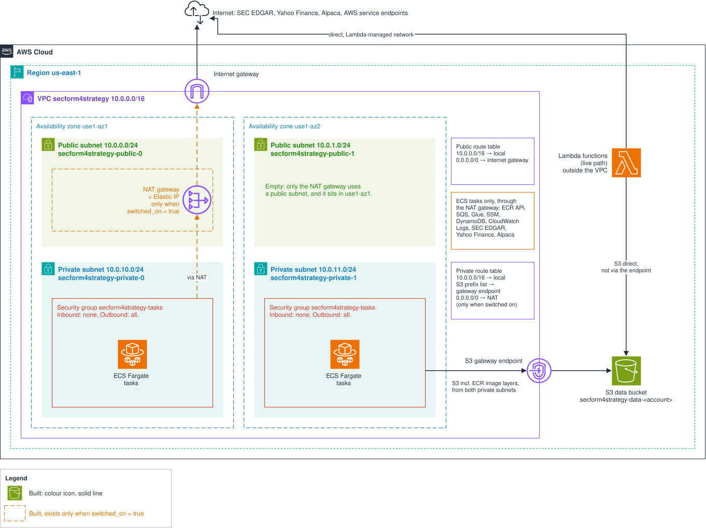
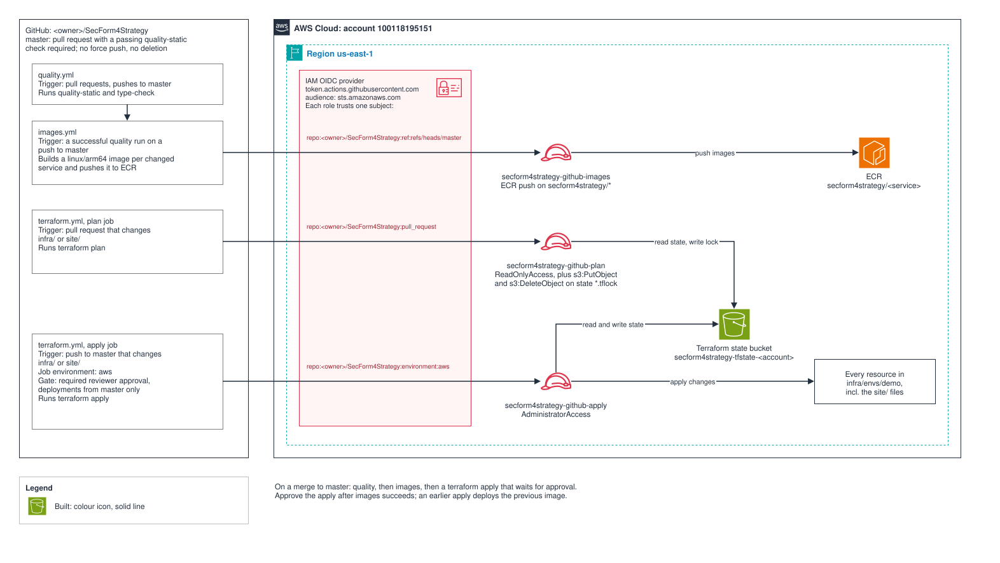

# AWS

The AWS deployment runs the same services as the local stack, on serverless AWS resources in account `100118195151`, region `us-east-1`. Terraform under `infra/` defines it. Part of it is built and applied; the rest is planned. Every section marks which is which.

## Overview


Colour icons and solid lines are built. Grey icons and dashed grey lines are planned. Orange dashed outlines are built, but exist only while the stack is switched on.

### Built

Terraform state lives in the bucket `secform4strategy-tfstate-<account>`, which `infra/bootstrap` creates. The backend locks the state with S3 native locking (`use_lockfile = true`). The root module `infra/envs/demo` calls five modules:

| Module | Resources |
| --- | --- |
| `storage` | Data bucket `secform4strategy-data-<account>`, Glue database `secform4strategy`, Athena workgroup `secform4strategy`, one ECR repository per service, the monthly budget |
| `network` | VPC, two public and two private subnets, internet gateway, S3 gateway endpoint, security group `secform4strategy-tasks`, and the NAT gateway while switched on |
| `queues` | SQS queues `secform4strategy-filings` and `secform4strategy-transactions`, each with a dead-letter queue |
| `iam` | The ECS execution role and one task role per service |
| `ci` | The GitHub OIDC provider and the roles `secform4strategy-github-images`, `-plan` and `-apply` |

The data bucket holds three prefixes:

- `warehouse/` holds the Iceberg tables. It is the location of the Glue database.
- `models/` holds the trained models.
- `athena-results/` holds Athena query results. Objects under it expire after 7 days.

The bucket blocks all public access and encrypts objects with SSE-S3. Incomplete multipart uploads expire after 1 day.

The Athena workgroup writes results to `athena-results/` and cancels any query that scans more than 1 GiB.

Each service has an ECR repository `secform4strategy/<service>`: `master-index`, `scraper`, `kafka-to-store`, `yahoo-connect`, `target`, `training` and `inference`. Tags are immutable, ECR scans each image on push, and each repository keeps its 2 newest images.

The budget `secform4strategy-monthly` is $5 per month. It sends an email when actual cost passes 50% of the budget, and when forecast cost passes 100%. The recipient is `alert_email` in the git-ignored `infra/envs/demo/terraform.tfvars`.

### Built in the Python code

The services choose their adapters from environment variables, as [configuration.md](configuration.md#backends-local-or-aws) describes:

| Setting | Local | AWS |
| --- | --- | --- |
| `QUEUE__BACKEND` | `kafka` | `sqs`, served by `SqsQueue` |
| `MODEL_STORE__BACKEND` | `local` | `s3`, served by `S3ModelStore` |
| `PYICEBERG_CATALOG__DEFAULT__TYPE` | `sql` (SQLite) | `glue` |

`SqsQueue` sends and receives JSON bodies on SQS standard queues, 10 messages per call. `ack` deletes the finished messages.

`S3ModelStore` saves each model in a folder named after its training time, as `model.joblib` plus `model.meta.json`. It then writes `latest.json`, which names that folder. `load` reads `latest.json` first, so a load never pairs a new model with old metadata. Earlier models stay in the bucket.

### Planned

- GitHub Actions workflows that build images and run Terraform.
- An ECS cluster that runs each service as a Fargate ARM64 task in the private subnets, with CloudWatch log groups.
- Step Functions state machines for the backfill and the daily runs.
- The live path: EventBridge Scheduler, three Lambda functions, SQS and DynamoDB.
- A CloudWatch alarm on the depth of each dead-letter queue.
- Schedules that `switched_on` enables.

## Batch path and live path

The system has two paths. Both use serverless compute, so nothing runs and nothing is billed between runs.

| | Batch path (planned) | Live path (planned) |
| --- | --- | --- |
| Work | Long, heavy jobs: the backfill of years of filings, price refresh, labels, training | One filing at a time, as SEC publishes it |
| Compute | ECS tasks on Fargate ARM64 | Lambda functions |
| Trigger | Step Functions, started by EventBridge Scheduler | EventBridge Scheduler, then SQS |
| Why | Fargate has no run-time limit; Lambda stops a run after 15 minutes | Lambda runs as soon as an event arrives and bills per invocation; speed from disclosure is the edge |

### Batch path

Step Functions runs two state machines:

- **backfill:** master-index publishes filings to `secform4strategy-filings`. The scraper reads them and publishes transactions to `secform4strategy-transactions`. kafka-to-store reads the transactions and upserts them into the Iceberg tables.
- **daily:** yahoo-connect refreshes prices, target builds the labelled rows, and training saves a new model to `models/` in S3.

The scraper runs with `EXIT_WHEN_EMPTY=true` in the backfill. It stops at the first receive that waits its full poll timeout without a message. If it left a filing unacknowledged for retry, it exits non-zero, and Step Functions reruns it after the visibility timeout.

The ECS task definitions read the secrets (the Alpaca keys and `SEC_USER_AGENT`) from SSM Parameter Store and pass them to the container as environment variables.

### Live path

1. EventBridge Scheduler starts the poller Lambda. The schedule is disabled unless the stack is switched on.
2. The poller Lambda reads SEC's current-filings feed. It records each filing in a DynamoDB table and skips filings already recorded. It sends new filings to SQS.
3. The scraper Lambda reads each filing from SQS and sends its transactions to a second SQS queue.
4. The scorer Lambda loads the model from `models/` in S3, scores the transactions and places Alpaca paper orders. Each order carries a `client_order_id`, so Alpaca rejects a duplicate.

## Network



All of the network is built:

| Resource | Value |
| --- | --- |
| VPC `secform4strategy` | `10.0.0.0/16`, DNS support and DNS hostnames on |
| Public subnets `secform4strategy-public-0`, `-1` | `10.0.0.0/24`, `10.0.1.0/24`, one per availability zone |
| Private subnets `secform4strategy-private-0`, `-1` | `10.0.10.0/24`, `10.0.11.0/24`, one per availability zone |
| Public route table | `0.0.0.0/0` to the internet gateway |
| Private route table | S3 to the gateway endpoint; `0.0.0.0/0` to the NAT gateway only while switched on |
| Security group `secform4strategy-tasks` | No inbound rules; all outbound traffic allowed |
| NAT gateway and Elastic IP | In `secform4strategy-public-0`, only while `switched_on = true` |

The tasks run in the private subnets. They have no public IP address, and the security group accepts no inbound connections. Nothing on the internet can open a connection to a task.

The public subnets hold only the NAT gateway. The NAT gateway gives the private subnets outbound internet access, which the tasks need for SEC EDGAR, Yahoo Finance and Alpaca. It also carries their calls to the AWS APIs other than S3: ECR, SQS, Glue, SSM and CloudWatch Logs.

The S3 gateway endpoint sits on the private route table. It carries all traffic from the private subnets to S3: the Iceberg data and the models. A gateway endpoint costs nothing, and S3 traffic through it does not pass the NAT gateway, so it adds no NAT data charges.

The NAT gateway exists only while the stack is switched on, because it bills about $1.08 per day whether or not traffic flows. While the stack is dormant, the private subnets reach only S3. No task can run then: it cannot pull its image from ECR or read its secrets.

## Identity

The `iam` module creates two kinds of role for ECS. Both trust only `ecs-tasks.amazonaws.com`.

| Role | Used by | Permissions |
| --- | --- | --- |
| `secform4strategy-execution` | The ECS agent, before the container starts | `AmazonECSTaskExecutionRolePolicy` (pull images from ECR, write CloudWatch logs), plus `ssm:GetParameters` on `/secform4strategy/*` |
| `secform4strategy-<service>` | The service's code, while it runs | Only the queues and data that service uses, from `task_access` |

The execution role reads the secrets from SSM and injects them as environment variables. The service code never holds permission to read SSM.

### Access per service

`task_access` in `infra/envs/demo/main.tf` lists, per service, the queues it sends to and receives from, and its capabilities. The `iam` module turns each entry into one inline policy `access` on the role `secform4strategy-<service>`.

| Service | Sends to | Receives from | Capabilities |
| --- | --- | --- | --- |
| master-index | `filings` | | |
| scraper | `transactions` | `filings` | |
| kafka-to-store | | `transactions` | `lakehouse-write` |
| yahoo-connect | | | `lakehouse-write` |
| target | | | `lakehouse-write` |
| training | | | `lakehouse-read`, `models-write` |
| inference | | | `lakehouse-read`, `models-read` |

Each entry grants these actions:

| Entry | Actions | Resources |
| --- | --- | --- |
| Sends to a queue | `sqs:GetQueueUrl`, `sqs:SendMessage` | That queue |
| Receives from a queue | `sqs:GetQueueUrl`, `sqs:ReceiveMessage`, `sqs:DeleteMessage` | That queue |
| `lakehouse-read` | `glue:GetDatabase`, `glue:CreateDatabase`, `glue:GetTable`, `glue:GetTables` | The Glue catalog, the database `secform4strategy` and its tables |
| | `s3:GetObject` | `warehouse/*` |
| | `s3:ListBucket` | The data bucket |
| `lakehouse-write` | The `lakehouse-read` Glue actions, plus `glue:CreateTable`, `glue:UpdateTable` | The Glue catalog, the database and its tables |
| | `s3:GetObject`, `s3:PutObject` | `warehouse/*` |
| | `s3:ListBucket` | The data bucket |
| `models-read` | `s3:GetObject` | `models/*` |
| | `s3:ListBucket` | The data bucket |
| `models-write` | `s3:PutObject` | `models/*` |

`glue:CreateDatabase` is part of both lakehouse capabilities because the feature store creates its namespace when it is missing.

### Credentials in containers

No container holds a static AWS key. ECS gives each task temporary credentials for its task role through the container credentials endpoint. boto3 finds them in its default credential chain, so the adapters create their clients with a region and no keys. AWS rotates the credentials before they expire.

## Messaging

Both queues are built. Each is an SQS standard queue with its own dead-letter queue:

| Setting | Value |
| --- | --- |
| Queues | `secform4strategy-filings`, `secform4strategy-transactions` |
| Dead-letter queues | `secform4strategy-filings-dlq`, `secform4strategy-transactions-dlq` |
| Visibility timeout | 300 seconds |
| `maxReceiveCount` | 5 |
| Retention | 4 days on the queues, 14 days on the dead-letter queues |
| Encryption | SSE with SQS-managed keys |

A received message stays hidden for the visibility timeout. If the consumer does not delete it in that time, SQS delivers it again. After 5 receives without a delete, SQS moves the message to the dead-letter queue.

The queues are the platform layer of the error contract in [error-handling.md](error-handling.md):

| Outcome of a message | Consumer action | SQS result |
| --- | --- | --- |
| Done | `ack` deletes it | Gone |
| `RetryableError` | No ack | Delivered again after 300 seconds |
| `PermanentError` | Logs it, then `ack` deletes it | Gone |
| Crash (a defect) | No ack | Delivered again; after 5 receives, moved to the dead-letter queue |
| Body is not JSON | `SqsQueue` logs it and deletes it | Gone |

A CloudWatch alarm on the depth of each dead-letter queue is planned.

## CI/CD



CI and Terraform own different things:

| Owner | Manages |
| --- | --- |
| Terraform | Every AWS resource, including the ECR repositories and the CI roles |
| CI (planned) | The images in ECR, and the runs of `terraform plan` and `terraform apply` |

The OIDC provider and the three roles are built and applied. The workflows that use them are planned. Today, `.github/workflows/quality.yml` runs only the quality gate.

### OIDC trust

GitHub Actions authenticates to AWS with OIDC. A workflow requests a token from `token.actions.githubusercontent.com`, and AWS STS exchanges it for temporary credentials of one role. GitHub holds no AWS key.

Each role trusts the provider only for the audience `sts.amazonaws.com` and one exact `sub` claim. `github_repository` in `infra/envs/demo/main.tf` sets the repository.

| Role | Trusted subject | Permissions |
| --- | --- | --- |
| `secform4strategy-github-images` | `repo:<owner>/SecForm4Strategy:ref:refs/heads/master` | `ecr:GetAuthorizationToken`, and image push and pull on `secform4strategy/*` |
| `secform4strategy-github-plan` | `repo:<owner>/SecForm4Strategy:pull_request` | `ReadOnlyAccess`, plus `s3:PutObject` and `s3:DeleteObject` on `*.tflock` in the state bucket |
| `secform4strategy-github-apply` | `repo:<owner>/SecForm4Strategy:environment:aws` | `AdministratorAccess` |

The plan role can read every resource and the state, and can write only the lock file. A pull request therefore cannot change any resource.

### Planned workflows

- **Images:** on each push to master, build a `linux/arm64` image for each changed service, tag it with the git SHA, and push it to ECR.
- **Terraform:** on each pull request, run `terraform plan`. On master, run `terraform apply` after approval.
- **Switch:** a manual workflow that switches the stack on or off.

### Approval gate

Only a job that runs in the GitHub environment `aws` can assume `secform4strategy-github-apply`. The environment is planned: it will require a reviewer's approval and allow deployments only from master. GitHub then holds every apply job until a reviewer approves it.

## Cost

| State | Cost | What is billed |
| --- | --- | --- |
| Dormant (`switched_on = false`) | About $0 per day | S3 storage and ECR storage. The VPC, subnets, internet gateway, S3 gateway endpoint, security group, IAM, Glue database and idle SQS queues cost nothing. |
| Switched on (`switched_on = true`) | About $1.20 per day, plus usage | The NAT gateway (about $1.08 per day) and its Elastic IP (about $0.12 per day). Usage: Fargate, Lambda, Step Functions, SQS requests, NAT data processing, Athena scans. |

The $5 monthly budget alerts at 50% of actual cost and at 100% of forecast cost.

## Operating

### Run Terraform

Prerequisites:

- Terraform 1.10 or later.
- An AWS CLI profile `secform4` for account `100118195151`.
- `infra/envs/demo/terraform.tfvars` with `alert_email` set. `terraform.tfvars.example` shows the format.

Steps:

1. `cd infra/envs/demo`
2. `AWS_PROFILE=secform4 terraform init`
3. `AWS_PROFILE=secform4 terraform plan -out tfplan`
4. Read the plan.
5. `AWS_PROFILE=secform4 terraform apply tfplan`

The provider block also names the profile `secform4`, and `allowed_account_ids` rejects any other account.

### Switch on and off

`switched_on` in `infra/envs/demo/variables.tf` defaults to `false`.

1. To switch on, run `AWS_PROFILE=secform4 terraform apply -var switched_on=true`. Terraform creates the Elastic IP, the NAT gateway and the private default route.
2. To switch off, run `AWS_PROFILE=secform4 terraform apply`. Terraform deletes the three resources, and billing for them stops.

The NAT gateway takes a few minutes to create and to delete. In the planned design, the same variable also enables the schedules.

### Secrets

The secrets go into SSM Parameter Store as `SecureString` parameters under `/secform4strategy/`. None exist yet. Create them with the AWS CLI, never in Terraform, so their values never enter the Terraform state:

```bash
aws ssm put-parameter --profile secform4 --type SecureString --name /secform4strategy/<name> --value '<value>'
```

The execution role can read only parameters under `/secform4strategy/`. The planned task definitions pass the Alpaca keys and `SEC_USER_AGENT` to the containers from there.

## Design decisions

| Decision | Rejected alternative | Reason |
| --- | --- | --- |
| scikit-learn model in S3, scored in a Lambda or a task | SageMaker | The model is a small scikit-learn pipeline, and scoring runs in batches. A SageMaker endpoint bills every hour it is up. |
| NAT gateway only while switched on | An always-on NAT gateway | An always-on NAT gateway costs about $32 per month, more than six times the budget. |
| S3 gateway endpoint plus NAT gateway | Interface endpoints for ECR (API and Docker), CloudWatch Logs, SQS and SSM | Five interface endpoints in two availability zones cost about $73 per month. The tasks need the internet for SEC, Yahoo Finance and Alpaca anyway, so the NAT gateway is required. |
| OIDC roles for CI | An IAM user with access keys stored in GitHub | A stored key lives until someone rotates it, and anyone who reads it can use it. OIDC credentials are temporary and bound to one repository and one trigger. |
