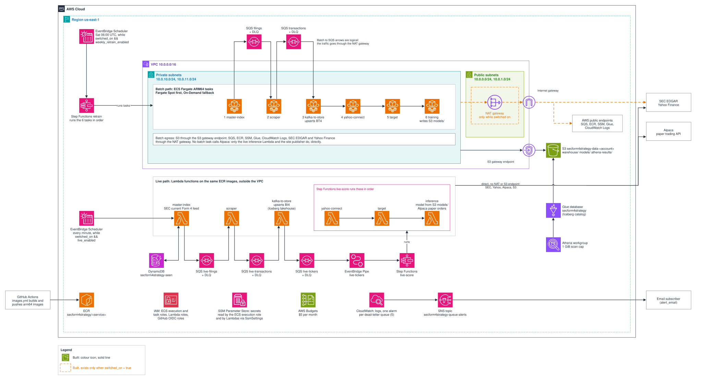

# AWS

The AWS deployment runs the same services as the local stack, on serverless AWS resources in account `100118195151`, region `us-east-1`. Terraform under `infra/` defines all of it, and GitHub Actions builds the images and applies the Terraform.

## Overview



The batch path runs ECS tasks in the private subnets. The live path runs Lambda functions outside the VPC. Orange dashed outlines and lines exist only while the stack is switched on.

Terraform state is in the bucket `secform4strategy-tfstate-<account>`, which `infra/bootstrap` creates. The backend locks the state with S3 native locking (`use_lockfile = true`). The root module `infra/envs/demo` calls ten modules:

| Module | Resources |
| --- | --- |
| `storage` | Data bucket `secform4strategy-data-<account>`, Glue database `secform4strategy`, Athena workgroup `secform4strategy`, one ECR repository per service, the monthly budget |
| `network` | VPC, two public and two private subnets, internet gateway, S3 gateway endpoint, security group `secform4strategy-tasks`, and the NAT gateway while switched on |
| `queues` | Five SQS queues, each with a dead-letter queue and a CloudWatch alarm, and the SNS topic `secform4strategy-queue-alerts` |
| `iam` | The ECS execution role, one task role per service, and one Lambda role per Lambda function |
| `ci` | The GitHub OIDC provider and the roles `secform4strategy-github-images`, `-plan` and `-apply` |
| `tasks` | The ECS cluster `secform4strategy`, one task definition per service, one log group per service |
| `retrain` | The `retrain` state machine and its weekly schedule |
| `live` | Six Lambda functions, the DynamoDB table `secform4strategy-seen`, the poller schedule, the `live-score` state machine and the EventBridge Pipe that starts it |
| `dashboard` | The CloudWatch dashboard `secform4strategy` |
| `site` | The site bucket, CloudFront distribution and password function, and the publisher Lambda with its triggers ([site.md](site.md)) |

The data bucket holds three prefixes:

- `warehouse/` holds the Iceberg tables. It is the location of the Glue database.
- `models/` holds the trained models.
- `athena-results/` holds Athena query results. Objects under it expire after 7 days.

The bucket blocks all public access and encrypts objects with SSE-S3. Incomplete multipart uploads expire after 1 day.

The Athena workgroup writes results to `athena-results/` and cancels any query that scans more than 1 GiB.

Each service has an ECR repository `secform4strategy/<service>`: `master-index`, `scraper`, `kafka-to-store`, `yahoo-connect`, `target`, `training`, `inference` and `site-publisher`. Tags are immutable, ECR scans each image on push, and each repository keeps its 5 newest images.

The budget `secform4strategy-monthly` is $5 per month. It sends an email when actual cost passes 50% of the budget, and when forecast cost passes 100%. The recipient is `alert_email` in the git-ignored `infra/envs/demo/terraform.tfvars`.

### Adapters in the Python code

The services choose their adapters from environment variables, as [configuration.md](configuration.md#backends-local-or-aws) describes:

| Setting | Local | AWS |
| --- | --- | --- |
| `QUEUE__BACKEND` | `kafka` | `sqs`, served by `SqsQueue` |
| `MODEL_STORE__BACKEND` | `local` | `s3`, served by `S3ModelStore` |
| `PYICEBERG_CATALOG__DEFAULT__TYPE` | `sql` (SQLite) | `glue` |

`SqsQueue` sends and receives JSON bodies on SQS standard queues, 10 messages per call. `ack` deletes the finished messages.

`S3ModelStore` saves each model in a folder named after its training time, as `model.joblib` plus `model.meta.json`. It then writes `latest.json`, which names that folder. `load` reads `latest.json` first, so a load never pairs a new model with old metadata. Earlier models stay in the bucket.

The live path adds three modules to `secform4strategy_clients`:

- `lambda_sqs` turns an SQS event into `Message` tuples. `batch_failures` returns the messages a handler did not finish, as the `batchItemFailures` response.
- `DynamoSeenKeys` records keys in a DynamoDB table and returns the ones it does not hold. Each item expires after `SEEN_DAYS` days.
- `SsmSettings` is a settings base class. If `SSM_PARAMETERS` is set, it reads the SSM parameters that variable names, in one call, when the settings are built.

## Batch path and live path

The system has two paths. Both use serverless compute, so nothing runs and nothing is billed between runs.

| | Batch path | Live path |
| --- | --- | --- |
| Work | Long, heavy jobs: the first full load of years of filings, then a weekly retrain on the new filings | One filing at a time, as SEC publishes it |
| Compute | ECS tasks on Fargate ARM64 | Lambda functions, on the same images |
| Trigger | Step Functions, started by EventBridge Scheduler | EventBridge Scheduler, then SQS, then an EventBridge Pipe |
| Why | Fargate has no run-time limit; Lambda stops a run after 15 minutes | Lambda runs as soon as an event arrives and bills per invocation; speed from disclosure is the edge |

### Batch path

One Step Functions state machine, `retrain`, runs six ECS tasks in order:

1. master-index publishes filings to `secform4strategy-filings`.
2. The scraper reads them and publishes transactions to `secform4strategy-transactions`.
3. kafka-to-store reads the transactions and upserts them into `BT4`.
4. yahoo-connect refreshes the prices of the tickers in the tables.
5. target builds the labelled rows.
6. training saves a new model to `models/` in S3.

Each step runs one Fargate ARM64 task in the cluster `secform4strategy`, in the private subnets, and waits for it to stop. The tasks use the `FARGATE` launch type (On-Demand). Fargate Spot runs ARM64 tasks too, but a Spot interruption fails the step, and the retry policy allows only 3 attempts, which a multi-day backfill could use up. A step whose task fails is retried after 600 seconds, at most 3 times. Each task writes its logs to the log group `/secform4strategy/<service>`, kept 14 days.

EventBridge Scheduler starts `retrain` every Saturday at 06:00 UTC. master-index then runs with `MODE=recent` and `DAYS_BACK=7`: it reads the master indexes of the quarters that the last 7 days touch, and publishes only the filings of those 7 days. The schedule is enabled only while both `switched_on` and `weekly_retrain_enabled` are `true`.

Each run's model replaces the previous one: training writes `latest.json` to point at the new model, without a comparison to the previous model.

The batch scraper's task definition caps SEC requests at `SEC_MAX_RATE=5` per second. The live path uses at most 4.5 per second. Both send the same `User-Agent`, so together they stay under SEC's limit of 10 requests per second per client.

#### Run input

The input of a `retrain` run can override environment variables per step:

```json
{"overrides": {"<service>": {"<VARIABLE>": "<value>"}}}
```

The first full load is the same state machine, started once by hand with `MODE=historical`. It loads the last `YEARS` years of filings. It raises the scraper's cap to 8 per second, and kafka-to-store's commit size to 10,000 rows:

```json
{"overrides": {"master-index": {"MODE": "historical", "YEARS": "5"}, "scraper": {"SEC_MAX_RATE": "8"}, "kafka-to-store": {"BUFFER_SIZE": "10000"}}}
```

#### Throughput

| Step | Measured rate | Setting that sets it |
| --- | --- | --- |
| scraper | 6 to 7.8 filings per second | `SEC_MAX_RATE`, `FETCH_WORKERS=12`, `BUFFER_SIZE=200`, `RETRY_PAUSE=5` |
| kafka-to-store | About 185 transactions per second | `BUFFER_SIZE=10000` (one Iceberg commit per batch; a commit takes about 7 seconds) |

The scraper downloads up to `FETCH_WORKERS` filings at once. SEC answers each request in about 0.5 seconds, so several requests in flight keep the rate near the cap. `EdgarClient` spaces request starts at least `1 / SEC_MAX_RATE` seconds apart across all threads.

The scraper runs with `EXIT_WHEN_EMPTY=true`. It stops at the first receive that waits its full poll timeout without a message. If it left a filing unacknowledged for retry, it exits non-zero, and Step Functions reruns it after 600 seconds.

The ECS task definitions read the secrets (the Alpaca keys and `SEC_USER_AGENT`) from SSM Parameter Store and pass them to the container as environment variables.

#### Revisions of a running run

A `retrain` run names exact task-definition revisions, for example `secform4strategy-kafka-to-store:3`, and keeps them until it ends. A new image or a changed environment makes Terraform register a new revision. The task definitions set `skip_destroy = true`, so Terraform leaves the old revision active, and a running run can still start tasks from it. ECS cannot start a task from an `INACTIVE` revision.

The images have a second limit. Each ECR repository keeps only its 5 newest images. If a service gets five newer images while a run still has to start it, ECR deletes the image the run's revision names, and that step fails. During a multi-day run, push at most four new images of a service whose step has not started.

### Live path

The live path runs the batch services as Lambda functions, on the same images, scoped to the tickers of each new filing:

1. EventBridge Scheduler invokes `secform4strategy-live-master-index` every minute.
2. master-index reads the first page of SEC's current Form 4 feed. It sends the filings that `secform4strategy-seen` does not hold to `secform4strategy-live-filings`, then records them.
3. The scraper Lambda parses each filing and sends its transactions to `secform4strategy-live-transactions`.
4. kafka-to-store upserts the transactions into `BI4` and sends `{"tickers": [...]}` to `secform4strategy-live-tickers`.
5. The EventBridge Pipe `secform4strategy-live-tickers` starts one run of the state machine `secform4strategy-live-score` per batch of up to 10 messages.
6. `live-score` runs three Lambdas in order, each passing `{"tickers": [...]}` to the next: yahoo-connect refreshes the prices, target builds the `BIR4` rows, and inference scores them and places Alpaca paper orders.

The schedule is enabled only while both `switched_on` and `live_enabled` are `true`.

| Function | Trigger | Settings |
| --- | --- | --- |
| master-index | Schedule, every minute | 512 MB, 60 s; `SEC_MAX_RATE=1`; `SEEN_DAYS=7` |
| scraper | `live-filings`, batches of 10 | 1024 MB, 120 s; at most 2 at a time, each at `SEC_MAX_RATE=2.25` with `FETCH_WORKERS=4` |
| kafka-to-store | `live-transactions`, batches of up to 100, waiting at most 5 s | 2048 MB, 240 s; at most 2 at a time |
| yahoo-connect | `live-score` | 2048 MB, 180 s |
| target | `live-score` | 2048 MB, 180 s |
| inference | `live-score` | 2048 MB, 180 s; `QTY=1`, `PREDICTION_THRESHOLD=-0.05` |

Each function runs `<service directory>/.venv/bin/python -m awslambdaric` with the handler `handler.handle`, or `src.handler.handle` for yahoo-connect and target. `awslambdaric` is the Lambda runtime interface client: it receives events from the Lambda service and calls the handler. Each handler sits beside the service's `main.py` and calls the same functions as the batch loop. The functions run outside the VPC, with `HOME=/tmp`, because the image's file system is read-only. Each function writes its logs to `/aws/lambda/secform4strategy-live-<service>`, kept 14 days.

The SQS triggers report partial batch failures. A handler returns the messages it did not finish in `batchItemFailures`, and SQS delivers only those again, after the 300-second visibility timeout.

Each `live-score` step is retried twice on `States.TaskFailed`, after 5 and 10 seconds. inference raises `RetryableError` when an order is left unplaced, so the step runs again. Each order carries the row key as `client_order_id`, so Alpaca rejects a duplicate. inference loads the latest model at each invocation, so a new weekly model takes effect immediately. It trades only fresh rows: rows whose latest filing was accepted within `MAX_SIGNAL_AGE_MINUTES` (default 60). The event carries tickers, so this keeps a ticker's older rows from trading late, for example after a retrain. In the session an order fills at once; outside it, Alpaca queues it for the open.

The live Lambdas read their secrets from SSM themselves, because Lambda cannot put SSM parameters into environment variables. `SSM_PARAMETERS` names the parameters, for example `{"sec_user_agent": "/secform4strategy/sec-user-agent"}`, and `SsmSettings` reads them at cold start. The values never enter the Terraform state.

#### Cold starts

The first invocation of a function after about 5 to 15 minutes without one is a cold start: Lambda loads the image and runs the handler module's imports. The images are about 1 GB, and a first cold start exceeds Lambda's 10-second initialization limit. Lambda then runs the initialization again inside the invocation, and the invocation succeeds. Measured on the first invocations:

| Function | Cold invocation |
| --- | --- |
| scraper | 10 seconds |
| kafka-to-store | 45 seconds |
| yahoo-connect | 39 seconds |

Warm invocations take a few seconds. A filing that arrives after a quiet period therefore reaches inference about 1 to 2 minutes after the poll. Provisioned concurrency keeps an instance warm, at about $10 per month per function. It is off: the cold start is an accepted cost trade-off. Smaller images would shorten it.

## Network


| Resource | Value |
| --- | --- |
| VPC `secform4strategy` | `10.0.0.0/16`, DNS support and DNS hostnames on |
| Public subnets `secform4strategy-public-0`, `-1` | `10.0.0.0/24`, `10.0.1.0/24`, one per availability zone |
| Private subnets `secform4strategy-private-0`, `-1` | `10.0.10.0/24`, `10.0.11.0/24`, one per availability zone |
| Public route table | `0.0.0.0/0` to the internet gateway |
| Private route table | S3 to the gateway endpoint; `0.0.0.0/0` to the NAT gateway only while switched on |
| Security group `secform4strategy-tasks` | No inbound rules; all outbound traffic allowed |
| NAT gateway and Elastic IP | In `secform4strategy-public-0`, only while `switched_on = true` |

The private subnets are in the availability zones `use1-az1` and `use1-az2`. Fargate ARM64 is not available in `use1-az3`.

### Why the project has a VPC

The ECS tasks require it. Fargate runs a task only in `awsvpc` mode: each task gets a network interface in a subnet that the caller names, with a security group. The other services need no VPC:

| Component | In the VPC | Reason |
| --- | --- | --- |
| ECS Fargate tasks | Yes | Fargate requires a subnet and a security group for every task |
| Live Lambda functions | No | They read only regional AWS services and internet APIs. Outside the VPC they do not depend on the NAT gateway, so the live path works while the stack is dormant. Their outbound address is not fixed. |
| Site publisher Lambda | No | It reads only regional AWS services and internet APIs; outside the VPC it does not depend on the NAT gateway ([site.md](site.md#data-path)) |
| Step Functions, SQS, DynamoDB, S3, EventBridge, CloudFront | Not applicable | Regional or global services: clients reach them through endpoints, and IAM controls each request |

The ECS tasks run in the private subnets. They have no public IP address, and the security group accepts no inbound connections. Nothing on the internet can open a connection to them.

The live Lambda functions run outside the VPC, in the Lambda service's own network. They reach SEC EDGAR, Yahoo Finance, Alpaca and the AWS APIs directly, without the NAT gateway, and accept no inbound connections.

The public subnets hold only the NAT gateway. The NAT gateway gives the private subnets outbound internet access, which the services need for SEC EDGAR, Yahoo Finance and Alpaca. It also carries their calls to the AWS APIs other than S3: ECR, SQS, Glue, SSM, DynamoDB and CloudWatch Logs.

The S3 gateway endpoint sits on the private route table. It carries all traffic from the private subnets to S3: the Iceberg data, the models and the image layers that ECR stores in S3. A gateway endpoint costs nothing, and S3 traffic through it does not pass the NAT gateway, so it adds no NAT data charges.

The NAT gateway exists only while the stack is switched on, because it bills about $1.08 per day whether or not traffic flows. While the stack is dormant, the private subnets reach only S3. No task can run then: it cannot pull its image from ECR or read its secrets.

## Identity

The `iam` module creates three kinds of role:

| Role | Trusts | Used by | Permissions |
| --- | --- | --- | --- |
| `secform4strategy-execution` | `ecs-tasks.amazonaws.com` | The ECS agent, before the container starts | `AmazonECSTaskExecutionRolePolicy` (pull images from ECR, write CloudWatch logs), plus `ssm:GetParameters` on `/secform4strategy/*` |
| `secform4strategy-<service>` | `ecs-tasks.amazonaws.com` | The service's code in an ECS task | Only the queues and data that service uses, from `task_access` |
| `secform4strategy-live-<service>` | `lambda.amazonaws.com` | The service's code in a Lambda function | `AWSLambdaBasicExecutionRole` (CloudWatch Logs), plus the entries in `lambda_access` |

In ECS, the execution role reads the secrets from SSM and injects them as environment variables, so the task roles hold no SSM permission. In Lambda, the function's own role reads them, so the Lambda roles that use secrets hold an SSM capability. master-index and scraper hold `read-secrets`. inference and site-publisher hold `read-alpaca-keys`, which covers only the two Alpaca keys.

### Access per service

`task_access` and `lambda_access` in `infra/envs/demo/main.tf` list, per service, the queues it sends to and receives from, and its capabilities. The `iam` module turns each entry into one inline policy `access` on the role.

| ECS task | Sends to | Receives from | Capabilities |
| --- | --- | --- | --- |
| master-index | `filings` | | |
| scraper | `transactions` | `filings` | |
| kafka-to-store | | `transactions` | `lakehouse-write` |
| yahoo-connect | | | `lakehouse-write` |
| target | | | `lakehouse-write` |
| training | | | `lakehouse-read`, `models-write` |
| inference | | | `lakehouse-read`, `models-read` |

| Lambda function | Sends to | Receives from | Capabilities |
| --- | --- | --- | --- |
| master-index | `live-filings` | | `seen-keys`, `read-secrets` |
| scraper | `live-transactions` | `live-filings` | `read-secrets` |
| kafka-to-store | `live-tickers` | `live-transactions` | `lakehouse-write` |
| yahoo-connect | | | `lakehouse-write` |
| target | | | `lakehouse-write` |
| inference | | | `lakehouse-read`, `models-read`, `read-alpaca-keys` |
| site-publisher | | | `lakehouse-read`, `models-read`, `read-alpaca-keys` |

The `site` module adds the inline policy `site` to the site-publisher role, as [site.md](site.md#publisher) describes.

Each entry grants these actions:

| Entry | Actions | Resources |
| --- | --- | --- |
| Sends to a queue | `sqs:GetQueueUrl`, `sqs:SendMessage` | That queue |
| Receives from a queue | `sqs:GetQueueUrl`, `sqs:GetQueueAttributes`, `sqs:ReceiveMessage`, `sqs:DeleteMessage` | That queue |
| `lakehouse-read` | `glue:GetDatabase`, `glue:CreateDatabase`, `glue:GetTable`, `glue:GetTables` | The Glue catalog, the database `secform4strategy` and its tables |
| | `s3:GetObject` | `warehouse/*` |
| | `s3:ListBucket` | The data bucket |
| `lakehouse-write` | The `lakehouse-read` Glue actions, plus `glue:CreateTable`, `glue:UpdateTable` | The Glue catalog, the database and its tables |
| | `s3:GetObject`, `s3:PutObject` | `warehouse/*` |
| | `s3:ListBucket` | The data bucket |
| `models-read` | `s3:GetObject` | `models/*` |
| | `s3:ListBucket` | The data bucket |
| `models-write` | `s3:PutObject` | `models/*` |
| `seen-keys` | `dynamodb:BatchGetItem`, `dynamodb:BatchWriteItem` | The table `secform4strategy-seen` |
| `read-secrets` | `ssm:GetParameters` | `/secform4strategy/*` |
| `read-alpaca-keys` | `ssm:GetParameters` | `/secform4strategy/alpaca-api-key` and `/secform4strategy/alpaca-api-secret` |

`glue:CreateDatabase` is part of both lakehouse capabilities because the feature store creates its namespace when it is missing. The SQS trigger of a Lambda function needs `sqs:GetQueueAttributes`.

The `live` and `retrain` modules create their own roles for the services that start work:

| Role | Trusts | Permissions |
| --- | --- | --- |
| `secform4strategy-retrain` | Step Functions | Run, describe and stop the ECS tasks; pass the execution and task roles |
| `secform4strategy-retrain-scheduler` | EventBridge Scheduler | `states:StartExecution` on `retrain` |
| `secform4strategy-live-scheduler` | EventBridge Scheduler | `lambda:InvokeFunction` on the master-index function |
| `secform4strategy-live-score` | Step Functions | `lambda:InvokeFunction` on yahoo-connect, target and inference |
| `secform4strategy-live-tickers-pipe` | EventBridge Pipes | Receive and delete on `live-tickers`; `states:StartExecution` on `live-score` |
| `secform4strategy-site-scheduler` | EventBridge Scheduler | `lambda:InvokeFunction` on the site publisher |

### Credentials in containers

No container holds a static AWS key. ECS and Lambda give the code temporary credentials for its role. boto3 finds them in its default credential chain, so the adapters create their clients with a region and no keys. AWS rotates the credentials before they expire.

## Messaging

Five queues are built. Each is an SQS standard queue with its own dead-letter queue:

| Setting | Value |
| --- | --- |
| Queues | `secform4strategy-filings`, `-transactions`, `-live-filings`, `-live-transactions`, `-live-tickers` |
| Dead-letter queues | The queue name plus `-dlq` |
| Visibility timeout | 300 seconds |
| `maxReceiveCount` | 5 |
| Retention | 4 days on the queues, 14 days on the dead-letter queues |
| Encryption | SSE with SQS-managed keys |

A received message stays hidden for the visibility timeout. If the consumer does not delete it in that time, SQS delivers it again. After 5 receives without a delete, SQS moves the message to the dead-letter queue.

The queues are the platform layer of the error contract in [error-handling.md](error-handling.md):

| Outcome of a message | ECS consumer | Lambda handler | SQS result |
| --- | --- | --- | --- |
| Done | `ack` deletes it | Not in `batchItemFailures` | Deleted |
| `RetryableError` | No ack | In `batchItemFailures` | Delivered again after 300 seconds |
| `PermanentError` | Logs it, then `ack` deletes it | Logs it, not in `batchItemFailures` | Deleted |
| Crash (a defect) | No ack | The invocation fails, so the whole batch | Delivered again; after 5 receives, moved to the dead-letter queue |
| Body is not JSON | `SqsQueue` logs it and deletes it | `sqs_messages` logs it and leaves it out | Deleted |

Each dead-letter queue has a CloudWatch alarm `secform4strategy-<queue>-dead-letters`. It goes into alarm when the dead-letter queue holds at least one message, checked every 5 minutes, and back to OK when it is empty. Both changes publish to the SNS topic `secform4strategy-queue-alerts`, which emails `alert_email`. The recipient confirms the subscription once, from the email AWS sends.

## CI/CD


CI and Terraform own different things:

| Owner | Manages |
| --- | --- |
| Terraform | Every AWS resource, including the ECR repositories and the CI roles |
| CI | The images in ECR, and the runs of `terraform plan` and `terraform apply` |

Four workflows run in `.github/workflows/`:

| Workflow | Trigger | Does |
| --- | --- | --- |
| `quality.yml` | Pull requests and pushes to master | The quality gate: quality-static and type-check |
| `images.yml` | A successful `quality` run on a push to master | Builds a `linux/arm64` image for each service whose code changed, tags it with that code's last commit, and pushes it to ECR |
| `terraform.yml` | Pull requests and pushes to master that change `infra/` or `site/` | `terraform plan` on pull requests; `terraform apply` on master, after approval |

A merge to master therefore runs `quality`, then `images`, then a `terraform` apply that waits for approval. Approve the apply after `images` succeeds. Terraform reads the newest image of each repository, so an apply before the build deploys the previous image.

The branch rules of master require a pull request whose `quality-static` check passes. They block force pushes and deletion of master.

### OIDC trust

GitHub Actions authenticates to AWS with OIDC. A workflow requests a token from `token.actions.githubusercontent.com`, and AWS STS exchanges it for temporary credentials of one role. GitHub holds no AWS key.

Each role trusts the provider only for the audience `sts.amazonaws.com` and one exact `sub` claim. `github_repository` in `infra/envs/demo/main.tf` sets the repository.

| Role | Trusted subject | Permissions |
| --- | --- | --- |
| `secform4strategy-github-images` | `repo:<owner>/SecForm4Strategy:ref:refs/heads/master` | `ecr:GetAuthorizationToken`, and image push and pull on `secform4strategy/*` |
| `secform4strategy-github-plan` | `repo:<owner>/SecForm4Strategy:pull_request` | `ReadOnlyAccess`, plus `s3:PutObject` and `s3:DeleteObject` on `*.tflock` in the state bucket, minus `cloudfront-keyvaluestore:GetKey` and `ListKeys` |
| `secform4strategy-github-apply` | `repo:<owner>/SecForm4Strategy:environment:aws` | `AdministratorAccess` |

The plan role can read every resource and the state, and can write only the lock file. A pull request therefore cannot change any resource. The inline policy `deny-site-keys` denies the plan role `cloudfront-keyvaluestore:GetKey` and `cloudfront-keyvaluestore:ListKeys` on all resources. A pull request branch can assume the plan role, and the key-value store `secform4strategy-site-auth` holds the hash of the site password.

### Approval gate

Only a job that runs in the GitHub environment `aws` can assume `secform4strategy-github-apply`. The environment admits only master and requires a reviewer's approval, so GitHub holds every apply job until a reviewer approves it.

## Cost

| State | Cost | What is billed |
| --- | --- | --- |
| Dormant (`switched_on = false`) | About $0 per day | S3 storage and ECR storage. The VPC, subnets, internet gateway, S3 gateway endpoint, security group, IAM, Glue database, idle SQS queues, idle Lambda functions, the DynamoDB table on demand and the state machines cost nothing. |
| Switched on (`switched_on = true`) | About $1.20 per day, plus usage | The NAT gateway (about $1.08 per day) and its Elastic IP (about $0.12 per day). Usage: Fargate, Lambda, Step Functions, SQS requests, DynamoDB requests, NAT data processing, Athena scans. |

The site adds the publisher's Lambda cost while switched on, about $0.86 per month for each second a publish takes ([site.md](site.md#cost)).

The $5 monthly budget alerts at 50% of actual cost and at 100% of forecast cost.

## Operating

### Run Terraform

CI applies master. Run Terraform locally only to read a plan.

Prerequisites:

- Terraform 1.10 or later.
- An AWS CLI profile `secform4` for account `100118195151`.
- `infra/envs/demo/terraform.tfvars` with `alert_email` set. `terraform.tfvars.example` shows the format.

Steps:

1. `cd infra/envs/demo`
2. `AWS_PROFILE=secform4 terraform init`
3. `AWS_PROFILE=secform4 terraform plan -lock=false`

The provider's `allowed_account_ids` rejects any other account. A local apply from a branch is undone by the next apply of master.

### Switches

`infra/envs/demo/switch.auto.tfvars` holds three switches. A change takes effect when it is merged to master and its apply is approved.

| Switch | Default | While `true` |
| --- | --- | --- |
| `switched_on` | `false` | The NAT gateway exists. The two schedules below may run. |
| `weekly_retrain_enabled` | `true` | The Saturday `retrain` schedule is enabled, if `switched_on` is `true`. |
| `live_enabled` | `true` | The live poller schedule is enabled, if `switched_on` is `true`. |

`make switch-on` and `make switch-off` set `switched_on` from master, commit the change and push it. They leave the other two switches as they are. The NAT gateway takes a few minutes to create and to delete.

Turn `weekly_retrain_enabled` off while a long manual run uses the batch queues. Turn `live_enabled` off while a full load runs the scraper at 8 requests per second: with the live path's 4.5, the total passes SEC's 10.

### Secrets

The secrets are `SecureString` parameters in SSM Parameter Store: `/secform4strategy/sec-user-agent`, `/secform4strategy/alpaca-api-key` and `/secform4strategy/alpaca-api-secret`. Create or change them with the AWS CLI, never in Terraform, so their values never enter the Terraform state. The site password is a hash in a CloudFront key-value store, written by `scripts/set_site_password.sh` and never by Terraform ([site.md](site.md#password)).

Create or change a secret:

```bash
aws ssm put-parameter --profile secform4 --type SecureString --overwrite --name /secform4strategy/<name> --value '<value>'
```

ECS tasks read a changed value at their next start. Lambda functions read it at their next cold start.

### Monitoring

`make status` prints the state of the stack in one screen, in about 15 seconds. It only reads:

| Section | Shows |
| --- | --- |
| Header | The time in UTC, whether the NAT gateway exists, and whether each schedule is enabled |
| `retrain` | Each running run, its current step, how long that step has run, and its attempt number |
| `queues` | Per queue: messages waiting, messages deleted per second over the last 10 minutes, the ETA (waiting divided by that rate), and the dead-letter depth |
| `tasks` | Each running ECS task, its revision, whether a run or a person started it, and for how long |
| `errors` | The `ERROR` log lines of the last hour, per service, for the tasks and the Lambdas |
| `live` | The `live-score` runs of the last 24 hours by outcome, and the latest failure's error |
| `model` | The model folder `latest.json` names, and when it was written |

yahoo-connect, target and training read tables, not a queue, so they have no ETA. `make status` shows how long they have run.

The CloudWatch dashboard `secform4strategy` shows the same metrics as graphs: queue depths, messages processed per minute, the backlog ETA of `filings` and `transactions` at the rate of the last 15 minutes, dead-letter depths, `retrain` and `live-score` runs, the live Lambdas' invocations, errors and p90 duration, and `ERROR` log lines per 15 minutes. `terraform output dashboard` prints its URL. A dashboard with at most 50 metrics is free. The log widget runs a Logs Insights query, billed per GB scanned, each time the dashboard is opened.

### Start a run by hand

```bash
aws stepfunctions start-execution --profile secform4 \
  --state-machine-arn arn:aws:states:us-east-1:100118195151:stateMachine:secform4strategy-retrain \
  --name <run-name> --input '<run input>'
```

The run name must be unique among the state machine's runs. "Run input" above lists the overrides.

### Test the live path with one filing

Send one filing to `live-filings`. The message body is `{"accession": ..., "file_path": ..., "filed_at": ...}`, as master-index builds it. Then follow it:

1. Read `/aws/lambda/secform4strategy-live-scraper`. It logs `1 of 1 filings -> <n> transactions`.
2. Read `/aws/lambda/secform4strategy-live-kafka-to-store`. It logs `Upserted <n> of <n> transactions into BI4`.
3. Open the newest run of `secform4strategy-live-score` in the Step Functions console. Its input holds the tickers.

To test only `live-score`, send `{"tickers": ["<ticker>"]}` to `live-tickers`. target needs `RT4`, which the batch target step writes, and inference needs a model in `models/`.

## Site

The `site` module serves a password-protected study website from S3 through CloudFront. [site.md](site.md) describes it. The site also uses two resources that other modules create:

- `storage` creates the ECR repository `secform4strategy/site-publisher`.
- `iam` creates the role `secform4strategy-live-site-publisher`.

The `site` module adds these resources:

- The bucket `secform4strategy-site-<account>` and one object per site file, which Terraform uploads from `site/`.
- A CloudFront distribution with an origin access control, the cache policies `secform4strategy-site-static` and `secform4strategy-site-data`, the function `secform4strategy-site-auth` and its key-value store.
- The Lambda `secform4strategy-site-publisher`, outside the VPC, its log group, the schedule `secform4strategy-site-publish`, its role `secform4strategy-site-scheduler`, and the EventBridge rule `secform4strategy-site-live-score-finished`.

## Design decisions

| Decision | Rejected alternative | Reason |
| --- | --- | --- |
| scikit-learn model in S3, scored in a Lambda function or a task | SageMaker | The model is a small scikit-learn pipeline. A SageMaker endpoint bills every hour it is up. |
| Live path as Lambda handlers of the batch services, on the same images | A separate scorer that computes the features again | One feature implementation for training and live scoring leaves no skew between them. |
| Live path scores and trades at once | Waiting for the next market print, which the label uses | The label uses the next print because historical execution times are not available. Trading earlier keeps the speed from disclosure. |
| No provisioned concurrency | One warm instance per live function | It costs about $10 per month per function. A cold filing reaches inference about 1 to 2 minutes later. |
| Lambda secrets read by `SsmSettings` at cold start | Terraform reads them and sets them as environment variables | The values would enter the Terraform state. |
| `skip_destroy` on task definitions | Terraform deregisters replaced revisions | A running `retrain` run can no longer start tasks from a deregistered revision. |
| `FARGATE` launch type (On-Demand) | Fargate Spot (`FARGATE_SPOT`, about 70% cheaper, ARM64 supported) | A Spot interruption fails the step, and 3 retries may not cover a multi-day backfill. The saving is a few dollars per week. |
| NAT gateway only while switched on | An always-on NAT gateway | An always-on NAT gateway costs about $32 per month, more than six times the budget. |
| S3 gateway endpoint plus NAT gateway | Interface endpoints for ECR (API and Docker), CloudWatch Logs, SQS and SSM | Five interface endpoints in two availability zones cost about $73 per month. The services need the internet for SEC, Yahoo Finance and Alpaca anyway, so the NAT gateway is required. |
| OIDC roles for CI | An IAM user with access keys stored in GitHub | A stored key lives until someone rotates it, and anyone who reads it can use it. OIDC credentials are temporary and bound to one repository and one trigger. |
