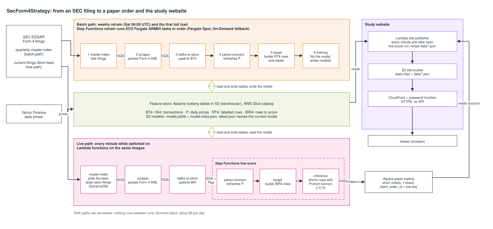
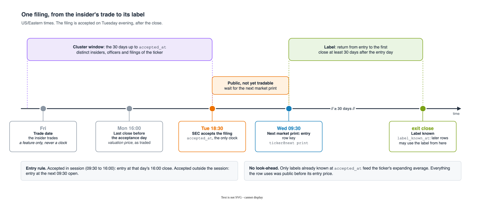
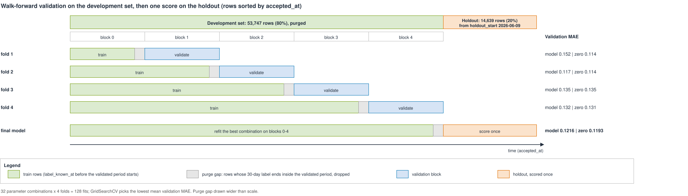
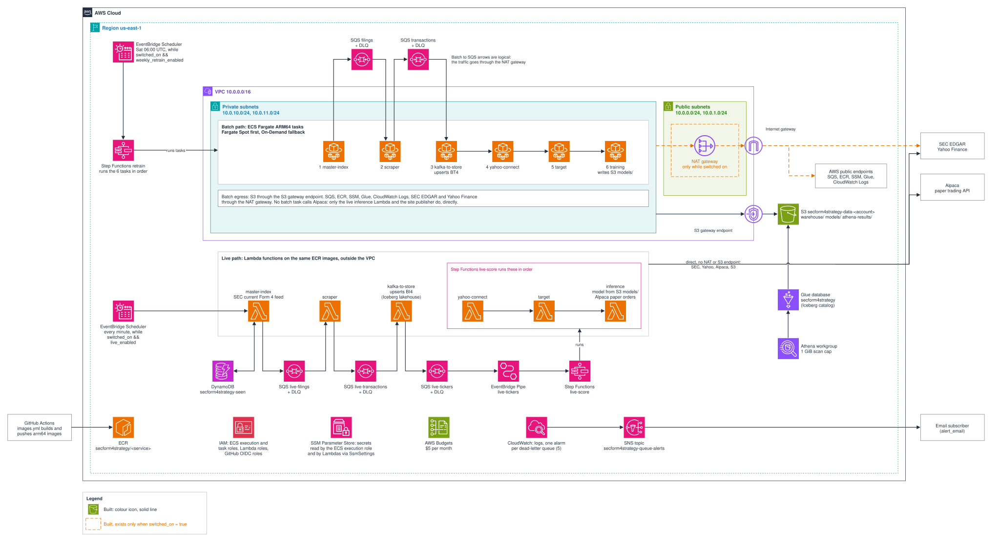
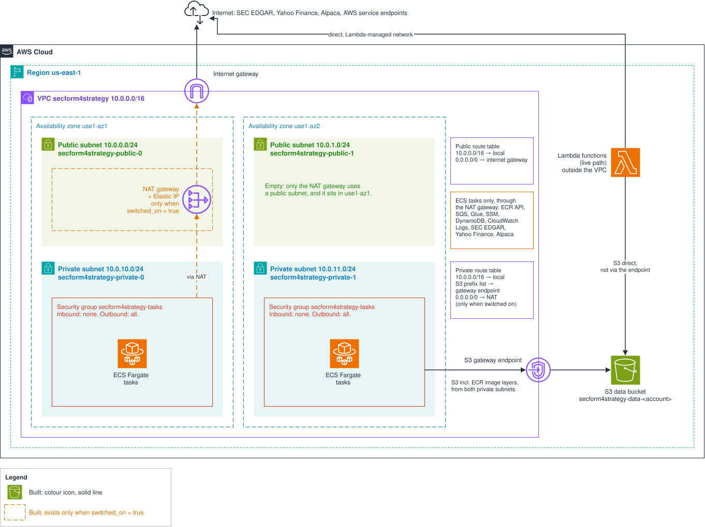
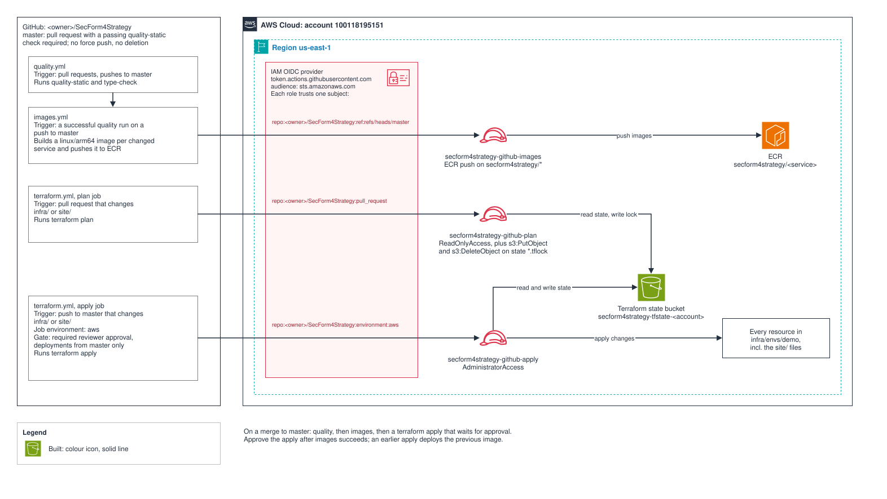
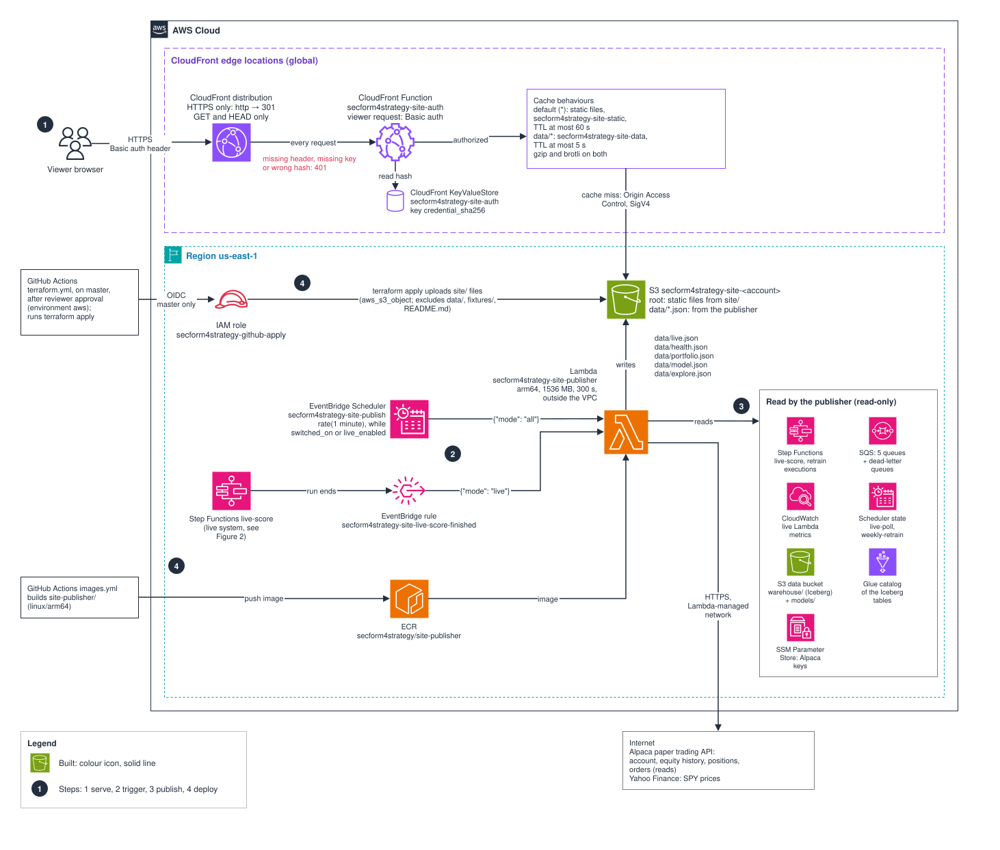
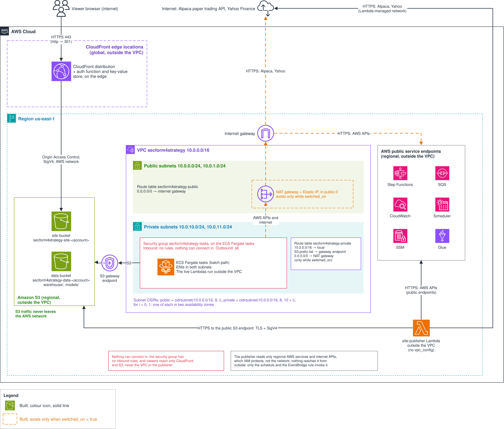
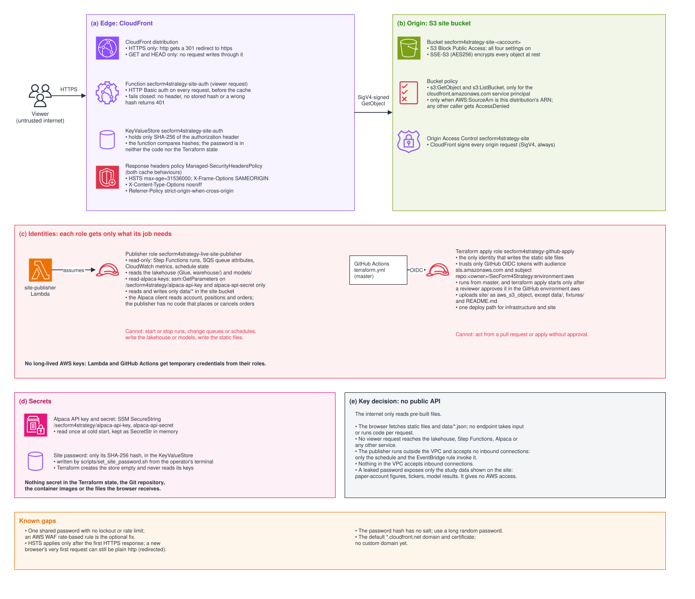
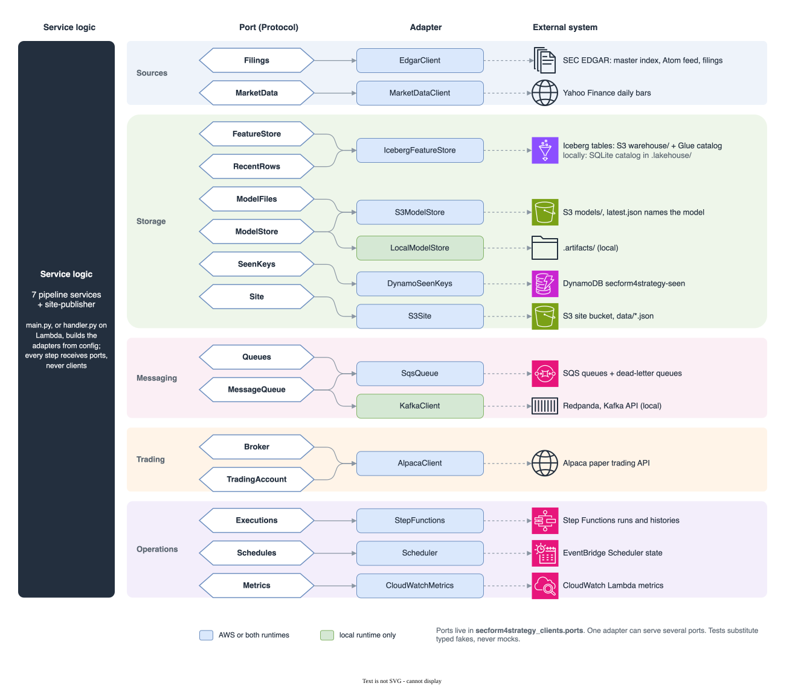

# SecForm4Strategy

**Cloud infrastructure on AWS to test whether corporate insider sales precede stock underperformance**

| | |
| --- | --- |
| Course | Cloud Solutions |
| Project | SecForm4Strategy |
| Date | 2026-11-22 |
| Repository | [https://github.com/josemita87/SecForm4Strategy](https://github.com/josemita87/SecForm4Strategy), branch `master` |

## Abstract

SecForm4Strategy reads the insider-trading disclosures (Form 4) that the US Securities and Exchange Commission (SEC) publishes on EDGAR. It joins each disclosure to the stock prices after the moment the filing became public, trains a gradient-boosted regression model to predict the 30-day return that follows, and places short orders on a paper-trading account at the broker Alpaca. The system runs on AWS in account `100118195151`, region `us-east-1`, and Terraform defines every resource. A batch path (Step Functions and ECS Fargate on ARM64) loads years of filings and retrains the model each week. A live path (EventBridge Scheduler, SQS, Lambda container images, an EventBridge Pipe and a second state machine) scores each new filing within minutes of publication. Both paths are serverless, and one Terraform switch takes the stack from about $0 per day when dormant to about $1.20 per day plus usage when switched on. A password-protected static website on CloudFront shows the live runs, the paper portfolio and the model. On one year of data, the model does not beat a constant zero prediction on mean absolute error (holdout MAE 0.1216 against 0.1193). Its most negative predictions still rank well: the 265 holdout rows predicted below -5% fell by 10.8% on average, before costs. The project therefore delivers cloud infrastructure that can test the insider-selling hypothesis rigorously, not a proven trading strategy.

## Contents

1. [Introduction](#1-introduction)
2. [Data](#2-data)
3. [Machine learning](#3-machine-learning)
4. [Cloud architecture on AWS](#4-cloud-architecture-on-aws)
5. [Study website](#5-study-website)
6. [Software engineering quality](#6-software-engineering-quality)
7. [Results](#7-results)
8. [Operations: the 5-year backfill](#8-operations-the-5-year-backfill)
9. [Design decisions and trade-offs](#9-design-decisions-and-trade-offs)
10. [Limitations and future work](#10-limitations-and-future-work)
11. [Conclusion](#11-conclusion)
12. [Appendix A: Resource inventory](#appendix-a-resource-inventory)
13. [Appendix B: Repository map](#appendix-b-repository-map)
14. [Appendix C: Glossary](#appendix-c-glossary)

---

## 1. Introduction

### 1.1 The question

A corporate insider is a director, an officer or an owner of more than 10% of a company. An insider who buys or sells the company's stock must report the trade to the SEC on a Form 4 within two business days. The SEC publishes each Form 4 on EDGAR, its public filing system.

Insiders know more about their company than the market does. The project tests one hypothesis: insider sales come before the stock underperforms, and the market has not yet priced that information in when the filing becomes public. The model trains on dispositions (`acquired_disposed = D`): sales, gifts, tax withholdings and other transactions that reduce the insider's holding.

### 1.2 Why disclosure time matters

A trader can act on a filing only after the SEC makes it public. Every transaction therefore carries `accepted_at`, the moment the SEC accepted the filing. This timestamp is the only clock for labels. The insider's own trade date, often days earlier, is a model feature and never times a label.

Other traders read the same filings, so the price can move soon after publication. A system that reacts faster captures more of the move. Speed from disclosure is therefore the edge, and it drives two cloud design choices: the live path polls the SEC every minute, and it trades as soon as it scores a filing.

### 1.3 What the system does, end to end



*Figure 1: End-to-end data flow. SEC filings enter a weekly batch path and a per-minute live path. Both paths share one Iceberg feature store and one model in S3. The live path places paper orders, and a publisher Lambda feeds the study website.*

Seven services do the work. Each service is a separate Python 3.14 program with one job, its own dependencies and its own container image.

| Step | Service | Job |
| --- | --- | --- |
| 1 | master-index | Lists Form 4 filings from EDGAR and sends one message per filing. |
| 2 | scraper | Downloads each filing, parses its Form 4 XML and sends one message per transaction. |
| 3 | kafka-to-store | Validates the transactions and upserts them into the feature-store table `BT4` (training) or `BI4` (inference). |
| 4 | yahoo-connect | Downloads daily prices from Yahoo Finance for every ticker in the transactions and upserts them into `P`. |
| 5 | target | Joins transactions with prices into one row per trading opportunity, adds features and, for training, the label. It writes `RT4` (labelled) or `BIR4` (to score). |
| 6 | training | Fits a scikit-learn model on `RT4`, compares it with baselines, saves it with its metadata as a new version, and promotes it only through a gate. |
| 7 | inference | Loads the model, scores `BIR4` rows and places a short order for each row predicted below the threshold. |

The name kafka-to-store comes from the local stack, which uses Redpanda (a Kafka-compatible broker). On AWS the same service reads from SQS. A shared package, `secform4strategy-clients`, holds every connection to an outside system behind a typed interface. The same service code therefore runs on a laptop with Docker Compose and on AWS (Section 6).

---

## 2. Data

### 2.1 SEC EDGAR Form 4

A Form 4 reports one or more transactions by one insider in one company. The system downloads each filing's full submission, `<accession>.txt`. This file is an SGML wrapper with two parts:

- The EDGAR header holds `<ACCEPTANCE-DATETIME>`, in US/Eastern time. It becomes `accepted_at`.
- An `<XML>` block holds the filer's `<ownershipDocument>`. Its non-derivative table lists trades in shares, and its derivative table lists trades in options and similar instruments.

master-index finds filings in two EDGAR sources. The quarterly master index lists every filing of a quarter, for the first full load and the weekly retrain. The current-filings Atom feed lists the newest filings, for the live path.

The SEC fair-access policy allows each client 10 requests per second and requires an honest `User-Agent` with a name and contact email. Every SEC request carries one `User-Agent`, read from the secret `SEC_USER_AGENT`. `EdgarClient` spaces request starts at least `1 / SEC_MAX_RATE` seconds apart across all threads. The batch scraper runs at `SEC_MAX_RATE=5` and the live path at most 4.5 in total, so both together stay under 10. The batch tasks leave through the Elastic IP of the NAT gateway. The live Lambdas run outside the VPC and leave from addresses that Lambda assigns. Both send the same `User-Agent`, so the limit applies to their sum. The first full load raises the batch cap to 8 per second while the live path is off.

The SEC answers a rate-limit breach with HTTP 403 and locks the client out for about 10 minutes. Requests during the lockout extend it. The adapter therefore does not retry a 403 itself. It raises `RetryableError` at once, and the platform retries the work minutes later (Section 6.4).

### 2.2 Parsing

The scraper declares the Form 4 XML as `pydantic-xml` models (`form4.py`) and maps it into a typed transaction record (`parser.py`, `transaction.py`). The main rules:

- Every record carries `accepted_at` as a timezone-aware timestamp.
- A joint filing with several reporting owners is attributed to the first owner listed.
- The `derivative` flag records the table a transaction comes from.
- Rule 10b5-1 trades are flagged from the `aff10b5One` checkbox or from any footnote that mentions `10b5-1`.
- Holding rows list accounts that the filing does not trade. Their shares are summed into `direct_holding` and `indirect_holding`.
- Placeholder tickers (`NONE`, `N/A`, `NA`, dashes) become missing, so the row is dropped downstream.
- A value that fails validation drops that one transaction, with a warning. A filing without a header or XML yields no records.

The transaction key is a hash of the accession number, the table and the transaction's position in that table. An accession number never changes, so every redelivery (a feed re-poll, an SQS retry, a backfill rerun) upserts the same row instead of adding a duplicate.

### 2.3 Prices

yahoo-connect keeps the table `P` (one row per ticker and day) current for every ticker in the transactions. It stores two price bases:

- `open` and `close` are adjusted for later splits and dividends. Returns between any two days are therefore comparable.
- `close_as_traded` is the close in that day's shares, with later splits undone. All USD values use it, because a Form 4 counts shares as of the trade.

Each refresh starts 30 stored days back for each ticker (`REBASE_LOOKBACK_DAYS`). If the adjustment factors of those days changed, Yahoo has re-based the history after a split or dividend, and yahoo-connect downloads the ticker's full history again. yahoo-connect never stores a bar before its close has printed.

target also joins static company data from files in its image: monthly market-cap snapshots (`mcaps.parquet`, 1992 to 2024-08) and company data by issuer CIK (`companies.json`: ticker, SIC code, SIC group, exchange).

### 2.4 Feature groups

A feature group is one table in the feature store. The feature store is a set of Apache Iceberg tables: Parquet data files plus metadata files that support upserts and schemas. Each service declares the feature groups it uses in its `spec.yaml`, with a primary key and an event-time column.

| Group | One row per | Key | Holds | Written by | Read by |
| --- | --- | --- | --- | --- | --- |
| `BT4` | Transaction (training) | Hash of accession, table, position | The parsed transaction with `accepted_at` | kafka-to-store | yahoo-connect, target |
| `BI4` | Transaction (inference) | The same | The same | kafka-to-store | yahoo-connect, target |
| `P` | Ticker and day | `<ticker>@<date>` | Adjusted `open`/`close`, `close_as_traded`, `split`, `dividend` | yahoo-connect | target |
| `RT4` | Ticker and next market print | `<ticker>@<next print>` | Features, label `pct_change`, `label_known_at` | target | training, target |
| `BIR4` | Ticker and next market print | `<ticker>@<next print>` | The same features, no label | target | inference |

### 2.5 One filing on the timeline



*Figure 2: One filing on the timeline. The insider trades on the trade date. The SEC accepts the filing at `accepted_at`. Values use the last close before the acceptance day, the entry is the next market print, and the label ends at the first close at least 30 days later (`label_known_at`).*

Figure 2 shows the four moments that time a row. The next section defines them.

---

## 3. Machine learning

### 3.1 One row per trading opportunity

Each trading day has two prices a trader can act on: the 09:30 open and the 16:00 close (US/Eastern). The **next print** of a filing is the first of these after `accepted_at`. A filing accepted during the session enters at that day's close. A filing accepted after the close or before the open enters at the next open.

target groups every transaction of a ticker with the same next print into one row, keyed `<ticker>@<next print>`. Several insiders who sell before the same print therefore form one row with one label. No label is counted twice, and the model sees clusters of insiders.

### 3.2 Features

| Feature | Meaning |
| --- | --- |
| `n_filings`, `n_insiders` | Distinct filings and insiders in the row |
| `insiders_recent`, `officers_recent`, `filings_recent` | Distinct insiders, officers and filings of the ticker in the 30 days up to the row's acceptance |
| `tx_value`, `derivative_value`, `remaining_value` | USD value of the shares traded, of the derivative notional, and of the traded accounts after the trade |
| `direct_holding`, `indirect_holding`, `total_held` | USD value of the untraded accounts, and the sum of all holdings |
| `price_to_close` | Mean reported price divided by the last close; missing outside 0.2 to 5 |
| `filing_lag_days` | Days from the earliest trade date to the acceptance day |
| `sale`, `gift`, `tax_withholding`, `exercise` | Flags from the transaction codes S, G, F and M/C/X |
| `director`, `officer`, `rule105b1`, `equity_swap` | Role, Rule 10b5-1 plan and equity-swap flags |
| `market_cap`, `exchange`, `sic`, `sic_group` | Company context |
| `avg_target_expanding` | Mean label of the ticker's earlier rows whose labels were already known at this row's acceptance |

Every USD value uses one price: the as-traded close of the last trading day strictly before the acceptance day.

### 3.3 Label

The label `pct_change` is the forward return of the row:

- **Entry:** the price at the row's next print, or the first actual print after it if that print did not happen.
- **Exit:** the first close at least `DELTA_PERIOD` (30) calendar days after the entry day.
- **Return:** (exit − entry) / entry, on adjusted prices.
- **`label_known_at`:** the moment of the exit close, in UTC. Later rows may use the label only after this moment.

### 3.4 No look-ahead

Look-ahead bias is the use of information that was not public at decision time. It makes a backtest look better than reality. The system blocks it in four places:

1. The entry price is the first print after `accepted_at`, never the trade date.
2. Values use the close of the last trading day before the acceptance day.
3. `avg_target_expanding` averages only labels whose `label_known_at` is strictly before the row's `accepted_at`. Training and inference use the same rule.
4. The holdout and the validation folds are split by time and purged.

### 3.5 Model

The model is a scikit-learn `Pipeline`. Its `preprocess` step applies `StandardScaler` to numeric columns and `OneHotEncoder` to boolean, category and text columns. Its `regressor` step is a `HistGradientBoostingRegressor` with early stopping, `max_iter=500`, `validation_fraction=0.1` and `random_state=42`. The preprocessing is part of the pipeline, so every fit learns it from that fit's training rows only, and it is saved with the model. The pipeline is small, so it needs no GPU and no hosted endpoint.

### 3.6 Walk-forward validation, grid search and holdout

Training sorts the rows by `accepted_at` and splits them in time (Figure 3).



*Figure 3: Walk-forward validation on the 1-year data. The latest 20% of rows form the holdout. The development set is cut into five blocks. Fold k trains on rows whose label was known before block k starts and validates on block k. The grey purge gaps remove rows whose 30-day label ends inside the validated period. Per-fold and holdout MAE are on the right.*

- **Holdout:** the latest `HOLDOUT_RATIO` (20%) of rows. `holdout_start` is the `accepted_at` of its first row.
- **Development:** the earlier rows whose `label_known_at` is before `holdout_start`.
- **Blocks:** the development set is cut into `N_FOLDS + 1` (5) consecutive time blocks.
- **Folds:** fold k validates on block k and trains on every development row whose `label_known_at` is before block k starts.

**Purging.** A label uses prices up to 30 days after its filing. A row filed 10 days before `holdout_start` has a label that uses prices from inside the holdout period. Training drops such rows from the development set, and from each fold's training rows. Without purging, the model would train on prices from the period it is scored on. On the 1-year data, 73,195 labelled rows gave 14,639 holdout rows and 53,747 development rows, so purging dropped 4,809 rows.

**Grid search.** `GridSearchCV` fits every parameter combination on every fold (`n_jobs=-1`):

| Parameter | Values |
| --- | --- |
| `loss` | `squared_error`, `absolute_error` |
| `learning_rate` | `0.03`, `0.1` |
| `max_leaf_nodes` | `15`, `31` |
| `min_samples_leaf` | `50`, `200` |
| `l2_regularization` | `0`, `1` |

The grid has 32 combinations, so 128 fits on 4 folds. The search selects the lowest mean validation MAE. The short return is not the selection metric: at the traded threshold, each fold's short return comes from a few hundred trades, which is too noisy to rank 32 combinations.

**Holdout.** Training refits the best combination on the whole development set and scores it once on the holdout. The holdout decides nothing: the parameters, the threshold and the feature set are fixed before training scores it.

### 3.7 Baselines and metrics

| Predictor | Prediction |
| --- | --- |
| `model` | The refitted pipeline |
| `zero` | No move: 0 for every row |
| `train_mean` | The mean development label |
| `ticker_history` | `avg_target_expanding`, or the development mean where it is missing |

Each predictor gets three scores on the same holdout rows:

- `mae`: the mean absolute error of the predicted return.
- `short_return`: the mean return captured per short. The predictor shorts every row it predicts below `PREDICTION_THRESHOLD`. A positive value is a profit.
- `n_shorts`: the number of rows shorted.

Training also logs the model's short return at the thresholds 0, -2%, -5% and -10% (`report_thresholds`).

### 3.8 Trading threshold and model metadata

Inference shorts every row with a prediction below `PREDICTION_THRESHOLD = -0.05`: a predicted fall of more than 5%. Training scores the holdout at the same value, and one Terraform local, `prediction_threshold`, sets both. Each order is a market sell of `QTY = 1` share, good until cancelled, with the row key as `client_order_id`.

Training saves `model.joblib` and `model.meta.json`. The metadata (`ModelMetadata`) records the training time, the git SHA, the scikit-learn version, the feature order, the parameters, the row counts, `holdout_start`, the holdout scores, the per-fold validation MAE and the threshold. Inference refuses a model saved under another scikit-learn version and stops before it places any order.

---

## 4. Cloud architecture on AWS

### 4.1 Overview



*Figure 4: AWS architecture. The batch path (top) runs six ECS Fargate tasks under the `retrain` state machine. The live path (middle) runs six Lambda functions on the same images, chained by SQS queues, an EventBridge Pipe and the `live-score` state machine. Orange dashed elements exist only while the stack is switched on.*

All resources are in account `100118195151`, region `us-east-1`. Terraform under `infra/` defines all of them. Terraform state is in the bucket `secform4strategy-tfstate-<account>`, which `infra/bootstrap` creates, with S3 native locking (`use_lockfile = true`). The provider's `allowed_account_ids` rejects any other account.

The root module `infra/envs/demo` calls ten modules:

| Module | Resources |
| --- | --- |
| `storage` | Data bucket `secform4strategy-data-<account>`, Glue database `secform4strategy`, Athena workgroup `secform4strategy`, one ECR repository per service, the monthly budget |
| `network` | VPC, two public and two private subnets, internet gateway, S3 gateway endpoint, security group `secform4strategy-tasks`, and the NAT gateway while switched on |
| `queues` | Five SQS queues, each with a dead-letter queue and a CloudWatch alarm, and the SNS topic `secform4strategy-queue-alerts` |
| `iam` | The ECS execution role, one task role per service, one Lambda role per Lambda function |
| `ci` | The GitHub OIDC provider and the roles `secform4strategy-github-images`, `-plan` and `-apply` |
| `tasks` | The ECS cluster `secform4strategy`, one task definition and one log group per service |
| `retrain` | The `retrain` state machine and its weekly schedule |
| `live` | Six Lambda functions, the DynamoDB table `secform4strategy-seen`, the poller schedule, the `live-score` state machine and the EventBridge Pipe |
| `dashboard` | The CloudWatch dashboard `secform4strategy` |
| `site` | The site bucket, the CloudFront distribution and password function, and the publisher Lambda (Section 5) |

The system has two paths. Both use serverless compute, so nothing runs and nothing is billed for compute between runs.

| | Batch path | Live path |
| --- | --- | --- |
| Work | The first full load of years of filings, then a weekly retrain | One filing at a time, as the SEC publishes it |
| Compute | ECS tasks on Fargate ARM64 | Lambda functions on the same images |
| Trigger | EventBridge Scheduler starts Step Functions | EventBridge Scheduler, then SQS, then an EventBridge Pipe |
| Reason | Fargate has no run-time limit; Lambda stops a run after 15 minutes | Lambda runs as soon as an event arrives and bills per invocation |

### 4.2 Storage: Iceberg on S3 with the Glue catalog

The data bucket `secform4strategy-data-<account>` holds three prefixes:

| Prefix | Content |
| --- | --- |
| `warehouse/` | The Iceberg tables. It is the location of the Glue database `secform4strategy`. |
| `models/` | One folder per trained model (`model.joblib`, `model.meta.json`), plus `latest.json`, which names the promoted model |
| `athena-results/` | Athena query results, expired after 7 days |

The bucket blocks all public access and encrypts objects with SSE-S3. Incomplete multipart uploads expire after 1 day. The AWS Glue Data Catalog is the Iceberg catalog: it records where each table's current metadata file is. The Athena workgroup `secform4strategy` queries the tables with SQL and cancels any query that scans more than 1 GiB.

`S3ModelStore` saves each model in a folder named after its training time. Saving does not change `latest.json`. Promoting a version writes `latest.json`, which names that folder. A load reads `latest.json` first, so it never pairs a new model with old metadata. Earlier models stay in the bucket.

Each service has an ECR repository `secform4strategy/<service>`. Tags are immutable, ECR scans each image on push, and each repository keeps its 5 newest images.

### 4.3 Batch path

The Step Functions state machine `secform4strategy-retrain` runs six ECS tasks in order:

1. master-index publishes filings to `secform4strategy-filings`.
2. scraper reads them and publishes transactions to `secform4strategy-transactions`.
3. kafka-to-store reads the transactions and upserts them into `BT4`.
4. yahoo-connect refreshes the prices of the tickers in the tables.
5. target builds the labelled rows in `RT4`.
6. training saves a new model to `models/`, and promotes it if it passes the gate.

Each step runs one Fargate ARM64 (Graviton) task in the cluster `secform4strategy`, in the private subnets, and waits for it to stop. The tasks use the `FARGATE` launch type (On-Demand). Fargate Spot runs ARM64 tasks too, but a Spot interruption fails the step, and the retry policy allows only 3 attempts, which a multi-day backfill could use up. A failed step is retried after 600 seconds, at most 3 times. The wait is deliberately longer than the 300-second SQS visibility timeout. A rerun that started earlier would find the unfinished messages still hidden, stop at once and leave the work undone. Each task logs to `/secform4strategy/<service>`, kept 14 days.

Task sizes follow the work. Most tasks run with 0.5 vCPU and 1 GB or 2 GB. kafka-to-store runs with 2 vCPU and 8 GB, because each Iceberg upsert loads and merges table rows, and at 0.5 vCPU a 10,000-row batch took about 40 seconds. The cluster has Container Insights enabled, so CloudWatch shows each task's CPU and memory use. target reads every ticker's price history at once and runs with 2 vCPU and 16 GB, because 4 GB ran out of memory on one year of filings. training runs the 128 grid-search fits in parallel on 4 vCPU and 16 GB.

EventBridge Scheduler starts `retrain` every Saturday at 06:00 UTC (`secform4strategy-weekly-retrain`). master-index then runs with `MODE=recent` and `DAYS_BACK=7` and publishes only the filings of the last 7 days. The training task runs with `PROMOTE=gated`, so a run's model replaces the promoted model only if it passes the promotion gate. The gate requires at least 50,000 development rows and at least 80% of the current model's, the same feature-group version and `features`, holdout rows, a finite holdout MAE and at least one short. It does not compare MAE with the current model, because each model is scored on a different holdout period. `scripts/promote_model.sh` lists the saved models and promotes one by hand, which is also the rollback.

**Run input.** A run's input can override environment variables per step:

```json
{"overrides": {"<service>": {"<VARIABLE>": "<value>"}}}
```

The first full load is the same state machine, started once by hand:

```json
{"overrides": {"master-index": {"MODE": "historical", "YEARS": "5"}, "scraper": {"SEC_MAX_RATE": "8"}, "kafka-to-store": {"BUFFER_SIZE": "10000"}}}
```

**Throughput.** The scraper downloads up to 12 filings at once (`FETCH_WORKERS=12`) and runs at 6 to 7.8 filings per second. kafka-to-store upserts one batch of `BUFFER_SIZE` rows per Iceberg commit. A 10,000-row batch takes about 25 seconds at 2 vCPU, and a 30,000-row batch about 75 seconds: about 400 rows per second either way (Section 8.2). One year holds about 250,000 Form 4 filings. The 5-year backfill (`backfill-5y`, started 2026-11-20) covers about 1.06 million filings.

**Revision pinning.** A `retrain` run names exact task-definition revisions, for example `secform4strategy-kafka-to-store:3`, and keeps them until it ends. A new image makes Terraform register a new revision. The task definitions set `skip_destroy = true`, so the old revision stays active and a multi-day run can still start tasks from it. ECR keeps only 5 images per repository, so a service must not get five newer images while a run still has to start it. During a multi-day run, the rule is to push at most four new images of a service whose step has not started. Section 8 describes the backfill failure that led to this rule.

**Batch consumers.** The scraper runs with `EXIT_WHEN_EMPTY=true`: it stops at the first receive that waits its full poll timeout without a message. If it left a message unacknowledged for retry, it exits non-zero, and Step Functions reruns it.

### 4.4 Live path

The live path runs the batch services as Lambda functions, on the same container images, scoped to the tickers of each new filing:

1. EventBridge Scheduler invokes `secform4strategy-live-master-index` every minute (`secform4strategy-live-poll`).
2. master-index reads the first page of the SEC's current Form 4 feed. It sends the filings that the DynamoDB table `secform4strategy-seen` does not hold to `secform4strategy-live-filings`, then records them. Each item expires after 7 days (`SEEN_DAYS`).
3. The scraper Lambda parses each filing and sends its transactions to `secform4strategy-live-transactions`.
4. kafka-to-store upserts the transactions into `BI4` and sends `{"tickers": [...]}` to `secform4strategy-live-tickers`.
5. The EventBridge Pipe `secform4strategy-live-tickers` starts one run of the state machine `secform4strategy-live-score` per batch of up to 10 messages.
6. `live-score` runs three Lambdas in order: yahoo-connect refreshes the prices, target builds the `BIR4` rows, and inference scores them and places Alpaca paper orders.

| Function | Trigger | Settings |
| --- | --- | --- |
| master-index | Schedule, every minute | 512 MB, 60 s; `SEC_MAX_RATE=1` |
| scraper | `live-filings`, batches of 10 | 1024 MB, 120 s; at most 2 at a time, each at `SEC_MAX_RATE=2.25` |
| kafka-to-store | `live-transactions`, up to 100, waiting at most 5 s | 2048 MB, 240 s; at most 2 at a time |
| yahoo-connect | `live-score` | 2048 MB, 180 s |
| target | `live-score` | 2048 MB, 180 s |
| inference | `live-score` | 2048 MB, 180 s; `QTY=1`, `PREDICTION_THRESHOLD=-0.05` |

The account allows 10 concurrent Lambda executions in total, shared by the live functions and the site publisher. Section 10.2 describes the risk and the fix.

**Same images, two runtimes.** Each function runs `<service directory>/.venv/bin/python -m awslambdaric`. `awslambdaric` is the Lambda runtime interface client: it receives events from the Lambda service and calls the handler. Each handler sits beside the service's `main.py` and calls the same functions as the batch loop. Training and live scoring therefore share one feature implementation, so the features cannot drift apart between them. The functions set `HOME=/tmp`, because the image's file system is read-only.

**Partial batch failures.** The SQS triggers report partial batch failures. A handler returns the messages it did not finish in `batchItemFailures`, and SQS delivers only those again after the visibility timeout.

**Retries and idempotent orders.** Each `live-score` step is retried twice on `States.TaskFailed`, after 5 and 10 seconds. inference raises `RetryableError` when an order is left unplaced, so the step runs again. Each order carries the row key as `client_order_id`, so Alpaca rejects a duplicate. inference loads the latest model at each invocation, so a new weekly model takes effect at once. It trades only fresh rows: rows whose latest filing was accepted within `MAX_SIGNAL_AGE_MINUTES` (default 60).

**Cold starts.** The images are about 1 GB. A first cold start exceeds Lambda's 10-second initialization limit, so Lambda runs the initialization again inside the invocation, which then succeeds. Measured cold invocations were 10 seconds for scraper, 45 seconds for kafka-to-store and 39 seconds for yahoo-connect. Warm invocations take a few seconds. A filing that arrives after a quiet period therefore reaches inference about 1 to 2 minutes after the poll. Provisioned concurrency would keep one instance warm for about $10 per month per function. The project accepts the cold start instead.

### 4.5 Messaging

Five SQS standard queues carry the work between services. Each has its own dead-letter queue (DLQ).

| Setting | Value |
| --- | --- |
| Queues | `secform4strategy-filings`, `-transactions`, `-live-filings`, `-live-transactions`, `-live-tickers` |
| Dead-letter queues | The queue name plus `-dlq` |
| Visibility timeout | 300 seconds |
| `maxReceiveCount` | 5 |
| Retention | 4 days on the queues, 14 days on the DLQs |
| Encryption | SSE with SQS-managed keys |

`SqsQueue` sends and receives JSON bodies, 10 messages per call. A large receive or delete runs in parallel rounds of up to 10 calls, so a batch of 10,000 messages takes about 100 rounds instead of 1,000 calls in a row. A received message stays hidden for the visibility timeout. If the consumer does not delete it in that time, SQS delivers it again. After 5 receives without a delete, SQS moves it to the DLQ. Section 6.4 maps the error contract onto these settings.

### 4.6 Network



*Figure 5: AWS network. The VPC `10.0.0.0/16` has two public and two private subnets in two availability zones. The Fargate tasks run in the private subnets. S3 traffic uses the free gateway endpoint. All other outbound traffic uses the NAT gateway, which exists only while the stack is switched on.*

| Resource | Value |
| --- | --- |
| VPC `secform4strategy` | `10.0.0.0/16`, DNS support and hostnames on |
| Public subnets `secform4strategy-public-0`, `-1` | `10.0.0.0/24`, `10.0.1.0/24` |
| Private subnets `secform4strategy-private-0`, `-1` | `10.0.10.0/24`, `10.0.11.0/24`, in `use1-az1` and `use1-az2` |
| Private route table | S3 to the gateway endpoint; `0.0.0.0/0` to the NAT gateway only while switched on |
| Security group `secform4strategy-tasks` | No inbound rules; all outbound allowed |
| NAT gateway and Elastic IP | In `secform4strategy-public-0`, only while `switched_on = true` |

**Why the project has a VPC.** Fargate requires it. Fargate runs a task only in `awsvpc` mode, where each task gets a network interface in a subnet with a security group. The other services need no VPC:

| Component | In the VPC | Reason |
| --- | --- | --- |
| ECS Fargate tasks | Yes | Fargate requires a subnet and a security group for every task |
| Live Lambda functions | No | They reach SEC EDGAR, Yahoo Finance, Alpaca and the AWS APIs directly. Outside the VPC they do not depend on the NAT gateway, so the live path works while the stack is dormant. Their outbound address is not fixed. |
| Site publisher Lambda | No | It reads only regional AWS services and internet APIs (Section 5) |
| Step Functions, SQS, DynamoDB, S3, EventBridge, CloudFront | Not applicable | Regional or global services, reached through endpoints and controlled by IAM |

The private subnets avoid `use1-az3`, because Fargate ARM64 is not available there. Nothing in the private subnets has a public IP address, and the security group accepts no inbound connections, so nothing on the internet can open a connection to the tasks. The Lambda functions accept no inbound connections either: only their triggers invoke them, through the Lambda API and IAM.

The NAT gateway gives the private subnets outbound internet access for SEC EDGAR, Yahoo Finance and Alpaca. It also carries their calls to the AWS APIs other than S3: ECR, SQS, Glue, SSM, DynamoDB and CloudWatch Logs. The S3 gateway endpoint carries the Iceberg data, the models and the ECR image layers. It costs nothing, and its traffic adds no NAT data charges. While the stack is dormant, the private subnets reach only S3, and no task can run because it cannot pull its image or read its secrets.

### 4.7 Identity and security

The `iam` module creates three kinds of role:

| Role | Trusts | Permissions |
| --- | --- | --- |
| `secform4strategy-execution` | `ecs-tasks.amazonaws.com` | Pull images, write logs, plus `ssm:GetParameters` on `/secform4strategy/*` |
| `secform4strategy-<service>` | `ecs-tasks.amazonaws.com` | Only the queues and data that service uses |
| `secform4strategy-live-<service>` | `lambda.amazonaws.com` | Logs, plus the service's own entries |

`task_access` and `lambda_access` in `infra/envs/demo/main.tf` list, per service, the queues it sends to, the queues it receives from, and named capabilities. The module turns each entry into one inline policy on the role.

| Capability | Grants |
| --- | --- |
| Send to a queue | `sqs:GetQueueUrl`, `sqs:SendMessage` on that queue |
| Receive from a queue | `sqs:GetQueueUrl`, `sqs:GetQueueAttributes`, `sqs:ReceiveMessage`, `sqs:DeleteMessage` on that queue |
| `lakehouse-read` | Glue reads on the database and its tables; `s3:GetObject` on `warehouse/*` |
| `lakehouse-write` | `lakehouse-read` plus `glue:CreateTable`, `glue:UpdateTable` and `s3:PutObject` on `warehouse/*` |
| `models-read` / `models-write` | `s3:GetObject` / `s3:PutObject` on `models/*` |
| `seen-keys` | `dynamodb:BatchGetItem`, `dynamodb:BatchWriteItem` on `secform4strategy-seen` |
| `read-secrets` | `ssm:GetParameters` on `/secform4strategy/*` |
| `read-alpaca-keys` | `ssm:GetParameters` on the two Alpaca key parameters only |

For example, the scraper task can only receive from `filings` and send to `transactions`. It cannot touch the lakehouse. training can read the lakehouse and write models, but it cannot place orders or read secrets. Only inference and the site publisher can read the Alpaca keys.

The orchestrators have their own roles:
- `secform4strategy-retrain` (Step Functions) runs, describes and stops the ECS tasks, and passes their roles.
- `secform4strategy-retrain-scheduler` and `secform4strategy-live-scheduler` start the `retrain` state machine and invoke the poller.
- `secform4strategy-live-score` invokes the three scoring Lambdas.
- `secform4strategy-live-tickers-pipe` receives from `live-tickers` and starts `live-score`.

**Secrets.** The secrets are `SecureString` parameters in SSM Parameter Store: `/secform4strategy/sec-user-agent`, `/secform4strategy/alpaca-api-key` and `/secform4strategy/alpaca-api-secret`. The operator creates them with the AWS CLI, never in Terraform, so their values never enter the Terraform state. In ECS, the execution role reads them and injects them as environment variables, so the task roles hold no SSM permission. Lambda cannot inject SSM parameters, so each live function reads its own: `SSM_PARAMETERS` names the parameters, and the settings class `SsmSettings` reads them in one call at cold start. The service code holds secrets as pydantic `SecretStr` values and unwraps them only at the SDK call.

**No static keys.** No container holds a static AWS key. ECS and Lambda give the code temporary credentials for its role, and boto3 finds them in its default credential chain.

### 4.8 CI/CD



*Figure 6: CI/CD. Three GitHub Actions workflows authenticate to AWS through OIDC. Master pushes images; pull requests get read-only plans; the approval-gated environment `aws` applies. The figure shows the deploy before it became two-stage: the plan role now also plans each master push, and the apply applies that saved, encrypted plan (see the text below).*

| Workflow | Trigger | Does |
| --- | --- | --- |
| `quality.yml` | Pull requests and pushes to master | The quality gate: `make quality-static`, and `make type-check` as a separate job |
| `images.yml` | A successful `quality` run on a push to master | Builds a `linux/arm64` image for each service whose code changed, tags it with that code's last commit, and pushes it to ECR |
| `terraform.yml` | Pull requests and pushes to master that change `infra/` or `site/` | `terraform plan` on pull requests; on master, a saved plan of the merged commit, then an apply of exactly that plan after approval |

Terraform manages every AWS resource, including the ECR repositories and the CI roles. CI manages only the images and the runs of plan and apply.

GitHub Actions authenticates with OIDC (OpenID Connect). A workflow requests a token from `token.actions.githubusercontent.com`, and AWS STS exchanges it for temporary credentials of one role. GitHub holds no AWS key. Each role trusts the audience `sts.amazonaws.com` and one exact `sub` claim:

| Role | Trusted subject | Permissions |
| --- | --- | --- |
| `secform4strategy-github-images` | `repo:josemita87/SecForm4Strategy:ref:refs/heads/master` | ECR push and pull on `secform4strategy/*` |
| `secform4strategy-github-plan` | `repo:josemita87/SecForm4Strategy:pull_request`, and `ref:refs/heads/master` for the plan of a master run | `ReadOnlyAccess`, plus write and delete on the state lock file only; `deny-site-keys` denies reading the site's key-value store |
| `secform4strategy-github-apply` | `repo:josemita87/SecForm4Strategy:environment:aws` | `AdministratorAccess` |

A merge to master that changes `infra/` or `site/` runs `terraform.yml` in two stages:

1. The `plan` job runs `terraform plan -out=tfplan` on the merged commit with the read-only plan role, and shows the plan on the run's summary page. The saved plan holds sensitive values in plain text. The repository is public, and so are its workflow artifacts. The job therefore encrypts the plan (AES-256 with PBKDF2, key in the repository secret `TFPLAN_KEY`) and uploads only the encrypted file, kept for one day.
2. The `apply` job waits for a reviewer's approval in the GitHub environment `aws`, decrypts the plan and runs `terraform apply tfplan`. It applies exactly the plan the reviewer read. If the state changed after the plan, Terraform refuses the saved plan and the run fails.

A plan with no changes skips the `apply` job.

A pull request cannot change any resource. Only a job in the GitHub environment `aws` can assume the apply role. That environment admits only master and requires a reviewer's approval. The branch rules of master require a pull request whose `quality-static` check passes, and they block force pushes and deletion.

### 4.9 Cost and the switches

| State | Cost | What is billed |
| --- | --- | --- |
| Dormant (`switched_on = false`) | About $0 per day | S3 and ECR storage. The VPC, subnets, gateway endpoint, IAM, Glue, idle queues, idle Lambdas, the on-demand DynamoDB table and the state machines cost nothing. |
| Switched on | About $1.20 per day, plus usage | The NAT gateway (about $1.08 per day) and its Elastic IP (about $0.12 per day). Usage: Fargate, Lambda, Step Functions, SQS and DynamoDB requests, NAT data processing, Athena scans. |

`infra/envs/demo/switch.auto.tfvars` holds the switches:

| Switch | Default | While `true` |
| --- | --- | --- |
| `switched_on` | `false` | The NAT gateway exists, and the two schedules below may run |
| `weekly_retrain_enabled` | `true` | The Saturday `retrain` schedule is enabled, if `switched_on` is `true` |
| `live_enabled` | `true` | The live poller schedule is enabled, if `switched_on` is `true` |

`make switch-on` and `make switch-off` set `switched_on` on master, then commit and push the change. The change takes effect after a reviewer approves the Terraform apply. During a full load, `live_enabled` is off, because the batch scraper at 8 requests per second plus the live path's 4.5 would exceed the SEC's 10. `weekly_retrain_enabled` is also off, because the weekly run would use the same batch queues.

The budget `secform4strategy-monthly` is $5 per month. It emails `alert_email` when actual cost passes 50% and when forecast cost passes 100%.

### 4.10 Monitoring

- **Dead-letter alarms.** Each DLQ has a CloudWatch alarm `secform4strategy-<queue>-dead-letters`. It goes into alarm when the DLQ holds at least one message, checked every 5 minutes, and publishes to the SNS topic `secform4strategy-queue-alerts`, which emails `alert_email`.
- **Dashboard.** The CloudWatch dashboard `secform4strategy` shows:
  - queue depths, messages processed per minute, and the backlog ETA of `filings` and `transactions`;
  - DLQ depths;
  - `retrain` and `live-score` runs;
  - the live Lambdas' invocations, errors and p90 duration;
  - `ERROR` log lines per 15 minutes.

  A dashboard with at most 50 metrics is free.
- **`make status`.** One read-only command prints the stack state in about 15 seconds:
  - whether the NAT gateway exists and the schedules are enabled;
  - each running `retrain` step and its attempt;
  - per-queue depth, rate and ETA;
  - the running ECS tasks;
  - the `ERROR` log lines of the last hour;
  - the `live-score` outcomes of the last 24 hours;
  - the current model folder.
- **Logs.** Every service logs one line per batch, for example `10 of 10 filings -> 23 transactions` (scraper). Log groups keep 14 days.

---

## 5. Study website

### 5.1 Purpose

The site is a password-protected study website for the course and the project. It has five pages:

| Page | Shows |
| --- | --- |
| Story | The presentation: the idea, the data, the model and the results |
| Live | The latest `live-score` runs, their filings, predictions and orders |
| Portfolio | The Alpaca paper account: equity, positions and orders |
| Model | The current model: parameters, validation folds, holdout results and feature importance |
| Explore | The largest insider sales and the clusters of insider sales of the last 7 days |

The `site` module in `infra/modules/site` defines the AWS resources, `site/` holds the frontend, and `site-publisher/` holds the publisher Lambda. The site is deployed (2026-11-22): CloudFront serves it behind the password, and the publisher writes the five data files every minute.

### 5.2 Architecture



*Figure 7: Site architecture. CloudFront serves static files from a private S3 bucket after a CloudFront Function checks the password. A publisher Lambda runs every minute and after each `live-score` run. It reads the system's state and writes `data/*.json` into the bucket.*

1. The bucket `secform4strategy-site-<account>` holds the static files at its root and the JSON files under `data/`.
2. The CloudFront distribution reads the bucket through an origin access control. The bucket policy admits only this distribution.
3. The CloudFront Function `secform4strategy-site-auth` checks the password on every request, before CloudFront reads its cache.
4. The Lambda `secform4strategy-site-publisher` reads the lakehouse, the models, Step Functions, SQS, CloudWatch and Alpaca, and writes `data/*.json`.
5. The browser fetches `/data/<name>.json` from the same domain and draws the pages.

| Resource | Settings |
| --- | --- |
| Distribution | HTTPS on the default `*.cloudfront.net` certificate (HTTP redirects to HTTPS), `PriceClass_100`, gzip and brotli |
| Cache of `data/*` | Policy `secform4strategy-site-data`: at most 5 seconds |
| Cache of other files | Policy `secform4strategy-site-static`: at most 60 seconds |
| Response headers | `Managed-SecurityHeadersPolicy` (HSTS, `X-Frame-Options`, `nosniff`, referrer policy) |

### 5.3 No public API

The site has no API. The browser connects only to CloudFront, and only CloudFront can read the bucket. Through CloudFront, a viewer gets only the static files and the data files that the publisher has already written. Those files hold no keys, no credentials and no write access. An API would accept requests from the internet and run code for each one, and each request could read the lakehouse or call Alpaca. A static site removes that attack surface. If the password leaks, the reader sees paper-account figures, tickers and model results, and gets no access to AWS. A static site also costs almost nothing while nobody visits it.

### 5.4 Network and security



*Figure 8: Site network paths. Viewers reach only CloudFront. The publisher runs outside the VPC, in Lambda's managed network, and reaches AWS service endpoints and the Alpaca and Yahoo APIs over TLS. The Terraform workflow deploys the static files with OIDC credentials.*

| Path | From | To | Through |
| --- | --- | --- | --- |
| Viewer | A browser | The site files in S3 | CloudFront, `GET` and `HEAD` only |
| Data | The publisher Lambda | AWS services, Alpaca, Yahoo Finance | Lambda's managed network, outside the VPC |
| Deploy | The `terraform` workflow | The site bucket | The AWS APIs, with OIDC credentials |

The publisher reads only regional AWS services and internet APIs. None of them is inside the VPC, so a place in the VPC would protect nothing the publisher touches. Outside the VPC, the publisher does not depend on the NAT gateway and starts without attaching network interfaces.



*Figure 9: Site security in five layers: edge (HTTPS, password, security headers), origin (private bucket, origin access control), identities (least-privilege roles), secrets (SSM and a hash in a key-value store) and no public API.*

The publisher role `secform4strategy-live-site-publisher` can:
- read state machine runs, queue attributes, metrics, schedules, the lakehouse and the models;
- read the two Alpaca key parameters;
- write `data/*` in the site bucket.

It cannot start or stop runs, change queues or schedules, write lakehouse tables or data, write the models, or write the static site files. Its lakehouse access includes `glue:CreateDatabase`, which `IcebergFeatureStore` needs to create its namespace, so it can create the Glue database if it is missing.

The publisher uses the same Alpaca key pair as inference. Those keys can place and cancel orders on the paper account. The publisher calls only read endpoints, so the isolation relies on code, not on permissions.

### 5.5 Password

The CloudFront Function implements HTTP Basic authentication. It computes the SHA-256 hash of the browser's `authorization` header and compares it with the key `credential_sha256` in the CloudFront KeyValueStore `secform4strategy-site-auth`. If the header or the key is missing, or the hashes differ, it returns 401 with `www-authenticate: Basic realm="SecForm4Strategy"`. Terraform creates the key-value store empty and never reads or writes its keys, so the credential never enters the Terraform state. `scripts/set_site_password.sh` asks for the user and password without echoing them and writes only the hash. Until the key is set, the site refuses every request.

### 5.6 Publisher and data files

The publisher is a Lambda on the image `secform4strategy/site-publisher` (arm64, 1536 MB, 300 s). Two triggers invoke it asynchronously:

| Trigger | Input | When |
| --- | --- | --- |
| Schedule `secform4strategy-site-publish`, `rate(1 minute)` | `{"mode": "all"}` | While `switched_on` is `true` |
| EventBridge rule `secform4strategy-site-live-score-finished` | `{"mode": "live"}` | A `live-score` run ends |

| File | Written | Contents |
| --- | --- | --- |
| `data/live.json` | After each `live-score` run, and every minute | The latest 50 runs, with steps, filings, predictions and orders |
| `data/health.json` | Every minute | Switches, queue depths, Lambda metrics, `live-score` outcomes, the latest `retrain` run, the model version |
| `data/portfolio.json` | Every minute | The paper account, equity history, positions and latest 100 orders |
| `data/model.json` | When the model version changes | Parameters, folds, holdout metrics, threshold results, cumulative return against SPY, feature importance |
| `data/explore.json` | Every 15 minutes | The largest insider sales and the insider clusters of the last 7 days |

Lambda drops an event older than 60 seconds and retries no failed invocation, so a slow publish does not queue more behind it. The next minute's publish replaces a missed one. The publisher needs an image in a repository that only the first apply creates, so its first deploy took two applies: the first created the repository, and the second, after CI pushed the image, created the function.

The site costs a few cents per month for S3 and stays inside the CloudFront free tier. The publisher adds about $1 per month while switched on: a local `all` publish took about 7 seconds and peaked at 585 MB. Its every-minute schedule runs only while `switched_on` is `true`.

---

## 6. Software engineering quality

### 6.1 Microservices as separate uv projects

Each service is its own `uv` project with a `pyproject.toml`, a lockfile, a Dockerfile, `src/` and `tests/`. Docker builds use `uv sync --frozen`, so an image installs exactly the locked versions. Each service builds from the repository root and replicates the repository layout under `/repo`, so the path dependency on the shared package resolves inside the image as on the host. A service can be rebuilt, rerun or scaled alone, and a failure in one stage does not lose the work of another.

### 6.2 Shared clients package: ports and adapters



*Figure 10: Ports and adapters. Services depend on Protocols in `secform4strategy_clients.ports`. Each `main.py` (or `handler.py` on Lambda) builds the concrete adapter for the environment: Kafka or SQS, a SQLite or Glue catalog, local disk or S3.*

`packages/secform4strategy-clients` separates the services from outside systems. A **port** is a Python `Protocol` that names the operations a service needs. An **adapter** implements a port for one outside system. Each service's `main.py` (or `handler.py` on Lambda) is the composition root: the only place that reads configuration and builds adapters.

| Port | Adapters | Outside system |
| --- | --- | --- |
| `Filings` | `EdgarClient` | SEC EDGAR over `httpx` |
| `MessageQueue` | `KafkaClient`, `SqsQueue` | Redpanda locally, SQS on AWS |
| `FeatureStore` | `IcebergFeatureStore` | Iceberg via `pyiceberg`, SQLite or Glue catalog |
| `MarketData` | `MarketDataClient` | Yahoo Finance via `yfinance` |
| `ModelStore` | `LocalModelStore`, `S3ModelStore` | Local disk, S3 |
| `Broker` | `AlpacaClient` | Alpaca via `alpaca-py` |
| `SeenKeys` | `DynamoSeenKeys` | DynamoDB (live path) |

Each SDK is an optional dependency ("extra") of the package, so a service installs only the SDKs it uses. The move from the local stack to AWS was a configuration change: `QUEUE__BACKEND` (`kafka` or `sqs`), `MODEL_STORE__BACKEND` (`local` or `s3`) and `PYICEBERG_CATALOG__DEFAULT__TYPE` (`sql` or `glue`).

### 6.3 Typed configuration

Each service reads its environment through a `pydantic-settings` class in `config.py`. Required fields have no default, so a missing variable stops the service at boot with a validation error. Static data, such as the feature-group catalogs and the parameter grid, sits in one `spec.yaml` per service and is validated at load. `make validate-config` checks every feature-group catalog against `FeatureGroupSpec`. Fixed-shape records are `NamedTuple`s or validated models, and credentials are `SecretStr`.

### 6.4 Error handling

Every service follows one contract. An adapter retries transient failures itself, with exponential backoff and jitter. When the retries run out, it raises one of two exceptions:
- `RetryableError`: the operation is safe to repeat. Examples are timeouts, HTTP 429 and 5xx, the SEC's 403 and Iceberg commit conflicts.
- `PermanentError`: the operation never succeeds. Examples are HTTP 404 and an invalid request.

Services never write `except Exception`.

| Outcome | ECS consumer | Lambda handler | SQS result |
| --- | --- | --- | --- |
| Done | `ack` deletes the message | Not in `batchItemFailures` | Deleted |
| `RetryableError` | No ack | In `batchItemFailures` | Delivered again after 300 seconds |
| `PermanentError` | Logs it, then acks | Logs it, leaves it out of `batchItemFailures` | Deleted |
| Crash (a defect) | No ack | The whole batch fails | Delivered again; after 5 receives, moved to the DLQ |

Retries happen at three time scales: seconds in the adapter, minutes on the platform (SQS redelivery, Step Functions `Retry`), and indefinitely in the DLQ with an alarm. Every task is incremental. Upserts by deterministic key and per-ticker start dates mean a rerun redoes only what failed.

### 6.5 Tests without mocks

The project bans `unittest.mock` and `pytest_mock`. Tests replace adapters with typed in-memory fakes from `secform4strategy_clients.fakes`. Each fake ends with an assignment such as `_conforms: Port = Fake(...)`, so mypy fails when a fake drifts from its Protocol. The scraper tests parse real Form 4 submissions saved under `tests/fixtures/`, each chosen for one parsing rule. Each project runs its tests in its own environment.

### 6.6 Static checks and the gate

| Target | Runs |
| --- | --- |
| `make quality-static` | ruff (lint), pydoclint, bandit (high severity), `validate-config`, unit tests; also the pre-commit hook |
| `make type-check` | mypy, one run per service, with the service's modules and the clients package on `MYPYPATH` |
| `make quality` | Format, then `quality-static`, then `type-check` |

The pre-commit hook also checks file size, private keys, merge markers and YAML/TOML syntax. CI runs the same targets, and the branch rules make `quality-static` a required check for every merge to master.

---

## 7. Results

### 7.1 Data and setup

| | 1-year data | 5-year data |
| --- | --- | --- |
| Filings | About 250,000 Form 4 filings per year | About 1.06 million filings (Section 8) |
| Labelled rows (`RT4`) | 73,195 | **[5-year results: to be filled after the Sunday 2026-11-22 run]** |
| Development rows (after purging) | 53,747 | **[5-year results: to be filled after the Sunday 2026-11-22 run]** |
| Holdout rows | 14,639, from 2026-06-09 | **[5-year results: to be filled after the Sunday 2026-11-22 run]** |
| Best parameters | `loss=absolute_error`, `learning_rate=0.03`, `max_leaf_nodes=15`, `min_samples_leaf=50`, `l2_regularization=1.0` | **[5-year results: to be filled after the Sunday 2026-11-22 run]** |

The 1-year results come from a local walk-forward run of the merged training code on Saturday 2026-11-21. On the 1-year data, the 128 fits plus the refit used about 2,200 CPU-seconds: 3 minutes on a 16-core laptop.

### 7.2 Holdout MAE against baselines

| Predictor | Holdout MAE, 1-year | Holdout MAE, 5-year |
| --- | --- | --- |
| `model` | 0.1216 | **[5-year results: to be filled after the Sunday 2026-11-22 run]** |
| `zero` | 0.1193 | **[5-year results: to be filled after the Sunday 2026-11-22 run]** |
| `train_mean` | 0.1218 | **[5-year results: to be filled after the Sunday 2026-11-22 run]** |
| `ticker_history` | 0.1421 | **[5-year results: to be filled after the Sunday 2026-11-22 run]** |

The model does not beat the zero baseline on MAE. Predicting "no move" for every row has a lower mean absolute error than the model (0.1193 against 0.1216). The model is level with `train_mean` and clearly better than `ticker_history`. A 30-day return is mostly noise, and an MAE loss pulls predictions towards the median, so a constant is a hard baseline on this metric.

### 7.3 Validation folds

| Fold | Model MAE | Zero MAE |
| --- | --- | --- |
| 1 | 0.152 | 0.114 |
| 2 | 0.117 | 0.114 |
| 3 | 0.135 | 0.135 |
| 4 | 0.132 | 0.131 |

The folds show the same result. The model is worse than zero on fold 1, which has the least training data, and close to zero on folds 2 to 4. It never beats zero on a fold. The 5-year folds are **[5-year results: to be filled after the Sunday 2026-11-22 run]**.

### 7.4 Short return by threshold

MAE scores every row. The trading rule acts only on the most negative predictions, so the ranking of those rows matters more than the average error.

| Threshold | Holdout shorts, 1-year | Mean return per short, 1-year | 5-year |
| --- | --- | --- | --- |
| 0 | 7,067 | +1.8% | **[5-year results: to be filled after the Sunday 2026-11-22 run]** |
| -2% | 1,942 | +4.0% | **[5-year results: to be filled after the Sunday 2026-11-22 run]** |
| -5% (traded) | 265 | +10.8% | **[5-year results: to be filled after the Sunday 2026-11-22 run]** |
| -10% | 29 | Too few to read | **[5-year results: to be filled after the Sunday 2026-11-22 run]** |

A positive mean return per short means the shorted stocks fell on average. The return grows as the threshold tightens: +1.8% at 0, +4.0% at -2% and +10.8% at -5%. The model therefore ranks the rows it is most negative about better than the MAE suggests. This is a signal worth testing, not a result. The 265 trades at -5% come from one holdout window that starts on 2026-06-09. The figures exclude trading costs, borrow fees, short availability and overlapping positions, and the report has no market benchmark for the same window.

### 7.5 Live path verification

The live path ran end to end on real filings. Filings for AMZN, TGT, DGICA and IMTX went from the SEC feed through the poller, scraper and kafka-to-store to the `live-score` state machine, and inference scored them. AWS records seven successful `live-score` runs. Alpaca paper orders were placed and then cancelled, to verify three things: the broker wiring, the `client_order_id` idempotency and the IAM path to the Alpaca keys. The measured cold starts in Section 4.4 come from these runs.

On the batch path, no `retrain` run has finished all six steps on AWS. The 1-year runs were stopped by hand. The 5-year backfill (`backfill-5y`) scraped every filing, then ended `FAILED`, and its remaining steps run by hand (Section 8).

---

## 8. Operations: the 5-year backfill

### 8.1 The run

`backfill-5y` is the first full load of five years of filings. It is a run of the `retrain` state machine with the full-load input of Section 4.3, started by hand on 2026-11-20 at 18:11 UTC.

| Step | Outcome |
| --- | --- |
| master-index | Finished. It published the filings of the five years to `secform4strategy-filings`. |
| scraper | Processed every filing. At the end, the `filings` queue and its DLQ were empty. The task exited non-zero, as designed, because it had left filings for a retry (Section 6.4). |
| scraper retries | Each Step Functions retry failed with `CannotPullContainerError`. |
| The run | Ended `FAILED` after its retries. kafka-to-store, yahoo-connect, target and training did not start. |

The cause was a missing image. The run had pinned the task-definition revision `scraper:3` when it started (Section 4.3). That revision named an image digest. The ECR lifecycle rule then kept only 2 images per repository, and newer scraper images had been pushed during the run, so ECR had already deleted that image. `skip_destroy` kept the revision active, but a revision without its image cannot start a task.

The work the scraper had done was not lost. Its transactions were in `secform4strategy-transactions`, which keeps messages for 4 days, and every task is incremental. The remaining steps run as ECS tasks started by hand, on the latest revisions:

1. kafka-to-store, with 2 vCPU, 8 GB and `BUFFER_SIZE` raised to 30,000.
2. yahoo-connect.
3. target.
4. training, with `PROMOTE=never`, so that the model is saved and not promoted.
5. A manual promotion of the saved model with `scripts/promote_model.sh`.

The 5-year results in Section 7 are **[5-year results: to be filled after the Sunday 2026-11-22 run]**.

### 8.2 Measurements

| Measurement | Value |
| --- | --- |
| kafka-to-store, one 10,000-row batch at 0.5 vCPU | About 40 seconds |
| kafka-to-store, one 10,000-row batch at 2 vCPU | About 25 seconds |
| kafka-to-store, one 30,000-row batch at 2 vCPU | About 75 seconds |
| Size of the Iceberg warehouse | About 430 MB |

Most of a kafka-to-store batch is spent after SQS: parallel receive and delete calls did not change the rate much. Four times the CPU cut a 10,000-row batch from about 40 to about 25 seconds, because the task went from half a core to a full core. Three times the batch took three times as long, so the cost is per row: the pandas cleaning in `store()` and the merge inside pyiceberg's upsert, which run on one core. Which of the two dominates is not yet measured.

More kafka-to-store tasks would not help either. Two writers to one Iceberg table conflict at commit: pyiceberg uses optimistic concurrency, so the second commit fails and redoes its whole upsert against the new snapshot. Bigger batches do not help, because the cost is per row. The next step is to profile one batch, then make the per-row work cheaper, for example with an append-then-deduplicate write for full loads.

### 8.3 Lessons

1. **A pinned revision depends on its image.** `skip_destroy` keeps old task-definition revisions active, but ECR can still delete their images. Each ECR repository now keeps 5 images. During a multi-day run, push at most four new images of a service whose step has not started.
2. **A retry needs the same image as the first attempt.** The scraper's non-zero exit and the Step Functions retry worked as designed. The retry failed for a reason outside the code: a missing image.
3. **Incremental steps make a failed run recoverable.** Upserts by deterministic key let the remaining steps run by hand, with no work repeated and no duplicate rows.
4. **Measure before scaling.** The batch times showed that kafka-to-store was CPU-bound at 0.5 vCPU and that the upsert, not SQS, took most of the time. They showed that one full core helps, while more tasks, more cores and bigger batches do not, and that the next step is profiling, not more guesses. The cluster now has Container Insights, so CloudWatch shows each task's CPU and memory use.

Section 10.2 lists the follow-ups: an append-then-deduplicate write for full loads, Iceberg maintenance, and a Spot design with an On-Demand fallback.

---

## 9. Design decisions and trade-offs

| Decision | Rejected alternative | Reason |
| --- | --- | --- |
| Live path on Lambda; batch path on ECS Fargate | One compute service for both | Lambda stops a run after 15 minutes, and a full load takes hours. A filing needs a reaction within minutes, and Lambda starts per event and bills per invocation. |
| Live Lambdas as handlers of the batch services, on the same images | A separate scorer that computes the features again | One feature implementation for training and scoring leaves no skew between them. |
| Iceberg tables on S3 with the Glue catalog | A relational database (RDS) or a hosted feature store | Iceberg costs only storage while idle, supports upserts by key, and Athena queries it with SQL. A database bills every hour it runs. |
| Step Functions for orchestration | Apache Airflow on MWAA | Step Functions bills per state transition and costs nothing idle. MWAA runs an environment around the clock, far above a $5 budget. Step Functions also gives retries and waits without a scheduler server. |
| scikit-learn model in S3, scored in a Lambda or a task | SageMaker endpoint | The model is a small pipeline. An endpoint bills every hour it is up. |
| Static website with a publisher | A website with an API | An API runs code for every internet request and could reach the lakehouse or Alpaca. Static files expose only what the publisher wrote, and cost almost nothing idle. |
| Password in a CloudFront Function with a KeyValueStore hash | Cognito, or a password in Terraform | Basic auth at the edge needs no server. The hash stays out of the code and the Terraform state. |
| On/off switches; dormant by default | An always-on stack | An always-on NAT gateway costs about $32 per month, more than six times the budget. |
| S3 gateway endpoint plus NAT gateway | Interface endpoints for ECR, Logs, SQS and SSM | Five interface endpoints in two zones cost about $73 per month, and the services need the internet anyway. |
| Cold starts accepted | Provisioned concurrency | About $10 per month per function. A cold filing reaches inference about 1 to 2 minutes later. |
| Live trades at once | Wait for the next market print, which the label uses | The label uses the next print because historical execution times are not available. Trading earlier keeps the speed from disclosure. |
| Lambda secrets read by `SsmSettings` at cold start | Terraform reads them into environment variables | The values would enter the Terraform state. |
| `skip_destroy` on task definitions | Terraform deregisters replaced revisions | A running `retrain` run could no longer start tasks from a deregistered revision. |
| `FARGATE` launch type (On-Demand) | Fargate Spot (`FARGATE_SPOT`, about 70% cheaper, ARM64 supported) | A Spot interruption fails the step, and 3 retries may not cover a multi-day backfill. The saving is a few dollars per week. A Spot design with an On-Demand fallback is planned (Section 10.2). |
| ECR keeps 5 images per repository | Keep 2 images, to save storage | A pinned revision of a running run needs its image. With 2 images, the 5-year backfill lost the scraper's image and failed (Section 8). |
| Promotion gate; training saves every model, and only `promote` changes the live model | Each training run replaces the live model | A truncated dataset or a changed feature contract would otherwise reach inference at once. The gate checks rows, the feature contract and a sane holdout. `scripts/promote_model.sh` promotes or rolls back by hand. |
| No MAE comparison in the gate | Promote only a model with a lower holdout MAE | Each model holds out the latest 20% of its own rows, so two models are scored on different periods. |
| One kafka-to-store task with one full core | Several kafka-to-store tasks in parallel | Parallel writers to one Iceberg table conflict at commit. The cost is per row on one core, so bigger batches do not help either (Section 8.2). |
| OIDC roles for CI | An IAM user with keys stored in GitHub | A stored key lives until rotated. OIDC credentials are temporary and bound to one repository and trigger. |
| Two-stage deploy: a saved plan, then an approved apply of exactly that plan | `terraform apply -auto-approve` after the plan | The reviewer approves the changes that are applied, not a fresh plan made after the approval. |
| Saved plan encrypted with `TFPLAN_KEY` before upload | Upload the plan file as it is | The plan holds sensitive values in plain text, and the artifacts of a public repository are public. |
| Publisher outside the VPC | Publisher in the private subnets | It reads nothing inside the VPC, and outside it does not depend on the NAT gateway. |
| Live Lambdas outside the VPC | Live Lambdas in the private subnets behind the NAT gateway | They reach nothing inside the VPC. Outside it the live path does not depend on the NAT gateway. The cost is that SEC no longer sees one fixed address for all of the project's traffic. |

---

## 10. Limitations and future work

### 10.1 Model

- **No MAE gain.** The model does not beat the zero baseline on MAE, on the holdout or on any validation fold.
- **A narrow ranking signal.** The +10.8% mean return at -5% rests on 265 trades. At -10% the 29 trades are too few to read.
- **Costs not modelled.** The short return excludes commissions, the bid-ask spread, borrow fees and whether a stock could be borrowed at the time. Only current borrow availability is known.
- **Overlap not modelled.** Rows of the same ticker within 30 days produce overlapping positions, so the 265 trades are not 265 independent bets.
- **One holdout window.** The holdout covers one period from 2026-06-09. Another period can give a different result.
- **Data gaps.**
  - Market-cap snapshots end in 2024-08.
  - Session times assume a 16:00 close, which is wrong on the few half-days.
  - Inference drops rows with any missing value.
  - Early stopping holds out random rows, not the latest rows.

The next research steps:
1. Rerun the evaluation on the 5-year data.
2. Score the strategy walk-forward with costs and a market benchmark (SPY).
3. Report how the result varies across several holdout windows.

### 10.2 Engineering

| Follow-up | Benefit |
| --- | --- |
| Append-then-deduplicate write for full loads | kafka-to-store appends each batch without matching keys against the whole `BT4` table, and one pass removes duplicate keys at the end. A full load then no longer slows as the table grows. |
| Iceberg maintenance: expire snapshots, compact data files | Every commit adds a snapshot and small files. Athena `OPTIMIZE` and `VACUUM` fit under the 1 GiB scan limit, because the warehouse is about 430 MB. |
| Fargate Spot for scraper and kafka-to-store, with an On-Demand fallback in a `Catch` | About 70% cheaper tasks for the two longest steps. An interruption falls back to an On-Demand task instead of using up the retries. |
| A Lambda concurrency quota above 1,000 | The account allows 10 concurrent Lambda executions, shared by the live functions and the publisher, so a burst of filings can throttle a `live-score` step. A quota request must ask for more than 1,000. Reserved concurrency for the scoring steps then becomes possible. |
| Make the Terraform apply wait for the `images` workflow | A plan made before the build ends deploys the previous image. |
| Smaller images for the live Lambdas | The about 1 GB images cause cold starts of up to 45 seconds. |
| AWS WAF rate-based rule on the site | Limits password guessing; about $6 per month. |
| Custom domain with an ACM certificate | Names the project and allows HSTS preload; about $15 per year. |
| Add `type-check` to the pre-commit hook | mypy runs in CI as a separate job only. |

---

## 11. Conclusion

SecForm4Strategy is a complete cloud system for one research question: do insider sales come before underperformance once the filing is public? It reads SEC filings at their acceptance time, builds features and labels with no look-ahead, and validates the model with purged walk-forward folds and a single holdout.

On AWS, the system has two paths:
- A batch path on Step Functions and Fargate loads the filings and retrains the model.
- A live path on Lambda, SQS, an EventBridge Pipe and Step Functions scores each new filing within minutes and places idempotent paper orders.

Terraform defines every resource. CI deploys through OIDC and applies only an encrypted, reviewed plan after approval. A promotion gate keeps a bad model away from inference. Roles grant only what each service uses, secrets stay out of the state, and one switch takes the stack to about $0 per day.

On one year of data, the result is negative on MAE and promising only in the tail. The model does not beat a zero prediction. Its 265 most negative holdout calls fell by 10.8% on average before costs. The infrastructure is the deliverable. It can rerun the test on five years of data, add costs and a benchmark, and keep scoring live filings. The hypothesis can then be accepted or rejected on evidence.

---

## Appendix A: Resource inventory

`<account>` stands for the AWS account ID `100118195151`.

| Area | Resource | Name |
| --- | --- | --- |
| State | S3 bucket | `secform4strategy-tfstate-<account>` |
| Storage | S3 data bucket | `secform4strategy-data-<account>` (`warehouse/`, `models/`, `athena-results/`) |
| Storage | Glue database | `secform4strategy` |
| Storage | Athena workgroup | `secform4strategy` (1 GiB scan limit) |
| Storage | ECR repositories | `secform4strategy/<service>` for master-index, scraper, kafka-to-store, yahoo-connect, target, training, inference, site-publisher |
| Network | VPC | `secform4strategy`, `10.0.0.0/16` |
| Network | Subnets | `secform4strategy-public-0`, `-1`; `secform4strategy-private-0`, `-1` |
| Network | Security group | `secform4strategy-tasks` |
| Compute | ECS cluster | `secform4strategy` |
| Compute | Task definitions | `secform4strategy-<service>` |
| Compute | Lambda functions | `secform4strategy-live-<service>` (6), `secform4strategy-site-publisher` |
| Orchestration | State machines | `secform4strategy-retrain`, `secform4strategy-live-score` |
| Orchestration | Schedules | `secform4strategy-weekly-retrain`, `secform4strategy-live-poll`, `secform4strategy-site-publish` |
| Orchestration | EventBridge Pipe | `secform4strategy-live-tickers` |
| Orchestration | EventBridge rule | `secform4strategy-site-live-score-finished` |
| Messaging | SQS queues | `secform4strategy-filings`, `-transactions`, `-live-filings`, `-live-transactions`, `-live-tickers`, each with `-dlq` |
| Messaging | SNS topic | `secform4strategy-queue-alerts` |
| Data | DynamoDB table | `secform4strategy-seen` |
| Identity | ECS roles | `secform4strategy-execution`, `secform4strategy-<service>` |
| Identity | Lambda roles | `secform4strategy-live-<service>`, `secform4strategy-live-site-publisher` |
| Identity | Orchestration roles | `secform4strategy-retrain`, `-retrain-scheduler`, `-live-scheduler`, `-live-score`, `-live-tickers-pipe`, `-site-scheduler` |
| Identity | CI roles | `secform4strategy-github-images`, `-github-plan`, `-github-apply` |
| Secrets | SSM parameters | `/secform4strategy/sec-user-agent`, `/secform4strategy/alpaca-api-key`, `/secform4strategy/alpaca-api-secret` |
| Monitoring | Dashboard | `secform4strategy` |
| Monitoring | Alarms | `secform4strategy-<queue>-dead-letters` (5) |
| Monitoring | Log groups | `/secform4strategy/<service>`, `/aws/lambda/secform4strategy-live-<service>`, `/aws/lambda/secform4strategy-site-publisher` |
| Cost | Budget | `secform4strategy-monthly` ($5) |
| Site | S3 bucket | `secform4strategy-site-<account>` |
| Site | CloudFront Function and KeyValueStore | `secform4strategy-site-auth` |
| Site | Cache policies | `secform4strategy-site-static`, `secform4strategy-site-data` |

## Appendix B: Repository map

```
SecForm4Strategy/
├── sec-feature-pipeline/                # master-index, scraper, kafka-to-store
├── prices-feature-pipeline/             # yahoo_connect (prices), target (rows and labels)
├── training/                            # walk-forward grid search, holdout, model metadata
├── inference/                           # scoring and Alpaca orders
├── site-publisher/                      # Lambda that writes the site's data/*.json
├── site/                                # static frontend of the study website
├── packages/secform4strategy-clients/   # ports, adapters and fakes shared by every service
├── infra/
│   ├── bootstrap/                       # Terraform state bucket
│   ├── envs/demo/                       # root module, switches, per-service settings
│   └── modules/                         # the ten modules of Section 4.1
├── .github/workflows/                   # quality.yml, images.yml, terraform.yml
├── docker-compose/                      # local Redpanda and service stacks
├── scripts/                             # status, lakehouse summary, promotion, site password
├── docs/                                # design notes, this report, diagrams
├── Makefile                             # quality gate, tests, local stacks, status, switches
└── pyproject.toml                       # repository-wide ruff, mypy, pydoclint and bandit settings
```

## Appendix C: Glossary

| Term | Meaning |
| --- | --- |
| Form 4 | The SEC form an insider files within two business days of a trade in the company's stock |
| EDGAR | The SEC's public filing system |
| Accession number | The permanent identifier of a filing |
| `accepted_at` | The moment the SEC accepted a filing and made it public |
| Next print | The first 09:30 open or 16:00 close (US/Eastern) after `accepted_at`; the entry price of a row |
| `pct_change` | The label: return from the entry to the first close at least 30 days later |
| `label_known_at` | The moment of the exit close, after which a label may be used |
| Look-ahead bias | Use of information that was not public at decision time |
| Purging | Removing training rows whose label ends inside the validated or holdout period |
| Walk-forward validation | Validation on consecutive time blocks, each fold training only on earlier rows |
| Holdout | The latest 20% of rows, scored once |
| Promotion | Making a saved model version the one inference loads, by writing `latest.json` |
| MAE | Mean absolute error |
| Short | Selling borrowed shares, to profit when the price falls |
| Paper trading | Trading with simulated money on a broker's test account |
| Feature group | One Iceberg table in the feature store |
| Apache Iceberg | An open table format of data and metadata files on object storage |
| Upsert | Insert a row, or update it if a row with the same key exists |
| Port / adapter | A Python Protocol for an outside system / a class that implements it |
| Composition root | Each service's `main.py` (or `handler.py` on Lambda), the only place that reads configuration and builds adapters |
| Fake | A typed in-memory implementation of a port, used in tests |
| Fargate | ECS mode in which AWS runs containers without servers to manage |
| Fargate Spot | Fargate capacity at a discount, which AWS can interrupt at short notice |
| Step Functions | AWS service that runs state machines: ordered steps with retries |
| EventBridge Pipe | A managed link from a source (here an SQS queue) to a target (here a state machine) |
| Visibility timeout | How long SQS hides a received message before it delivers it again |
| Dead-letter queue | A queue that receives messages that failed too often |
| NAT gateway | Gives private subnets outbound-only internet access |
| S3 gateway endpoint | A free route from private subnets to S3 that bypasses the NAT gateway |
| OIDC | OpenID Connect; GitHub Actions uses it to get temporary AWS credentials without a stored key |
| Cold start | The first invocation of a Lambda after idle time, which loads the image and runs the imports |
| `switched_on` | The Terraform variable that creates the NAT gateway and enables the schedules |
