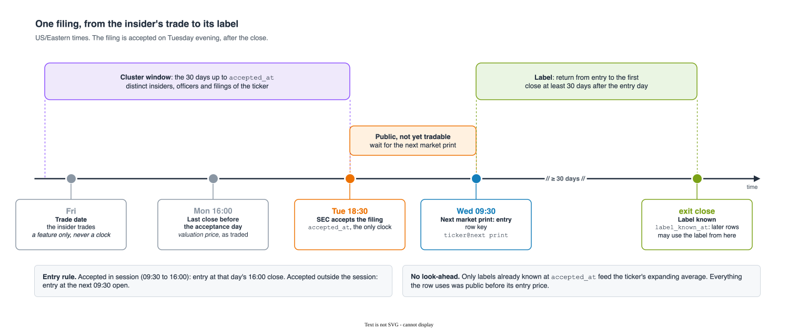
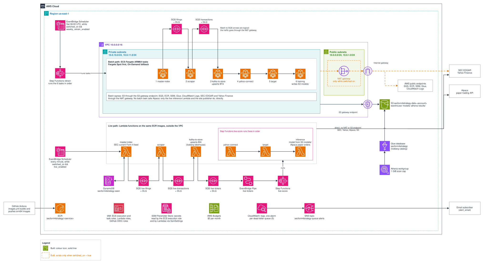
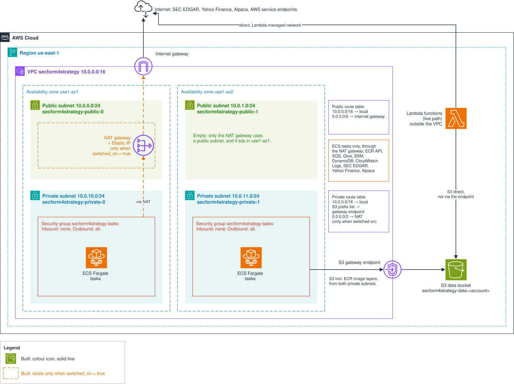
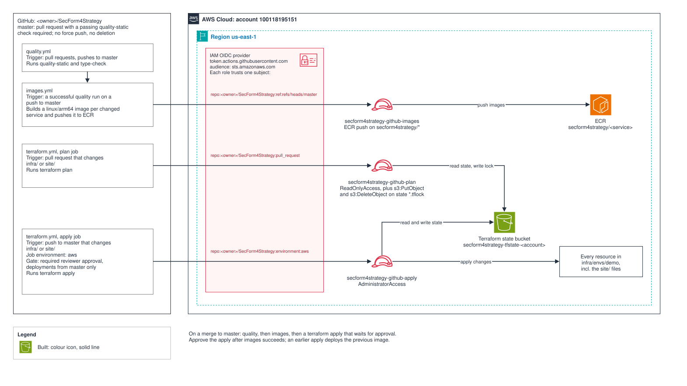
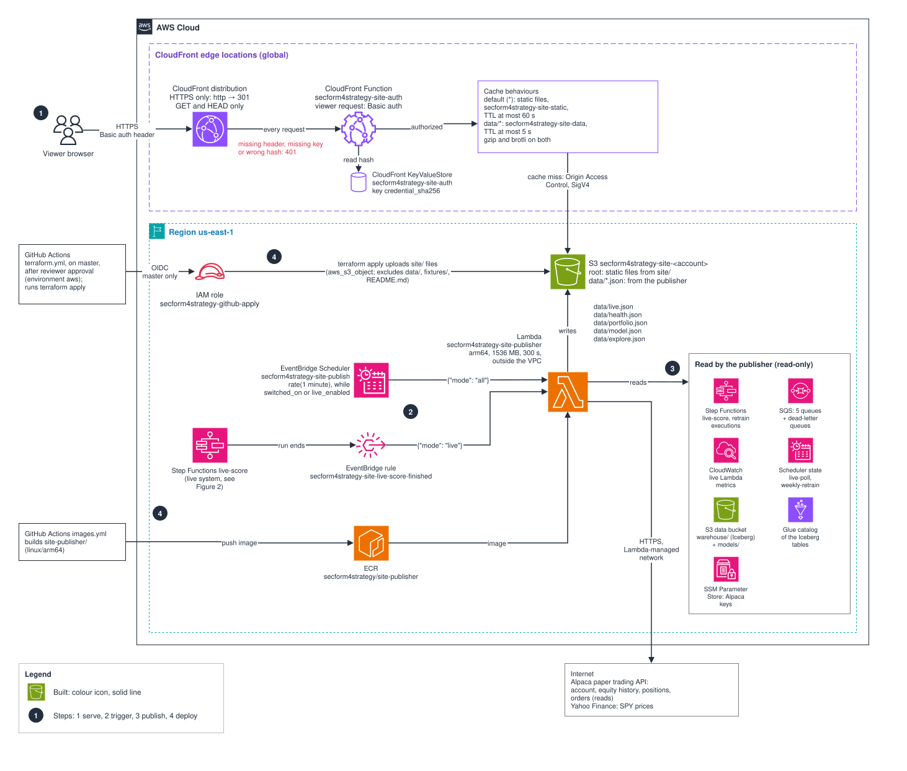
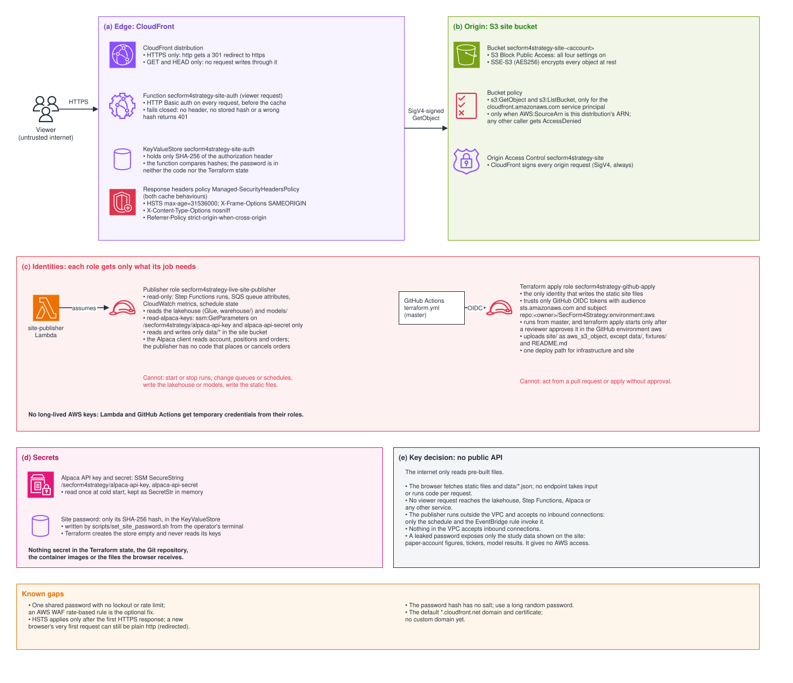

# SecForm4Strategy

**Cloud architecture for testing an insider-selling signal on AWS**

| | |
| --- | --- |
| Authors | Adrià Anglada, Teo Arqués, Joan Batlló, Josep Cubedo, Natan Viejo |
| Course | Cloud Solutions |
| Project | SecForm4Strategy |
| Date | 2026-11-23 |
| Repository | [https://github.com/josemita87/SecForm4Strategy](https://github.com/josemita87/SecForm4Strategy), branch `master` |

## 1. Executive summary

**The question.** Corporate insiders must report their trades to the US Securities and Exchange Commission (SEC) on a Form 4. The project tests one hypothesis: insider sales come before the stock underperforms, and the market has not priced that in when the filing becomes public.

**The thesis.** Each AWS service in this design answers a stated requirement. The live path runs for cents to a few dollars per month, and the batch path costs nothing while it is switched off.

**The system.** SecForm4Strategy reads every Form 4 from the SEC's EDGAR system, joins it to the stock prices after the filing became public, trains a gradient-boosted classifier to predict whether the stock falls by more than 5% over the next 30 days, and places short orders on a paper-trading account at the broker Alpaca. It runs on AWS in account `100118195151`, region `us-east-1`. Terraform defines every resource. GitHub Actions deploys it with an approval-gated, two-stage apply, and gets temporary AWS credentials through OpenID Connect (OIDC) federation, so no AWS key is stored.

The architecture has two paths on one feature store:

- A **batch path** (EventBridge Scheduler, Step Functions, ECS Fargate on ARM64) loads years of filings and retrains the model each week.
- A **live path** (EventBridge Scheduler, SQS, Lambda container images, an EventBridge Pipe and a second state machine) scores each new filing within minutes of publication.

Four constraints drive the main decisions:

- Speed from disclosure, and one feature implementation → a live path on Lambda that runs the batch path's images (D1, D3).
- Loads that run for days → Fargate tasks under Step Functions, on Spot with an On-Demand fallback (D2, D6).
- One feature store, at $0 while idle → Apache Iceberg tables on S3 with the Glue catalog (D10).
- A $10 monthly budget → a batch path dormant behind one Terraform switch, and a live path outside the VPC with no NAT gateway (D12, D19).

A password-protected static website on CloudFront shows the live runs, the paper portfolio and the model, with no public API. The $10 monthly budget covers the live path all month, plus several days with the batch path switched on at about $1.20 per day plus usage. Usage from 1 to 23 November 2026, which includes the 5-year backfill, cost $8.52 (Section 5.7).

**How to read this report.** Chapter 2 ends in ten requirements. Chapters 4 and 5 are the core: each architecture decision names the requirement that drives it, the alternative it was weighed against, and why it won. Appendix A lists every decision in one table.

**The outcome.** The presented model is the 5-year classifier `20261122T224917Z`. It predicts "short winners": rows whose stock falls by more than 5% over the 30 days after the entry. On the holdout from 2025-10-24, its average precision (AP) is 0.418, against 0.338 for a constant prediction, and it beats the constant prediction in all four validation folds. A per-ticker baseline reaches AP 0.404, so the ranking edge is small. At its score cutoff of 0.70, it takes 314 holdout shorts with a precision of 0.60 and a median short return of +9.9%, before borrow fees, slippage and commissions, while shorting SPY over the same windows returns −1.33% per trade. 314 overlapping trades in one holdout year are a small sample. The architecture ran every step on five years of data, and the live path ran end to end on real filings. The deliverable is cloud infrastructure that can test the insider-selling hypothesis rigorously, with a first signal worth testing further. It is not a proven trading strategy.

## Contents

1. [Executive summary](#1-executive-summary)
2. [The business problem and requirements](#2-the-business-problem-and-requirements)
3. [Data, model and engineering in brief](#3-data-model-and-engineering-in-brief)
4. [Architecture overview](#4-architecture-overview)
5. [Architecture decisions by area](#5-architecture-decisions-by-area)
6. [Results in brief](#6-results-in-brief)
7. [Limitations and future work](#7-limitations-and-future-work)
8. [Conclusion](#8-conclusion)

Appendices:

- [Appendix A: Decision log](#appendix-a-decision-log)
- [Appendix B: Resource inventory](#appendix-b-resource-inventory)
- [Appendix C: Configuration reference](#appendix-c-configuration-reference)
- [Appendix D: Glossary](#appendix-d-glossary)
- [Appendix E: Diagrams](#appendix-e-diagrams)
- [References](#references)

---

## 2. The business problem and requirements

### 2.1 The signal

A corporate insider is a director, an officer or an owner of more than 10% of a company. An insider who buys or sells the company's stock must file a Form 4 within two business days. The SEC publishes each Form 4 on EDGAR at the moment it accepts it, `accepted_at`.

Insiders know more about their company than the market does. The system pursues two edges. The first is selection: most insider sales are routine, such as taxes or diversification, but some come before the stock falls. A classifier trained on five years of dispositions (sales, gifts, tax withholdings and other trades that reduce the insider's holding) scores each new one and shorts only the top of the ranking. The second is speed: a trader can act only after `accepted_at`, and other traders read the same filings, so a system that reacts sooner can capture more of the move.

The timing of filings limits the speed edge. Of the 215,273 labelled disclosure rows in `RT4`, 32,434 (15.1%) were accepted in US market hours, Monday to Friday from 09:30 to 16:00 ET. The other 85% arrive outside market hours, and their next price print is the next open. Nobody can trade them before the open, so the race starts at the open for every trader, and a batch run before the open would reach the same entry price as the live path. The live path adds value in two ways. It makes in-session filings tradable at the same day's close, and it gives both paths one implementation (D3).

### 2.2 The client

The target client is an investor who lets the system trade part of their money on this signal. The client needs to see what the system did with the money, and needs confidence that a broken model or a leaked key cannot trade.

### 2.3 Constraints

| Constraint | Value |
| --- | --- |
| SEC fair access | At most 10 requests per second per client, with one honest `User-Agent`. A breach returns HTTP 403 and a lockout of about 10 minutes. |
| Budget | $10 per month. The live path runs continuously; the batch path is switched on for the weekly retrain and loads, and dormant otherwise. |
| Broker | Alpaca paper trading; its keys can place and cancel orders. |
| Repository | Public on GitHub, including its workflow artifacts |

### 2.4 Requirements

Section 4.2 and Chapter 5 trace each AWS decision back to these ten requirements.

| ID | Requirement | Source |
| --- | --- | --- |
| R1 | React to a new filing within minutes of `accepted_at`, at near-zero cost while no filing arrives. The inference service trades only rows whose latest filing is at most 60 minutes old (`MAX_SIGNAL_AGE_MINUTES`). | Business |
| R2 | Process years of history and run long jobs: a multi-day backfill and a weekly retrain. | Data, ML |
| R3 | Stay under the SEC limit of 10 requests per second, shared by every request with the project's `User-Agent`. | Constraint |
| R4 | Use no information that was not public at decision time, and compute features with one implementation for training and scoring. | ML |
| R5 | Support upserts, reprocessing and at-least-once delivery without duplicate rows or orders. | Data |
| R6 | Never let a bad or test model trade. Record what each model was trained on. | ML, business |
| R7 | Cost at most $10 per month in normal operation, with a batch path that switches on and off. | Constraint |
| R8 | Keep secrets and trading keys out of code, state and CI, in a public repository. | Security |
| R9 | Show a client what the system does with their money, without exposing the system. | Business |
| R10 | Operate and recover a multi-day backfill. | Operations |

---

## 3. Data, model and engineering in brief

This chapter keeps only what the cloud decisions depend on. The repository's `docs/` folder holds the details.

### 3.1 What flows through the system

Seven services do the work. Each is a separate Python 3.14 program with one job and its own container image. With the site publisher (Section 5.9), the project builds eight images. The same image runs as an ECS task on the batch path and as a Lambda function on the live path.

| Step | Service | Job | Writes |
| --- | --- | --- | --- |
| 1 | master-index | Lists Form 4 filings from EDGAR | One message per filing |
| 2 | scraper | Downloads and parses each filing | One message per transaction |
| 3 | kafka-to-store | Validates and upserts transactions | `BT4` (training) or `BI4` (live) |
| 4 | yahoo-connect | Downloads daily prices for the tickers | `P` |
| 5 | target | Builds one row per trading opportunity, with features and, for training, the label | `RT4` (labelled) or `BIR4` (to score) |
| 6 | training | Fits the model, compares it with baselines, saves it, and promotes it only through a gate | `models/` |
| 7 | inference | Scores rows and places short orders | Alpaca paper orders |

The five tables are Iceberg tables with deterministic keys. A transaction's key is a hash of its accession number, its table and its position, so a redelivered filing upserts the same row (R5).

The system is an extract-transform-load (ETL) pipeline. The scraper extracts filings from EDGAR, and kafka-to-store and target transform the rows and load them into the tables. The batch path ingests on a schedule, and the live path in near real time, driven by events. Iceberg stores the rows as columnar Parquet files with a fixed schema, and kafka-to-store casts each column and drops invalid rows before it writes (schema-on-write).

| Zone | Tables | Note |
| --- | --- | --- |
| Landing (raw) | None | The scraper parses the Form 4 XML in memory; EDGAR is the immutable raw archive |
| Formatted | `BT4`, `BI4`, `P` | Typed transactions and prices |
| Serving | `RT4`, `BIR4`, `models/` | Feature rows and models; Athena serves ad-hoc queries |

| Data property | Value | Cloud consequence |
| --- | --- | --- |
| Volume: history | 1,048,560 filings from 1 January 2021 (`YEARS=5`) to 20 November 2026, about 5.9 years, and 166,886 to 191,909 per full year; at 6 to 7.8 filings per second the scraper needs 37 to 49 hours, and about 6 to 9 hours for one full year | A load of days, beyond any 15-minute limit (R2) |
| Volume: warehouse size | About 870 MB after the 5-year load, including old snapshot files; `P` holds about 650 MB | Object storage, no database server (R7) |
| Velocity: live arrival | A few filings per minute in market hours, in bursts | Per-event compute that costs nothing between events (R1) |
| Variety | Semi-structured Form 4 XML, parsed into typed tables; daily prices | One parser in the scraper; fixed table schemas |
| Veracity | Bad split adjustments, reused tickers and sub-penny quotes produce impossible labels | Label guards in target (Section 3.2) |

### 3.2 Constraints from the model

*Figure 1 (Appendix E)*

| ML property | Value | Cloud consequence |
| --- | --- | --- |
| No look-ahead | Every row is timed by `accepted_at`. The label is the return from the next market print to the first close at least 30 days later. A label feeds later rows only after `label_known_at`. | Training and live scoring must compute features with the same code on the same tables: same images, one feature store (R4). |
| Model | A scikit-learn `Pipeline`: scaling, one-hot encoding and a `HistGradientBoostingClassifier` (**D11a**) | One `model.joblib` file. No GPU, no hosted endpoint: the model loads in a Lambda or a task (R7, **D24**). |
| Training | A walk-forward grid search: 32 parameter combinations, including `class_weight`, on 4 purged time folds, so 128 fits scored on AP, then one holdout score | Five years took about 16 minutes on a Fargate task overridden to 16 vCPU, more cores than a Lambda function offers (R2). |
| Score cutoff | Chosen on the validation folds only, by the median short return, and saved in the model metadata (`probability_cutoff`, 0.70). If no cutoff takes at least 100 shorts in every fold, training falls back to 0.5 (`fallback_cutoff`). | A promotion moves the model and its cutoff together (R6) |
| Trading rule | Short 1 share for each row whose score is at least the cutoff (the rule "P ≥ 0.70"), with the row key as `client_order_id` | Idempotent orders under at-least-once delivery (R5) |

**Label guards.** The target service leaves the label `pct_change` missing when the entry or exit adjusted price is not positive, or when the 30-day return is above +300% (`max_label_return: 3.0`) (**D11b**). The guards removed 61 rows with impossible labels, such as +24,335% (BSAI at $0.01). The +300% guard removes only the tail that would hurt a short, so it may bias short returns slightly upwards. The system sets no price floor. Penny stocks may carry more edge, because institutional investors largely avoid them, but they are hard to borrow (Section 7.2).

### 3.3 Engineering in brief

| Practice | What it is | Cloud consequence |
| --- | --- | --- |
| Ports and adapters | Services depend on Python `Protocol`s; `main.py` or `handler.py` builds the adapter | The local stack (Redpanda, SQLite, disk) and AWS (SQS, Glue, S3) run the same code; three settings select the backends |
| Error contract | An adapter retries transient errors, then raises `RetryableError` or `PermanentError` | SQS redelivery, Step Functions `Retry` and DLQs do the rest (Section 5.2) |
| Secrets as types | Credentials are `SecretStr`, unwrapped only at the SDK call | Secrets come from SSM at run time (Section 5.5) |
| Quality gate | ruff, pydoclint, bandit (a SAST tool for the Python code), config validation, unit tests without mocks, and Trivy scans of the dependencies, secrets and Terraform; mypy in a separate job | `quality-static` is a required check before any merge and image build (Section 5.6); mypy reports but does not block |

---

## 4. Architecture overview

### 4.1 The two paths

*Figure 2 (Appendix E)*

### 4.2 Requirements to AWS decisions

Each requirement from Section 2.4 maps to the AWS decisions that meet it.

| Requirement | AWS decision | Section |
| --- | --- | --- |
| R1 Speed from disclosure | Separate live path: Scheduler polls every minute, SQS, Lambda, EventBridge Pipe, `live-score`; cold starts accepted | 5.1, 5.2 |
| R2 Years of history, long jobs | Fargate ARM64 tasks under Step Functions `runTask.sync`; Fargate Spot with an On-Demand fallback; waits of 600 s; pinned revisions | 5.1, 5.2 |
| R3 SEC fair access | Rate budget split between batch and live; batch egress through the NAT gateway; live Lambdas outside the VPC | 5.1, 5.4 |
| R4 No look-ahead, one feature implementation | Same images on Fargate and Lambda; one Iceberg feature store | 5.1, 5.3 |
| R5 Upserts, reprocessing, at-least-once | Iceberg on S3 with the Glue catalog; deterministic keys; SQS standard queues with DLQs and partial batch failures; `client_order_id` | 5.2, 5.3 |
| R6 A bad model never trades | `save` vs `promote` in S3; `PROMOTE=never\|gated`; metadata as lineage | 5.3 |
| R7 $10 per month, on/off batch path | Serverless everywhere; `switched_on` for the batch path; NAT only while it is on; live path outside the VPC; S3 gateway endpoint; budget alarm | 5.4, 5.7 |
| R8 Secrets and trading keys | SSM SecureString outside Terraform state; least-privilege roles; GitHub OIDC; approval-gated, encrypted two-stage deploy | 5.5, 5.6 |
| R9 Show the client | CloudFront and a private S3 bucket with OAC; Basic auth at the edge; publisher Lambda writing static JSON; no public API | 5.9 |
| R10 Operate a multi-day backfill | Dashboard, DLQ alarms, `make status`; ECR retention vs pinned revisions; measure before scaling; one Iceberg writer | 5.2, 5.8 |

### 4.3 Terraform layout

Terraform state is in the bucket `secform4strategy-tfstate-<account>`, which `infra/bootstrap` creates, with S3 native locking. The provider's `allowed_account_ids` rejects any account other than `100118195151`.

- **Region.** `us-east-1` offers every service the design uses, usually at the lowest regional prices. It is also the region where CloudFront requires an ACM certificate, which a custom domain would need (Section 7.1).
- **Provider.** AWS was chosen over Azure and Google Cloud (D26). The course labs and the team's credits are on AWS. The design rests on AWS features that the backfill exercised, such as Fargate Spot with an On-Demand fallback under Step Functions; the other providers were not prototyped.
- **Terraform** was chosen over AWS CloudFormation and the CDK (D18). The course labs use Terraform, and its HCL works across providers. CloudFormation change sets would also show exactly what an apply runs.

The root module `infra/envs/demo` calls ten modules:

| Module | Resources |
| --- | --- |
| `storage` | Data bucket, Glue database, Athena workgroup and its seven saved queries, one ECR repository per service, the monthly budget |
| `network` | VPC, two public and two private subnets, internet gateway, S3 gateway endpoint, security group, and the NAT gateway while the batch path is switched on |
| `queues` | Five SQS queues, each with a dead-letter queue and a CloudWatch alarm, and an SNS topic |
| `iam` | The ECS execution role, one task role per service, one Lambda role per function |
| `ci` | The GitHub OIDC provider and the roles for images, plan and apply |
| `tasks` | The ECS cluster, one task definition and one log group per service |
| `retrain` | The `retrain` state machine and its weekly schedule |
| `live` | Six Lambda functions, the DynamoDB table `secform4strategy-seen`, the poller schedule, the `live-score` state machine and the EventBridge Pipe |
| `dashboard` | The CloudWatch dashboard |
| `site` | The site bucket, the CloudFront distribution and password function, and the publisher Lambda |

---

## 5. Architecture decisions by area

Each section starts from a pressure that the business, the model or the engineering puts on the system. It then gives the AWS choice, the alternative it beat, and its trade-off. Appendix A lists decisions D1 to D27, and Appendix C holds the configuration details.

### 5.1 Compute: batch and live

The system has two workloads with opposite shapes. No single compute service serves both within $10 per month (R7), so each path gets its own.

| | Live (R1) | Batch (R2) |
| --- | --- | --- |
| Shape | A few filings per minute in market hours, in bursts; most minutes bring none | The 5-year load ran for days; a 10,000-row Iceberg upsert takes about 25 seconds (Section 5.3); training runs 128 fits, in parallel across the task's vCPUs |
| Need | Score each filing within minutes of `accepted_at` | Run for hours with no time limit |
| Choice | Six Lambda functions, one per service step, triggered by a schedule, SQS and Step Functions (**D1**) | One ECS task per step on Fargate Spot with an On-Demand fallback, started and awaited by Step Functions (**D2**) |
| Rejected | A long-running container (an ECS service) that polls and scores | Lambda for everything, or EC2 instances |

Lambda bills per invocation, so an idle minute costs nothing, while an always-on Fargate service would bill around the clock. Lambda cannot run the batch steps: it stops a run after 15 minutes and offers at most 10 GB of memory. Fargate has no run-time limit, sizes each task separately, and bills only while the task runs. EC2 would add instances to patch and stop. With no EC2 instances, AWS patches the hosts, their operating systems and the managed services under the shared responsibility model. The project owns its code, its images, its IAM policies and its data. AWS Batch on Fargate would add compute environments, job queues and job definitions, while ECS task definitions under Step Functions already give the runs, retries and fallback. AWS Glue ETL jobs and Amazon EMR would need the code rewritten for their job runtimes, which breaks the one image that runs on both paths (D3), and about 870 MB of data needs no Spark cluster.

Each batch task runs on Fargate Spot first, and falls back to On-Demand Fargate (**D2**). AWS prices Spot capacity at up to 70% below On-Demand, and ARM64 tasks can use it. AWS can reclaim a Spot task after a two-minute warning. Every batch step is idempotent, so a reclaimed task loses only its in-flight batch: Iceberg commits are atomic, writes are upserts by key, and SQS delivers unacknowledged messages again. The alternative, On-Demand only, costs more for no gain in correctness.

Both paths run on ARM64 (Graviton) for R7 (**D4**). AWS prices Fargate and Lambda on Graviton about 20% below x86_64 for the same vCPU and memory, and the Python stack needs no x86-only binaries. SageMaker managed Spot training was the alternative for the training step. It would need the model code adapted to SageMaker's training container contract, while the training image already runs as a plain Fargate task under the same state machine as the other steps.

Two runtimes create a modelling risk. If training and live scoring built features with different code, the model would score rows unlike the rows it learned from (R4). Each Lambda therefore runs the service's own image through `awslambdaric`, the Lambda runtime interface client (**D3**). Each handler sits beside the service's `main.py` and calls the same functions as the batch loop. A separate live scorer that computes the features again was the alternative. One implementation leaves no skew between training and scoring. Its cost is image size: about 1 GB.

Image size sets up the main trade-off of the live path, R1 against R7 (**D5**). A first cold start of a 1 GB image exceeds Lambda's 10-second initialization limit. Lambda then repeats the initialization inside the invocation, which succeeds. Cold invocations measured 10 s (scraper), 45 s (kafka-to-store) and 39 s (yahoo-connect), and warm ones take a few seconds. Provisioned concurrency would remove cold starts for about $10 per month per function: about $60 per month for six, six times the budget.

A filing after a quiet period still reaches inference about 1 to 2 minutes after the poll, which keeps R1. Cold starts matter only for the 15.1% of filings accepted in market hours. The other 85% cannot trade before the next open, so a delay of a minute changes nothing for them (Section 2.1). Smaller images would cut the in-session delay at no running cost (Section 7.1).

Each task and function size comes from a measurement. Appendix C.1 lists every size with its evidence.

At the time of writing (2026-11-23), the account allows 10 concurrent Lambda executions in total, shared by the live functions and the site publisher. An increase to 1,000, the AWS default, has been requested through Service Quotas. The `maximum_concurrency` of 2 on each SQS trigger keeps the two queue consumers inside that quota. The same limit of 2 caps the live scrapers' share of the SEC rate (R3, Section 5.4). Section 7.1 describes the remaining risk.

### 5.2 Orchestration and messaging

Both paths chain several steps, and any step can fail halfway. The batch path must wait hours for a task and retry it with nobody watching (R2, R10). The live path must absorb bursts and survive redelivery without duplicate rows or orders (R1, R5).

#### The batch path

The state machine `secform4strategy-retrain` runs the six batch steps in order (**D6**). Each step uses `ecs:runTask.sync`, which starts a Fargate task and waits for it to stop. Each step in `spot_steps`, all six in the demo environment, gets 3 attempts on `FARGATE_SPOT`. If the last one fails, the state machine waits 600 seconds and runs the step On-Demand, with one retry. A `Catch` on `States.ALL` takes every error, because a RunTask failure, such as no Spot capacity at launch, arrives as `AmazonECS.Unknown`, not as `States.TaskFailed`. Appendix C.2 lists the states and retry settings.

Apache Airflow on Amazon Managed Workflows for Apache Airflow (MWAA) was the alternative, but MWAA runs an environment around the clock, far above $10 per month (R7). Step Functions bills per state transition, costs nothing idle, and gives waits and retries without a scheduler server.

Every wait is 600 seconds, longer than the 300-second SQS visibility timeout, on purpose. A rerun that started earlier would find the unfinished messages still hidden. It would find an empty queue, exit with code 0 and leave the work undone.

The fallback has a cost. A real code failure runs 5 times before the run fails, against 4 with On-Demand only, and its retries take about 40 minutes instead of 30. The services set no handler for the SIGTERM that ECS sends two minutes before AWS reclaims a Spot task, so Python exits at once and SQS delivers the in-flight batch again.

EventBridge Scheduler starts `retrain` every Saturday at 06:00 UTC (`cron(0 6 ? * SAT *)`). The master-index service then publishes only the filings of the last 7 days. A run's input can override environment variables per step, so the first full load is the same state machine with a different input:

```json
{"overrides": {"master-index": {"MODE": "historical", "YEARS": "5"}, "scraper": {"SEC_MAX_RATE": "8"}, "kafka-to-store": {"BUFFER_SIZE": "10000"}}}
```

The 5-year load, the run `backfill-5y` started on 2026-11-20, was this state machine with this input. Its scraper processed all 1,048,560 filings. After the failure below, the remaining steps ran on the latest revisions.

A run that lasts days meets a second problem: CI keeps deploying new images while it runs (R10). By default, Terraform deregisters a replaced revision. ECS cannot start a task from an `INACTIVE` revision, so a deploy during a backfill would break the run.

A run therefore names exact task-definition revisions, for example `secform4strategy-kafka-to-store:3` (**D7**). The task definitions set `skip_destroy = true`, so Terraform leaves the replaced revision active. A pinned revision still needs its image in ECR. In `backfill-5y`, the scraper finished every filing but exited non-zero (Section 7.1). By then the ECR lifecycle rule, which kept 2 images per repository, had deleted the image of the pinned revision `scraper:3`, so every retry failed with `CannotPullContainerError`. Each repository now keeps 5 images, so a run survives four new images of a service whose step has not started. No work was lost: every step upserts by key, and the queue `secform4strategy-transactions` keeps messages for 4 days.

#### The live chain

The SEC feed does not push, and a minute is the finest rate EventBridge Scheduler offers. The live chain therefore starts with a poll every minute and passes each filing down a line of queues (**D8**, Figure 2). The master-index Lambda reads the first page of the SEC's current Form 4 feed and sends the filings that the DynamoDB table `secform4strategy-seen` does not hold to `live-filings`. The scraper Lambda sends their transactions to `live-transactions`. The kafka-to-store Lambda upserts them into `BI4` and sends their tickers to `live-tickers`. The EventBridge Pipe `secform4strategy-live-tickers` starts one run of `live-score` per batch of up to 10 messages. `live-score` runs yahoo-connect, target and inference in order, and retries each step twice.

The alternative was one Lambda that polls, scrapes, stores and scores in a single invocation. The chain handles failure and load better. Each queue absorbs a burst and retries only its own failed messages. The two queue consumers scale separately. The Pipe starts the scoring sequence without glue code, and Step Functions shows each run's steps, which the website reads.

The `live-score` state machine is a Standard workflow. Express workflows cost less per short run, but they keep no execution history, which the site publisher reads to show each live run. DynamoDB on demand holds the seen keys, in place of an ElastiCache server. It bills per request and costs nothing idle. Each item expires after 7 days (`SEEN_DAYS`), so the table stays small.

#### Queues and failures

Five SQS standard queues, each with a dead-letter queue (DLQ), connect the stages of both paths (**D9**). SQS FIFO queues would give exactly-once processing. Amazon MSK would match the managed Kafka of the local stack. Neither earns its cost. Every write is an upsert by key and every order carries `client_order_id`, so duplicates are harmless and FIFO ordering buys nothing. Standard queues cost less per request. MSK bills brokers around the clock. Amazon Kinesis Data Streams also bills while idle: about \$10 per month for one provisioned shard (\$0.015 per shard-hour). SQS retries each message separately and has DLQs, which fit a few filings per minute.

The SQS triggers report partial batch failures. A handler returns the messages it did not finish in `batchItemFailures`, and SQS delivers only those again. The error contract of Section 3.3 maps onto these settings, and Appendix C.2 lists the queue names, retention and encryption:

| Outcome | ECS consumer | Lambda handler | SQS result |
| --- | --- | --- | --- |
| Done | `ack` deletes the message | Not in `batchItemFailures` | Deleted |
| `RetryableError` | No ack | In `batchItemFailures` | Delivered again after 300 seconds |
| `PermanentError` | Logs it, then acks | Logs it, leaves it out | Deleted |
| Crash | No ack | The whole batch fails | Delivered again; after 5 receives, moved to the DLQ |

Retries therefore happen at two time scales: seconds in the adapter and minutes on the platform. A DLQ does not retry. A message waits there for 14 days, with an alarm, for a manual redrive. Two failures bypass the DLQs: a `PermanentError` is logged and deleted, and a failed `live-score` run has no DLQ (Section 7.1).

### 5.3 Storage: lakehouse and models

Both paths need one store for the features (R4). The store must accept upserts by key and reprocessing (R5), and cost nothing while the stack sleeps (R7). A database server fails the last test. RDS bills every hour it runs, so even its smallest instance, running all month, would use most or all of the budget.

The store is a set of Apache Iceberg tables in `s3://secform4strategy-data-<account>/warehouse/` (**D10**). The AWS Glue Data Catalog records where each table's current metadata file is. Athena queries the tables with SQL.

Iceberg supports upserts and schema changes on plain S3 objects, so it costs only storage while idle. Batch tasks and live Lambdas read and write the same tables through the same catalog. It beat both RDS and a hosted feature store.

Two other stores were weighed. Amazon S3 Tables manages Iceberg tables with automatic compaction, and is the natural fix for the missing table maintenance (Section 7.1); the project uses a general-purpose bucket with the Glue catalog, which pyiceberg supports directly. Aurora Serverless v2 can pause when idle, but it runs inside the VPC, so the live Lambdas would need VPC access or the Data API, and training reads whole tables, which columnar files on S3 serve directly.

The data bucket holds the tables, the models and the Athena results under three prefixes (Appendix C.3). It blocks all public access, encrypts objects with SSE-S3, and has no versioning and no backup. The Athena workgroup `secform4strategy` cancels any query that scans more than 1 GiB, so a careless query cannot break the budget. It holds seven saved queries that Terraform defines (Appendix C.3). A provisioned Amazon Redshift cluster bills every hour it runs, and QuickSight bills per user. Both are oversized for under 1 GB of data and one client, so Athena and the static site (Section 5.9) serve queries and charts.

The missing versioning is a trade-off between cost and recovery time. A backfill rebuilds the lakehouse from the SEC and Yahoo Finance, which takes days. The models are small and could be versioned for almost nothing. Today a deleted model cannot be restored: a retrain produces a new model, not the same one.

Iceberg has one limit that shapes operations. The pyiceberg library uses optimistic concurrency. When two writers commit to one table, the second commit fails and redoes its upsert against the new snapshot. Parallel writers to one table therefore do not speed up a load, so a batch load runs one kafka-to-store task (**D25**). More CPU helps that one writer only up to one full core, because the pandas cleaning and pyiceberg's upsert merge run on one core (Section 5.1).

The model is the one artefact that loses money when it is wrong. A run on truncated data, a changed feature contract or a test run must never trade (R6).

Training therefore always **saves** a model to its own folder (`model.joblib` and `model.meta.json`), and only **promote** writes `latest.json` (**D11**). The inference service loads only what `latest.json` names. `PROMOTE=never` saves only: it is the local default, and the override for test and manual runs. `PROMOTE=gated`, set in the weekly `retrain` task definition, promotes when every gate check passes. The gate requires at least 50,000 development rows and at least 80% of the current model's, the same feature-group version and features, holdout rows with a finite holdout AP, and at least one holdout short at the score cutoff. It does not compare AP with the current model, because each model holds out a different period.

The alternatives were to let each training run replace the live model, or to run a model registry service. Two S3 writes give versioning, promotion and rollback without another service.

The metadata is the model's lineage: the training time, git SHA, scikit-learn version, feature order, parameters, row counts, holdout and per-fold scores, label threshold and score cutoff (`probability_cutoff`). The inference service refuses a model saved under another scikit-learn version, or one without a score cutoff, before it places any order.

The script `scripts/promote_model.sh` lists the saved models and promotes one by hand, which is also the rollback. The inference service loads the model at each invocation, so a promotion takes effect at once.

### 5.4 Network

*Figure 3 (Appendix E)*

Three constraints meet in the network. The SEC limit applies to every request the project sends (R3). The NAT gateway is the largest fixed cost (R7). Nothing in the network may accept connections from the internet (R8).

The VPC `secform4strategy` (`10.0.0.0/16`) has two public subnets, which hold only the NAT gateway, and two private subnets for the tasks. Appendix C.4 lists the address ranges, routes and security group.

The two private subnets, in two availability zones (AZs), spread Fargate capacity, and both route through one NAT gateway (**D27**). One NAT gateway saves the hourly cost of a second one. The trade-off is an AZ dependency: if the NAT gateway's AZ fails, batch tasks lose internet egress, and tasks in the other AZ pay cross-AZ data charges to reach it (Section 5.8).

#### Who sits in the VPC

The VPC holds only the ECS tasks, because Fargate requires a subnet and a security group for every task (**D12**). The alternative was to put every compute resource in the VPC. The live Lambdas reach only the SEC, Yahoo Finance, Alpaca and AWS APIs, and the site publisher reads only regional AWS services and internet APIs. Step Functions, SQS, DynamoDB, S3, EventBridge and CloudFront are regional or global services, reached through endpoints and controlled by IAM. Nothing the Lambdas touch is inside the VPC, so a place in the VPC would protect nothing. It would make the live path depend on the NAT gateway, at about $32 per month when always on.

Nothing in the private subnets has a public IP, and the security group accepts no inbound connections. The Lambdas accept no inbound connections either. Only their triggers invoke them, through the Lambda API and IAM.

#### The SEC rate budget

Every SEC request carries one `User-Agent`, read from the secret `/secform4strategy/sec-user-agent`. Batch and live send the same `User-Agent`, so the limit of 10 requests per second applies to their sum.

The system splits that limit into an explicit rate budget (**D13**). `EdgarClient` spaces request starts at least `1 / SEC_MAX_RATE` seconds apart across its threads.

| Path | Cap | Egress |
| --- | --- | --- |
| Batch scraper | `SEC_MAX_RATE=5` | NAT gateway Elastic IP (fixed) |
| Live scrapers | 2 at a time × `SEC_MAX_RATE=2.25` = 4.5 | Addresses that Lambda assigns |
| Live poller | One feed request per minute (about 0.02 per second) | Addresses that Lambda assigns |
| Full load | Batch raised to 8, with `live_enabled = false` | NAT gateway Elastic IP |

The batch scraper, the live scrapers and the poller together stay at about 9.5 requests per second, under the SEC's 10.

The alternative was to route the live Lambdas through the NAT gateway too, so all traffic leaves from one fixed address. That address would serve R3 only cosmetically, because the SEC already sees one `User-Agent`. It would cost R7, because the live path would need the NAT gateway always on.

The trade-off is throughput. The fixed split reserves 4.5 requests per second for the live scrapers even in minutes when no filing arrives, so the batch scraper runs at half the limit, which the weekly run fits easily. Nothing enforces the sum across the paths: each client limits only itself. A shared limiter, such as a token bucket in DynamoDB, would enforce the sum and lend idle live capacity to the batch path, at the cost of one more call per request and more code.

On an HTTP 403 (Section 2.3), the adapter raises `RetryableError` at once, because requests during the lockout extend it, and the platform retries minutes later.

#### Egress without interface endpoints

A free S3 gateway endpoint on the private route table carries the Iceberg data, the models and the ECR image layers (**D14**). The batch tasks reach SQS, the ECR API, SSM, Glue, CloudWatch Logs, SEC EDGAR and Yahoo Finance through the NAT gateway, which exists only while the batch path is switched on. No batch task calls Alpaca.

The alternative was interface endpoints with no NAT gateway. The tasks would need at least six: the ECR API, ECR Docker, CloudWatch Logs, SQS, SSM and Glue.

| Option | Cost | Reaches the internet |
| --- | --- | --- |
| S3 gateway endpoint plus a switched NAT gateway (chosen) | Endpoint free; NAT gateway about $1.08 per day plus its Elastic IP at about $0.12 per day, only while the batch path is switched on | Yes |
| Six or more interface endpoints in two availability zones | About $88 per month or more (about $0.01 per hour per endpoint per zone) | No |

The tasks need the internet for SEC EDGAR and Yahoo Finance anyway, which settles it. S3 traffic through the gateway endpoint adds no NAT data charges. While the batch path is dormant, the private subnets reach only S3. No task can run then, because it cannot pull its image or read its secrets.

### 5.5 Identity, secrets and security

The repository and its workflow artifacts are public, and the Alpaca keys can place and cancel orders. The security design therefore assumes that anyone can read the code, and limits what a compromised service could do (R8). Only one service may trade (R6).

The `iam` module creates one role per ECS task (`secform4strategy-<service>`) and one per Lambda (`secform4strategy-live-<service>`) (**D15**). `task_access` and `lambda_access` in `infra/envs/demo/main.tf` list, per service, the queues it sends to, the queues it receives from, and named capabilities. The module turns each entry into one inline policy. Appendix C.5 lists the actions that each capability grants. One shared role for all services would give the scraper the Alpaca keys and give training the right to place orders.

For example, the scraper task can only receive from `filings` and send to `transactions`. It cannot touch the lakehouse. The training service can read the lakehouse and write models, but it cannot read secrets or place orders. Among the task and Lambda roles, only inference and the site publisher can read the Alpaca keys (`read-alpaca-keys`); `read-secrets` covers only the SEC `User-Agent`. The state machines, the schedules and the Pipe have their own roles, each limited to its targets.

Terraform state stores every value it manages in plain text, so secrets stay out of Terraform (**D16**). They are `SecureString` parameters in SSM Parameter Store (Appendix B), which the operator creates with the AWS CLI.

In ECS, the execution role reads them and injects them as environment variables, so the task roles hold no SSM permission. The injection is per task definition: only the inference task definition names the Alpaca keys. The shared execution role can read every parameter under `/secform4strategy/*`, so on ECS that part of the isolation rests on the task definitions, not on IAM. Lambda cannot inject SSM parameters. Each live function reads its own at cold start: `SSM_PARAMETERS` names them, and `SsmSettings` reads them in one call.

Two alternatives lost. If Terraform read the parameters into environment variables, the values would enter the state. AWS Secrets Manager costs $0.40 per secret per month and adds rotation the project does not use. SSM standard parameters are free. No container holds a static AWS key: ECS and Lambda give the code temporary credentials for its role, and boto3 finds them in its default credential chain.

### 5.6 CI/CD and deployment

*Figure 4 (Appendix E)*

The repository is public, and its pipeline can change the AWS account. The pipeline must deploy without a stored key, and a reviewer must see exactly what changes (R8). It must also deploy safely during a multi-day run (R10).

The code is on GitHub, so GitHub Actions runs the pipeline next to the pull requests, with free minutes for a public repository. AWS CodePipeline was the alternative. It would add a connection to GitHub and a billed AWS service for the same steps.

Three workflows make up the pipeline (Appendix C.6): `quality.yml` checks every pull request and master push, `images.yml` builds and pushes the `linux/arm64` images, and `terraform.yml` plans and applies changes to `infra/` and `site/`.

Terraform manages every AWS resource, including the ECR repositories and the CI roles. CI manages only the images and the runs of plan and apply. Each service has an ECR repository `secform4strategy/<service>`. Tags are immutable, ECR scans each image on push, and each repository keeps its 5 newest images (Section 5.2 explains why 5).

#### Code structure and the pipeline

The repository layout decides what CI tests and builds. Each image comes from its own `uv` project, with a lockfile and a Dockerfile, and every service depends on one shared package of clients:

| Directory | Contents | CI output |
| --- | --- | --- |
| `sec-feature-pipeline/` | master-index, scraper and kafka-to-store, one `uv` project each | 3 images |
| `prices-feature-pipeline/` | yahoo_connect and target, one `uv` project each | 2 images |
| `training/`, `inference/`, `site-publisher/` | One `uv` project each | 3 images |
| `packages/secform4strategy-clients/` | `ports.py`: the ports, as Python `Protocol` classes; one adapter module per outside system (SQS, Kafka, the Iceberg feature store, the S3 model store, DynamoDB, SSM, Step Functions, CloudWatch, EventBridge Scheduler, EDGAR, Alpaca, Yahoo Finance); `fakes/`: typed in-memory adapters for the tests | In every image |
| `infra/` | Terraform: `bootstrap`, the root module `envs/demo` and its ten modules | Plan and apply |
| `site/` | The static study website | Site files |

Each SDK is an optional extra of the shared package, so a service installs only the adapters it uses. Each `main.py` or `handler.py` builds its adapters, so the same service code runs on the local stack and on AWS (Section 3.3). Three pipeline rules follow from this layout:

- `quality.yml` runs each project's unit tests in its own environment. The tests use the in-memory adapters in `fakes/`, so CI needs no AWS access and no mocks.
- `quality.yml` also runs Trivy (`make security-scan`): `trivy fs` checks the lockfiles for vulnerable dependencies and the repository for secrets, and `trivy config infra/` checks the Terraform. Each fails the required check on a HIGH or CRITICAL finding. Accepted findings are listed in `.trivyignore`, each with its reason, such as SSE-S3 instead of a paid KMS key.
- `images.yml` builds a matrix of eight images from the repository root, so each image contains the shared package. An image's tag is the last commit that changed its service or the shared package, so a change to one service rebuilds and redeploys one image, and a change to the shared package rebuilds all eight. Each new image is scanned with `trivy image` before the push, and a service with a fixable HIGH or CRITICAL vulnerability is not pushed, so Terraform keeps deploying its previous image.

The workflows hold no AWS key (**D17**). A workflow requests a token from `token.actions.githubusercontent.com`, and AWS STS exchanges it for temporary credentials of one role. Each role trusts the audience `sts.amazonaws.com` and exact `sub` claims.

The alternative was an IAM user with access keys stored as GitHub secrets. A stored key lives until someone rotates it, and anyone who reads it can use it. OIDC credentials are temporary and bound to one repository and one trigger.

Each of the three roles does one job (Appendix C.6). The images role can only push and pull images in ECR, and the plan role is read-only, apart from the state lock file. The apply role has `AdministratorAccess`, and only a job in the GitHub environment `aws` can assume it. That environment admits only master and requires a reviewer's approval, so a pull request cannot change any resource.

Two GitHub rulesets protect master. One requires a pull request whose `quality-static` check passes; the repository admin role bypasses it for the switch commits of Section 5.7, whose apply still requires a reviewer's approval. The other blocks force pushes and deletion, and nobody bypasses it.

Approval raises a second question: what exactly does the reviewer approve? A merge to master that changes `infra/` or `site/` runs two jobs (**D18**):

1. `plan` runs `terraform plan -out=tfplan` on the merged commit with the read-only plan role and shows the plan on the run's summary page. It uploads only the encrypted plan (Appendix C.6), kept for one day.
2. `apply` waits for a reviewer's approval in the environment `aws`, decrypts the plan and runs `terraform apply tfplan`.

A plan with no changes skips `apply`. If the state changed after the plan, Terraform refuses the saved plan and the run fails.

The alternative was `terraform apply -auto-approve` after a fresh plan, with an unencrypted plan artifact. A fresh plan after approval can differ from the plan the reviewer read. The saved plan holds sensitive values in plain text, and anyone signed in to GitHub can download the artifacts of a public repository.

The pipeline follows GitOps. The declarative Terraform code in Git is the single source of truth, and CI checks every change before apply. The approval gate makes it Continuous Delivery: Continuous Deployment would apply without a reviewer. Resources change only through this pipeline, never in the console, so they do not drift from the code. The SSM secrets and the site password are the deliberate exceptions: they are set outside Terraform so their values never enter the state (D16, D23).

One gap remains. Terraform reads the newest image of each repository when it plans, so a plan made before `images.yml` finishes deploys the previous images. A merge that changes only service code therefore needs a manual run of `terraform.yml` (`workflow_dispatch`) after `images.yml`. Section 7.1 lists the fix.

### 5.7 Cost and switches

The budget is $10 per month (R7). A stack with a NAT gateway, Fargate, Lambda and a CDN fits inside it only if almost nothing bills while idle.

| State | Cost | What is billed |
| --- | --- | --- |
| Dormant (all switches off) | About $0 per day | S3 and ECR storage. The VPC, subnets, gateway endpoint, IAM, Glue, idle queues, idle Lambdas, the on-demand DynamoDB table and the state machines cost nothing. |
| Live only (`live_enabled = true`, `switched_on = false`) | Cents to a few dollars per month | No NAT gateway and no Elastic IP. Lambda invocations, Step Functions transitions, SQS and DynamoDB requests, and the site publisher at about $1 per month. |
| Batch path switched on (`switched_on = true`) | About $1.20 per day, plus usage | The NAT gateway (about $1.08 per day) and its Elastic IP (about $0.12 per day). Usage: Fargate, NAT data processing and Athena scans, on top of the live path's usage when it runs. |

The batch path is dormant by default, and only it needs the NAT gateway (**D19**). The alternative, an always-on stack, fails on the NAT gateway alone: about $32 per month, more than three times the budget.

Every other component is serverless and bills nothing idle, so one switch on the NAT gateway covers almost all fixed cost. `infra/envs/demo/switch.auto.tfvars` holds three switches:

| Switch | Default | On master | While `true` |
| --- | --- | --- | --- |
| `switched_on` | `false` | `false` | The batch path is switched on: the NAT gateway exists, and the weekly `retrain` schedule may run |
| `weekly_retrain_enabled` | `true` | `true` | The Saturday `retrain` schedule (`PROMOTE=gated`) is enabled, but only while `switched_on` is `true` |
| `live_enabled` | `false` | `true` | The live poller schedule is enabled, independently of `switched_on` |

The site publisher's schedule runs while `switched_on` or `live_enabled` is `true`.

For the presentation, the live path runs and the batch path is dormant, with no NAT gateway. `make switch-on` and `make switch-off` set `switched_on` in that file, commit the change and push it straight to master through the admin bypass (Section 5.6). The change takes effect only after a reviewer approves the Terraform apply.

During a full load, `live_enabled` must be off, because the batch scraper at 8 requests per second plus the live path's 4.5 would exceed the SEC's 10. The `weekly_retrain_enabled` switch is also off then, because the weekly run would use the same batch queues.

**November 2026.** The first month cost more than average, because the batch path was switched on continuously from 2026-11-20 for the 5-year backfill and the training runs. Cost Explorer reports $8.52 of usage from 1 to 23 November, within the $10 budget: $4.70 for NAT gateway hours and data (EC2 – Other), $2.53 for ECS Fargate, $0.44 for S3, $0.39 for VPC, $0.23 for SQS, and smaller items. Account credits covered it, so the billed amount was $0.

Three guardrails catch mistakes. The budget `secform4strategy-monthly` is $10 per month, and it emails `alert_email` when actual cost passes 50% and when forecast cost passes 100%. A budget only alerts; it does not cap spend. The Athena workgroup cancels any query above 1 GiB. Log groups keep 14 days.

### 5.8 Observability and operations

A small team with no operations staff runs a multi-day load and a live path (R10). The operator must learn of a lost message without watching a screen, and see the whole stack at a glance.

Every message that exhausts its SQS retries ends in a DLQ, so one alarm per DLQ covers those messages (R5) (**D20**). Two failures bypass the DLQs, and no alarm covers failed state-machine runs (Section 7.1). Each alarm, `secform4strategy-<queue>-dead-letters`, goes into alarm when its DLQ holds at least one message, checked every 5 minutes. It publishes to the SNS topic `secform4strategy-queue-alerts`, which emails `alert_email`.

The CloudWatch dashboard `secform4strategy` shows the queues, DLQs, state machine runs, live Lambdas and `ERROR` log lines on one screen, free up to 50 metrics. Container Insights shows each task's CPU and memory use. In a terminal, the read-only command `make status` prints the stack state in about 15 seconds (Appendix C.7).

The alternatives were a third-party monitoring service or X-Ray tracing. CloudWatch is already where the logs and metrics are, and the dashboard and alarms stay inside the free tier. Step Functions execution history traces each `live-score` run step by step, and the site shows it. X-Ray would add per-message segments across the SQS hops, of little value at a few filings per minute. CloudTrail event history, on by default, records the account's API calls. Terraform `default_tags` tag every resource with `Project`, `Environment` and `ManagedBy`.

#### Availability and recovery

Under the shared responsibility model, AWS keeps each regional service available across AZs, and the project chooses which redundancy to pay for. The live path has high availability within the region (**D27**); the batch path and the data accept longer recovery for R7. The recovery time objective (RTO) is the time to recover, and the recovery point objective (RPO) is the data that can be lost.

| Failure | Effect | Recovery |
| --- | --- | --- |
| One AZ fails | The live path is unaffected: Lambda, SQS, DynamoDB, Step Functions and S3 are regional services that span several AZs. Batch tasks lose egress if the AZ of the single NAT gateway fails (Section 5.4). | None for the live path. A second NAT gateway, about $32 per month, would remove the batch dependency. |
| A message cannot be processed | After 5 receives it moves to its DLQ, which keeps it 14 days, and an alarm emails the operator | Manual redrive; RPO zero within the 14 days |
| A lakehouse table is lost | No versioning or backup (Section 5.3) | Rebuild from EDGAR and Yahoo Finance, the systems of record: RTO about 2 days, with a 37 to 49 h scrape |
| The promoted model is deleted | Inference cannot load a model and places no orders | `scripts/promote_model.sh` promotes an earlier saved model in minutes, or a retrain saves a new one in about 16 minutes |
| The region fails | Not designed for: the whole stack stops | Terraform can recreate the stack in another region (untested); the data is rebuilt as above |

### 5.9 The study website

The client must see what the system does with their money (R9). The same system holds the lakehouse and keys that can trade (R8), and the budget leaves nothing for a server (R7).

The site is a password-protected study website with five pages: Story, Live, Portfolio, Model and Explore (Appendix C.8). It is deployed behind the password.

#### A publisher in place of an API

The site has no API (**D21**). The Lambda `secform4strategy-site-publisher` reads the lakehouse, the models, Step Functions, SQS, CloudWatch and Alpaca, and writes five JSON files under `data/` in the bucket `secform4strategy-site-<account>`. The browser fetches only static files and `/data/<name>.json` through CloudFront. Appendix C.8 lists when the publisher writes each file and what it holds.

The alternative was a dynamic site with an API (API Gateway and a Lambda) that queries the system per request. An API accepts requests from the internet and runs code for each one, and each request could read the lakehouse or call Alpaca.

Static files expose only what the publisher already wrote: no keys, no credentials and no write access. If the password leaks, the reader sees paper-account figures, tickers and model results, and gets no access to AWS. A static site also costs almost nothing while nobody visits it.

Two triggers invoke the publisher asynchronously: a schedule every minute while `switched_on` or `live_enabled` is `true`, and an EventBridge rule when a `live-score` run ends. Lambda drops an event older than 60 seconds and retries no failed invocation, so a slow publish does not queue more behind it. The next minute's publish replaces a missed one.

The publisher role can read the system's state and the two Alpaca key parameters, and write only `data/*` in the site bucket. It cannot start or stop runs, change queues or schedules, write tables or models, or write the static files.

One weakness remains. The publisher uses the same Alpaca key pair as inference, which can place and cancel orders. The publisher calls only read endpoints, so that isolation relies on code, not on permissions.

*Figure 5 (Appendix E)*

#### The edge

The site bucket blocks all public access (**D22**). The CloudFront distribution reads it through an origin access control (OAC), and the bucket policy admits only this distribution.

S3 static website hosting with a public bucket was the alternative. It serves only HTTP and needs a public bucket (R8). CloudFront adds HTTPS, edge caching and a place to check the password. The site costs a few cents per month for S3 and stays inside the CloudFront free tier (R7). Appendix C.9 lists the cache times and security headers.

The site is for the client and the course, and the public stays out (R9, R8). The CloudFront Function `secform4strategy-site-auth` runs on every request, before CloudFront reads its cache (**D23**). It compares the SHA-256 hash of the browser's `authorization` header with a hash in a CloudFront KeyValueStore, and returns 401 with a Basic auth challenge on a mismatch. Terraform creates the store empty and never reads or writes its keys, and `scripts/set_site_password.sh` writes only the hash. Until the key is set, the site refuses every request.

Amazon Cognito, or a password in Terraform, were the alternatives. Basic auth at the edge needs no server and no user pool for one shared password. The hash stays out of the code and the Terraform state, and the plan role is denied `GetKey` and `ListKeys` on the store.

*Figure 6 (Appendix E)*

---

## 6. Results in brief

Every step of the system ran on five years of data. The presented classifier shows a modest but consistent ranking signal before costs. It does not prove a tradable strategy.

### 6.1 The 5-year classifier

The results come from the `training` task on AWS on 2026-11-22, which saved model `20261122T224917Z`. The task read 215,273 labelled rows. After purging, 169,941 development rows remained, and the holdout has 43,055 rows from 2025-10-24 18:24 UTC. The best parameters are `class_weight=balanced`, `learning_rate=0.03`, `max_leaf_nodes=15`, `min_samples_leaf=50` and `l2_regularization=0.0`.

The base rate is the share of short winners. It is also the AP of a constant predictor, so a model with a ranking signal scores above it. Each fold validates on 33,988 or 33,989 rows.

The model's outputs are scores, not calibrated probabilities. Only 34% of rows are short winners, and `class_weight=balanced` gives each winner more weight in training, so the scores run high: 97% of the holdout rows score at or above 0.30. A score of 0.70 does not mean a 70% chance of a drop. It is a rank threshold chosen on the folds, and its measured holdout precision is 0.60. The rule keeps its name, "P ≥ 0.70", but P is a score.

| Fold | Training rows | Validation period | Model AP | Base rate |
| ---: | ---: | --- | ---: | ---: |
| 1 | 30,456 | 2021-11-22 to 2022-12-21 | 0.4757 | 0.4105 |
| 2 | 64,648 | 2022-12-21 to 2023-12-19 | 0.3748 | 0.3074 |
| 3 | 97,859 | 2023-12-19 to 2024-11-14 | 0.3635 | 0.2538 |
| 4 | 132,963 | 2024-11-14 to 2025-09-23 | 0.4084 | 0.3582 |

The cutoff comes from the folds only. The median short return over all folds' shorts rises with the cutoff: +1.13% at 0.50, +2.48% at 0.60, +3.75% at 0.65 and +5.53% at 0.70. At 0.70 the folds take 3,343 shorts, and the smallest fold takes 295. At 0.75 and 0.80 some fold takes fewer than 100 shorts, so neither qualifies. The chosen cutoff is therefore 0.70.

On the holdout, each predictor shorts the rows whose score is at least 0.70. The return is the captured short return (minus the stock's return, so positive is a profit), before borrow fees, slippage and commissions.

| Predictor | AP | ROC-AUC | Precision | Shorts | Mean | Median | 5% trimmed mean |
| --- | ---: | ---: | ---: | ---: | ---: | ---: | ---: |
| `model` | 0.4184 | 0.5892 | 0.5987 | 314 | +9.58% | +9.89% | +11.45% |
| `ticker_history` | 0.4042 | 0.5730 | 0.5190 | 1,025 | +5.82% | +5.91% | +7.06% |
| `base_rate` | 0.3383 | 0.5000 | – | 0 | – | – | – |
| Short SPY, same 314 windows | – | – | – | 314 | −1.33% | – | – |

| Cutoff | Holdout shorts | Mean | Median |
| --- | ---: | ---: | ---: |
| 0.30 | 41,650 | −0.39% | +0.27% |
| 0.50 | 21,350 | −0.13% | +0.94% |
| 0.60 | 5,653 | +1.58% | +2.93% |
| 0.65 | 1,647 | +5.66% | +6.99% |
| 0.70 (chosen) | 314 | +9.58% | +9.89% |
| 0.75 | 52 | +20.51% | +16.36% |
| 0.80 | 1 | +49.75% | +49.75% |

- **A modest, consistent ranking signal.** The model's AP is above the base rate in all four folds and on the holdout (0.418 against 0.338). Its ROC-AUC is 0.589.
- **The median short return rises with the cutoff,** on the folds and on the holdout. At 0.70 the mean (+9.6%) and the median (+9.9%) agree, so outliers do not drive the result.
- **Not the market's direction.** Shorting SPY over the same 314 windows returns −1.33% per trade, because the market rose over the holdout. The model's shorts beat a short-SPY position by about 10.9 percentage points per trade.
- **A small edge over `ticker_history` in ranking.** The `ticker_history` baseline is a ticker's past share of short winners, and it reaches AP 0.404, so much of the signal is per-ticker persistence. The model's advantage is at the top: precision 0.60 against 0.52, and median +9.9% against +5.9%. The two compare different recall levels, because `ticker_history` at 0.70 takes 1,025 shorts against the model's 314.
- **A small effective sample.** 314 shorts in one holdout year is about 1.2 per trading day. Their 30-day windows overlap, so the independent sample is smaller. Above 0.70, 52 and 1 shorts are too few to read.

### 6.2 The superseded regressor

Before the classifier, the model was a `HistGradientBoostingRegressor` of the 30-day return, selected on mean absolute error (MAE), and inference shorted the rows predicted below −5%. It never beat a constant zero prediction on MAE. The 5-year regressor (`20261122T205816Z`) scored 0.12653 against 0.12646 on the holdout and was worse than zero in all four folds. Single outlier labels drove its mean short return of +2.64% over 619 holdout shorts. That result led to the label guards (D11b) and the switch to the classifier (D11a).

### 6.3 Live path verification

The live path ran end to end on real filings. In seven successful `live-score` runs, filings for AMZN, TGT, DGICA and IMTX went from the SEC feed through the live chain, and inference scored them. These runs verified the wiring before the classifier was promoted, so this report claims no live result for the classifier. Alpaca paper orders were placed and then cancelled, to verify the broker wiring, the `client_order_id` idempotency and the IAM path to the Alpaca keys.

### 6.4 Batch path verification

No `retrain` run has finished all six steps on AWS in one state-machine run, so the `PROMOTE=gated` path has not yet run end to end. The 1-year runs were stopped by hand. The 5-year backfill scraped every filing, then ended `FAILED`. Its remaining steps ran on 2026-11-22, so every step of the batch path completed on five years of data (Section 5.2). The target and training services then ran again with the label guards, and `scripts/promote_model.sh` promoted the classifier `20261122T224917Z` by hand.

---

## 7. Limitations and future work

### 7.1 Cloud

| Follow-up | Benefit |
| --- | --- |
| Catch failed `live-score` runs | The Pipe starts `live-score` with `invocation_type = "FIRE_AND_FORGET"`, so it deletes the `live-tickers` messages once the run starts. A run that fails after its retries loses its tickers. A `Catch` in `live-score` that sends them to a queue with an alarm closes the gap; a Pipe DLQ catches only runs that fail to start. |
| Keep `PermanentError` messages | A `PermanentError` message is logged and acknowledged, so it never reaches a DLQ, and only the log records it. Sending it to a separate queue would keep it for inspection. |
| Alarm on failed runs | No alarm watches `ExecutionsFailed` for `retrain` or `live-score`; only the dashboard shows it. An alarm on `ExecutionsFailed` for both state machines, to the same SNS topic, closes the gap. |
| Iceberg maintenance: expire snapshots, compact data files | Every commit adds a snapshot and small files. Athena `OPTIMIZE` and `VACUUM` stay under the 1 GiB scan limit, because the largest table, `P`, holds about 650 MB including old snapshots. |
| Append-then-deduplicate write for full loads | kafka-to-store appends each batch without matching keys against the whole table, and one pass removes duplicates at the end. A full load then no longer slows as the table grows: yahoo-connect's batches slowed from about 35 to 80 seconds as `P` grew to about 23 million rows. |
| Clear the scraper's exit flag when redelivery succeeds | A finished scraper step no longer reports failure, so `retrain` does not rerun it through the Spot retries and the On-Demand fallback. |
| CI: make the Terraform apply wait for the `images` workflow; run `terraform fmt -check` and `terraform validate` | A plan made before the build ends deploys the previous image (Section 5.6). The course lab runs both checks before plan; today only `plan` runs. |
| Keep each Form 4 XML under `raw/` (a landing zone) | A rebuild then reads small XML files from S3 instead of scraping EDGAR again. |
| Smaller images for the live Lambdas | The about 1 GB images cause cold starts of up to 45 seconds. |
| A higher Lambda concurrency quota | With 10 concurrent executions (Section 5.1), a burst of filings can throttle a `live-score` step, which fails its run after two retries. The increase to 1,000, requested on 2026-11-23, removes that risk. |
| Exclude `use1-az3` from the private subnets | The private subnets take the first two available AZs, today `use1-az1` and `use1-az2`. Fargate ARM64 is not available in `use1-az3`, and nothing excludes it. |
| Site hardening | A custom domain with an ACM certificate (about $15 per year) allows HSTS preload. An AWS WAF rate-based rule (about $6 per month) limits password guessing. A Content-Security-Policy header, which `Managed-SecurityHeadersPolicy` does not send, needs testing against Plotly's inline styles. |

### 7.2 Model

The classifier shows a modest ranking signal, and these caveats remain:

| Caveat | Effect | Next step |
| --- | --- | --- |
| Borrow and costs | The returns exclude borrow fees, slippage and commissions. The shorted names are likely small caps that are hard to borrow, and Alpaca shorts only easy-to-borrow names. | Model costs and borrow availability |
| Effective sample | 314 holdout shorts is about 1.2 per trading day, and their 30-day windows overlap, so the independent sample is smaller | Count independent positions, not rows |
| One holdout year | The holdout starts on 2025-10-24. Another period can give a different result. | Test several holdout windows |
| Holdout reuse | The regressor's holdout results informed the redesign: the label guards, the classifier and the median rule for the cutoff. The classifier is scored on the same holdout period, so that period is no longer untouched. | Treat the next untouched period as the real test |
| Live cluster features | Live rows read their cluster features from `BI4` only, which has a shorter history than `BT4`. The code is the same, but the data differ: a known skew. | Read `BT4` plus `BI4`; monitor drift between the `RT4` and `BIR4` feature distributions |
| Label prices | The labels use adjusted prices. A bad split adjustment below the +300% guard stays in the data. | Cross-check the labels against as-traded prices |

---

## 8. Conclusion

The design gives each requirement the AWS service that meets it at the lowest standing cost. The two workloads have opposite shapes, so they get two compute models: Lambda for a live path that waits for filings, and Fargate Spot under Step Functions for batch jobs that run for days. Both run the same images on one Iceberg lakehouse on S3, so training and scoring share one feature implementation, and idle storage is the only fixed cost.

Three choices carry the cost and security story. Only the batch path needs a NAT gateway, so it sits behind one switch, and the live path runs outside the VPC for cents to a few dollars per month. Secrets stay in SSM, each service has its own role, and CI deploys through OIDC with an encrypted plan that a reviewer approves. The client sees a static site on CloudFront, with no API to attack.

The 5-year backfill tested the design at scale. Every step completed, and the failure it met, a pinned revision whose image ECR had deleted, was recoverable because every step upserts by key. The classifier's holdout result is a first signal, not a proven strategy. The platform is the deliverable: it scores live filings while `live_enabled` is on, and can test the next untouched period at almost no standing cost.

---

## Appendix A: Decision log

Each decision is explained, with its trade-off, in the section shown.

| ID | Decision | Req. | Rejected alternative | Section |
| --- | --- | --- | --- | --- |
| D1 | Live path on Lambda | R1, R7 | An always-on container | 5.1 |
| D2 | Batch tasks on Fargate Spot, On-Demand fallback | R2, R7, R10 | Lambda; EC2; Glue ETL or EMR; On-Demand only | 5.1 |
| D3 | Same images on Fargate and Lambda | R4 | A separate live scorer | 5.1 |
| D4 | ARM64 (Graviton) | R7 | x86_64 | 5.1 |
| D5 | Cold starts accepted | R1, R7 | Provisioned concurrency | 5.1 |
| D6 | Step Functions `runTask.sync`, waits of 600 s | R2, R10 | Airflow on MWAA; immediate retry | 5.2 |
| D7 | Pinned revisions, `skip_destroy`, ECR keeps 5 images | R10 | Deregistered revisions | 5.2 |
| D8 | Live chain: poll, queues, Pipe, `live-score` | R1, R5 | One Lambda that does everything | 5.2 |
| D9 | SQS standard queues with DLQs | R5 | SQS FIFO; MSK; Kinesis Data Streams | 5.2 |
| D10 | Iceberg on S3 with the Glue catalog, Athena for queries | R4, R5, R7 | RDS; a hosted feature store; Redshift | 5.3 |
| D11 | `save` vs `promote`, promotion gate | R6 | Each run replaces the live model | 5.3 |
| D11a | Short-winner classifier, cutoff chosen on the folds | R6 | A return regressor selected on MAE | 3.2 |
| D11b | Label guards, no price floor | R6 | A minimum stock price | 3.2 |
| D12 | VPC only for Fargate | R7, R8 | Everything in the VPC | 5.4 |
| D13 | SEC rate budget | R3, R7 | One NAT address for all SEC traffic; a shared limiter | 5.4 |
| D14 | S3 gateway endpoint, switched NAT gateway | R7 | Interface endpoints | 5.4 |
| D15 | One role per service | R8 | One shared role | 5.5 |
| D16 | Secrets in SSM, outside Terraform | R8 | Terraform-managed secrets; Secrets Manager | 5.5 |
| D17 | OIDC roles for CI | R8 | IAM user keys in GitHub | 5.6 |
| D18 | Terraform; two-stage deploy, encrypted saved plan | R8 | CloudFormation or the CDK; `apply -auto-approve` | 4.3, 5.6 |
| D19 | Batch path dormant by default, three switches | R7 | An always-on stack | 5.7 |
| D20 | One alarm per DLQ, CloudWatch dashboard | R5, R10 | Third-party monitoring; X-Ray | 5.8 |
| D21 | Static site written by a publisher | R8, R9 | An API; QuickSight | 5.9 |
| D22 | Private bucket behind CloudFront with OAC | R8 | A public S3 website | 5.9 |
| D23 | Basic auth at the edge | R8, R9 | Cognito | 5.9 |
| D24 | Model file in S3, no endpoint | R7 | A SageMaker endpoint | 3.2 |
| D25 | One Iceberg writer per table | R10 | Parallel writers | 5.3 |
| D26 | AWS as the cloud provider | R2, R7 | Azure; Google Cloud | 4.3 |
| D27 | One region; multi-AZ regional services; one NAT gateway | R7 | A second region; a NAT gateway per AZ | 5.4, 5.8 |

## Appendix B: Resource inventory

`<account>` stands for the AWS account ID `100118195151`.

| Area | Resources |
| --- | --- |
| State | S3 bucket `secform4strategy-tfstate-<account>` |
| Storage | S3 bucket `secform4strategy-data-<account>` (`warehouse/`, `models/`, `athena-results/`); Glue database and Athena workgroup `secform4strategy` (1 GiB scan limit); ECR repositories `secform4strategy/<service>` for master-index, scraper, kafka-to-store, yahoo-connect, target, training, inference, site-publisher |
| Network | VPC `secform4strategy` (`10.0.0.0/16`); subnets `secform4strategy-public-0`, `-1`, `secform4strategy-private-0`, `-1`; security group `secform4strategy-tasks`; S3 gateway endpoint; NAT gateway and Elastic IP while `switched_on = true` |
| Compute | ECS cluster `secform4strategy`; task definitions `secform4strategy-<service>`; Lambda functions `secform4strategy-live-<service>` (6) and `secform4strategy-site-publisher` |
| Orchestration | State machines `secform4strategy-retrain`, `secform4strategy-live-score`; schedules `secform4strategy-weekly-retrain`, `-live-poll`, `-site-publish`; EventBridge Pipe `secform4strategy-live-tickers`; EventBridge rule `secform4strategy-site-live-score-finished` |
| Messaging | SQS queues `secform4strategy-filings`, `-transactions`, `-live-filings`, `-live-transactions`, `-live-tickers`, each with `-dlq`; SNS topic `secform4strategy-queue-alerts` |
| Data | DynamoDB table `secform4strategy-seen` |
| Identity | ECS roles `secform4strategy-execution`, `secform4strategy-<service>`; Lambda roles `secform4strategy-live-<service>`, `secform4strategy-live-site-publisher`; orchestration roles `secform4strategy-retrain`, `-retrain-scheduler`, `-live-scheduler`, `-live-score`, `-live-tickers-pipe`, `-site-scheduler`; CI roles `secform4strategy-github-images`, `-github-plan`, `-github-apply` |
| Secrets | SSM parameters `/secform4strategy/sec-user-agent`, `/secform4strategy/alpaca-api-key`, `/secform4strategy/alpaca-api-secret` |
| Monitoring | Dashboard `secform4strategy`; alarms `secform4strategy-<queue>-dead-letters` (5); log groups `/secform4strategy/<service>`, `/aws/lambda/secform4strategy-live-<service>`, `/aws/lambda/secform4strategy-site-publisher` |
| Cost | Budget `secform4strategy-monthly` ($10) |
| Site | S3 bucket `secform4strategy-site-<account>`; CloudFront distribution; CloudFront Function and KeyValueStore `secform4strategy-site-auth`; cache policies `secform4strategy-site-static`, `secform4strategy-site-data` |

## Appendix C: Configuration reference

Each table supports one section of Chapter 5.

### C.1 Task and function sizes (Section 5.1)

| Service | Batch task (Fargate) | Live function (Lambda) |
| --- | --- | --- |
| master-index | 0.5 vCPU, 1 GB | 512 MB, 60 s, every minute |
| scraper | 0.5 vCPU, 1 GB, `FETCH_WORKERS=12` | 1024 MB, 120 s, batches of 10, at most 2 at a time |
| kafka-to-store | 2 vCPU, 8 GB: at 0.5 vCPU a 10,000-row batch took about 40 s, at 2 vCPU about 25 s | 2048 MB, 240 s, batches of up to 100, at most 2 at a time |
| yahoo-connect | 0.5 vCPU, 2 GB; a full price download covers at most 15 years (`PRICE_HISTORY_YEARS`) | 2048 MB, 180 s |
| target | 2 vCPU, 16 GB: 4 GB ran out of memory on one year | 2048 MB, 180 s |
| training | 4 vCPU, 16 GB for the parallel grid search | Not on the live path |
| inference | 0.5 vCPU, 2 GB (not a `retrain` step) | 2048 MB, 180 s |

These are the sizes in `infra/envs/demo/main.tf`, which the weekly runs use. The 5-year runs overrode them at run time: target to 8 vCPU and 60 GB, training to 16 vCPU and 32 GB. Container Insights shows that the configured sizes are enough:

- The target service peaked at about 1 vCPU and 3.7 GB, because pandas runs mostly on one core, so its override was unneeded headroom. The 5-year run took about 2 minutes at the override, and the `RT4` rebuild about 1.5 minutes at the configured size;
- The training service used all 16 vCPU at 100% and peaked at about 20 GB, because each `n_jobs` worker holds a copy of the data. The override cut the regressor run from an expected 35 minutes at 4 vCPU to about 10 minutes. The classifier run took about 16 minutes at 16 vCPU.

### C.2 SQS and retry settings (Section 5.2)

| Setting | Value |
| --- | --- |
| Queues | `secform4strategy-filings`, `-transactions`, `-live-filings`, `-live-transactions`, `-live-tickers` |
| Dead-letter queues | The queue name plus `-dlq`, after 5 receives (`maxReceiveCount`) |
| Visibility timeout | 300 seconds |
| Retention | 4 days on the queues, 14 days on the DLQs |
| Encryption | SSE with SQS-managed keys |
| Spot steps | `spot_steps` in `infra/envs/demo/main.tf`: all six `retrain` steps |
| Spot state | Capacity provider `FARGATE_SPOT`; retried on `States.TaskFailed` after 600 seconds, at most 2 times |
| Fallback | `Catch` on `States.ALL`, then `<step>-wait` (600 seconds), then `<step>-on-demand` with launch type `FARGATE`, retried once after 600 seconds |
| Steps not in `spot_steps` | Launch type `FARGATE` only; retried after 600 seconds, at most 3 times |

### C.3 Data bucket prefixes (Section 5.3)

| Prefix | Content |
| --- | --- |
| `warehouse/` | The Iceberg tables; the location of the Glue database `secform4strategy` |
| `models/` | One folder per trained model, plus `latest.json`, which names the promoted model |
| `athena-results/` | Athena query results, expired after 7 days |

Incomplete multipart uploads expire after 1 day. Terraform defines seven saved queries in the Athena workgroup `secform4strategy` (`aws_athena_named_query.demo`, from `infra/modules/storage/queries/*.sql`). They show the table sizes, the transaction codes, the largest recent sales, insider clusters, split-adjusted prices, the training rows and the label by sector.

### C.4 Network resources (Section 5.4)

| Resource | Value |
| --- | --- |
| VPC `secform4strategy` | `10.0.0.0/16`, DNS support and hostnames on |
| Public subnets | `10.0.0.0/24`, `10.0.1.0/24`; they hold only the NAT gateway |
| Private subnets | `10.0.10.0/24`, `10.0.11.0/24`, in `use1-az1` and `use1-az2` |
| Private route table | S3 to the gateway endpoint; `0.0.0.0/0` to the NAT gateway only while `switched_on = true` |
| Security group `secform4strategy-tasks` | No inbound rules; all outbound allowed |
| NAT gateway and Elastic IP | In `secform4strategy-public-0`, only while `switched_on = true` |

### C.5 IAM capabilities (Section 5.5)

| Capability | Grants |
| --- | --- |
| Send to a queue | `sqs:GetQueueUrl`, `sqs:SendMessage` on that queue |
| Receive from a queue | `sqs:GetQueueUrl`, `sqs:GetQueueAttributes`, `sqs:ReceiveMessage`, `sqs:DeleteMessage` on that queue |
| `lakehouse-read` | Glue reads on the database and its tables; `s3:GetObject` on `warehouse/*` |
| `lakehouse-write` | `lakehouse-read` plus `glue:CreateTable`, `glue:UpdateTable`, `s3:PutObject` and `s3:DeleteObject` on `warehouse/*` |
| `models-read` / `models-write` | `s3:GetObject` / `s3:PutObject` on `models/*` |
| `seen-keys` | `dynamodb:BatchGetItem`, `dynamodb:BatchWriteItem` on `secform4strategy-seen` |
| `read-secrets` | `ssm:GetParameters` on `/secform4strategy/sec-user-agent` only |
| `read-alpaca-keys` | `ssm:GetParameters` on the two Alpaca key parameters only |

### C.6 CI/CD workflows and OIDC roles (Section 5.6)

| Workflow | Trigger | Does |
| --- | --- | --- |
| `quality.yml` | Pull requests and pushes to master | `make quality-static` and `make security-scan` (Trivy), and `make type-check` as a separate job |
| `images.yml` | A successful `quality` run on a push to master | Builds a `linux/arm64` image for each service whose code changed, tags it with that code's last commit, scans it with Trivy, and pushes it to ECR only if the scan passes |
| `terraform.yml` | Pull requests and pushes to master that change `infra/` or `site/` | `terraform plan` on pull requests; on master, a saved plan of the merged commit, encrypted with AES-256 and PBKDF2 (key in the repository secret `TFPLAN_KEY`), then an apply of exactly that plan after approval |

| Role | Trusted subject | Permissions |
| --- | --- | --- |
| `secform4strategy-github-images` | `repo:<owner>/SecForm4Strategy:ref:refs/heads/master` | ECR push and pull on `secform4strategy/*` |
| `secform4strategy-github-plan` | `...:pull_request`, and `...:ref:refs/heads/master` for the plan of a master run | `ReadOnlyAccess`, plus write and delete on the state lock file only; `deny-site-keys` denies reading the site's key-value store |
| `secform4strategy-github-apply` | `...:environment:aws` | `AdministratorAccess` |

### C.7 Dashboard and `make status` (Section 5.8)

The CloudWatch dashboard `secform4strategy` shows:

- queue depths, messages processed per minute and the backlog ETA of `filings` and `transactions`;
- DLQ depths;
- `retrain` and `live-score` runs;
- the live Lambdas' invocations, errors and p90 duration;
- `ERROR` log lines per 15 minutes.

The read-only command `make status` prints the stack state in about 15 seconds:

- whether the NAT gateway exists and the schedules are enabled;
- each running `retrain` step and its attempt;
- per-queue depth, rate and ETA, and the running ECS tasks;
- the `ERROR` log lines of the last hour and the `live-score` outcomes of the last 24 hours;
- the promoted model folder.

### C.8 Site pages and data files (Section 5.9)

| Page | Shows |
| --- | --- |
| Story | The idea, the data, the model and the results |
| Live | The latest `live-score` runs, their filings, each prediction's score against the cutoff, and orders |
| Portfolio | The Alpaca paper account: equity, positions and orders |
| Model | The current model: parameters, validation folds, holdout AP, ROC-AUC, base rate, cutoff and median return, and feature importance |
| Explore | The largest insider sales and the clusters of insider sales of the last 7 days |

| File | Written | Contents |
| --- | --- | --- |
| `data/live.json` | After each `live-score` run, and every minute | The latest 50 runs, with steps, filings, predictions and orders |
| `data/health.json` | Every minute | Switches, queue depths, Lambda metrics, run outcomes, the model version |
| `data/portfolio.json` | Every minute | The paper account, equity history, positions and latest 100 orders |
| `data/model.json` | When the model version changes | Parameters, folds, holdout metrics, cumulative return against SPY, feature importance |
| `data/explore.json` | Every 15 minutes | The largest insider sales and the insider clusters of the last 7 days |

### C.9 CloudFront settings (Section 5.9)

| Resource | Settings |
| --- | --- |
| Distribution | HTTPS on the default `*.cloudfront.net` certificate (HTTP redirects to HTTPS), `PriceClass_100`, gzip and brotli, `GET` and `HEAD` only |
| Cache of `data/*` | At most 5 seconds (`secform4strategy-site-data`) |
| Cache of other files | At most 60 seconds (`secform4strategy-site-static`) |
| Response headers | `Managed-SecurityHeadersPolicy`: HSTS, `X-Frame-Options`, `nosniff`, referrer policy |

## Appendix D: Glossary

The glossary covers the project's own terms. AWS services keep their standard meaning.

| Term | Meaning |
| --- | --- |
| Form 4 | The SEC form an insider files within two business days of a trade in the company's stock |
| EDGAR | The SEC's public filing system |
| `accepted_at` | The moment the SEC accepted a filing and made it public |
| Disposition | A Form 4 transaction that reduces the insider's holding (`acquired_disposed = D`): a sale, gift or tax withholding |
| Next market print | The first market price after `accepted_at`: the next open or close. A row's entry. |
| `label_known_at` | The first close at least 30 days after the entry, when the row's label becomes known |
| Look-ahead bias | Use of information that was not public at decision time |
| `BT4` | Iceberg table of parsed Form 4 transactions for training |
| `BI4` | Iceberg table of parsed transactions from the live path |
| `P` | Iceberg table of daily prices, one row per ticker and day |
| `RT4` | Iceberg table of labelled training rows, one per ticker and next market print |
| `BIR4` | Iceberg table of rows to score on the live path, with the same features and no label |
| Short winner | A row whose 30-day return is below −5% (`short_return`); the classifier's positive class |
| Captured short return | Minus the stock's 30-day return, so a positive value is a profit on the short |
| Holdout | The latest 20% of rows, scored once |
| Development rows | The rows before the holdout, used for the walk-forward folds and the cutoff search |
| Walk-forward validation | Validation in time order: each fold trains on earlier rows and validates on the next block |
| Purge | Removal of training rows whose 30-day label ends inside the validated period, so no label leaks across the split |
| Base rate | The share of short winners; also the AP of a constant predictor |
| AP | Average precision: how well the scores rank short winners above other rows |
| ROC-AUC | The chance that a random short winner scores above a random other row; 0.5 is random |
| MAE | Mean absolute error; the selection metric of the superseded regressor |
| Score cutoff | The score at or above which the inference service shorts a row (`probability_cutoff`), saved with the model. The scores are not calibrated probabilities. |
| `ticker_history` | Baseline predictor: a ticker's past share of short winners |
| Promotion | Making a saved model the one inference loads, by writing `latest.json` |
| `PROMOTE` | Training's promotion mode: `never` saves only; `gated` promotes when every gate check passes |
| `RetryableError` / `PermanentError` | The services' error contract: retry the message later, or log it and drop it |
| Rate budget | The split of the SEC's 10 requests per second between the batch scraper, the live scrapers and the poller |
| `switched_on` | Switches the batch path on: creates the NAT gateway and lets the weekly retrain run |
| `live_enabled` | Enables the live poller schedule, independently of `switched_on` |
| `weekly_retrain_enabled` | Enables the Saturday `retrain` schedule while `switched_on` is `true` |
| `spot_steps` | The `retrain` steps that run on Fargate Spot first, with an On-Demand fallback |
| Apache Iceberg | An open table format of data and metadata files on object storage, with snapshots and upserts |
| Upsert | Insert a row, or update it if a row with the same key exists |
| Short | Selling borrowed shares, to profit when the price falls |
| Paper trading | Trading with simulated money on a broker's test account |

## Appendix E: Diagrams



*Figure 1: One filing on the timeline (R4). The insider trades on the trade date. The SEC accepts the filing at `accepted_at`. The row's USD features use the as-traded close of the last trading day before the acceptance day ("Last close before acceptance" in the figure). The entry is the next market print, and the label ends at the first close at least 30 days later (`label_known_at`).*



*Figure 2: AWS architecture. The batch path (top) runs six ECS Fargate tasks under the `retrain` state machine (R2). The live path (middle) runs six Lambda functions on the same images (R4), chained by SQS queues, an EventBridge Pipe and the `live-score` state machine (R1, R5). Orange dashed elements depend on the switches of Section 5.7 (R7). The arrows between the batch tasks and SQS are logical: that traffic passes the NAT gateway, as the note in the private subnets states (Figure 3).*



*Figure 3: AWS network. Only Fargate needs the VPC. The tasks run in private subnets with no inbound access (R8). S3 traffic uses the free gateway endpoint, and all other outbound traffic of the tasks, including SQS, uses the NAT gateway, which exists only while the batch path is switched on (R7). Batch SEC traffic leaves from the NAT gateway's Elastic IP (R3).*



*Figure 4: CI/CD (R8). Three GitHub Actions workflows authenticate to AWS through OIDC. Pull requests get read-only plans. A merge to master pushes images, saves an encrypted plan, and applies exactly that plan after approval in the environment `aws`. A merge that changes only service code needs a manual Terraform run after the images.*



*Figure 5: Site architecture (R9). CloudFront serves static files from a private S3 bucket after a CloudFront Function checks the password. A publisher Lambda runs every minute and after each `live-score` run. It reads the system's state and writes `data/*.json` into the bucket, so the browser never reaches the system itself (R8).*



*Figure 6: Site security in five layers (R8): edge (HTTPS, password, security headers), origin (private bucket, OAC), identities (least-privilege roles), secrets (SSM and a hash in a key-value store) and no public API (R9).*

## References

- Amazon VPC pricing (NAT gateway): <https://aws.amazon.com/vpc/pricing/>
- AWS PrivateLink pricing (interface endpoints): <https://aws.amazon.com/privatelink/pricing/>
- AWS Lambda pricing: <https://aws.amazon.com/lambda/pricing/>
- AWS Fargate pricing (Fargate Spot discount of up to 70%): <https://aws.amazon.com/fargate/pricing/>
- AWS Secrets Manager pricing: <https://aws.amazon.com/secrets-manager/pricing/>
- Lambda quotas: <https://docs.aws.amazon.com/lambda/latest/dg/gettingstarted-limits.html>
- Amazon ECS, AWS Fargate capacity providers (Fargate Spot): <https://docs.aws.amazon.com/AmazonECS/latest/developerguide/fargate-capacity-providers.html>
- EventBridge Pipes, `PipeTargetStateMachineParameters` (invocation types): <https://docs.aws.amazon.com/eventbridge/latest/pipes-reference/API_PipeTargetStateMachineParameters.html>
- SEC, Accessing EDGAR Data (fair access): <https://www.sec.gov/search-filings/edgar-search-assistance/accessing-edgar-data>
