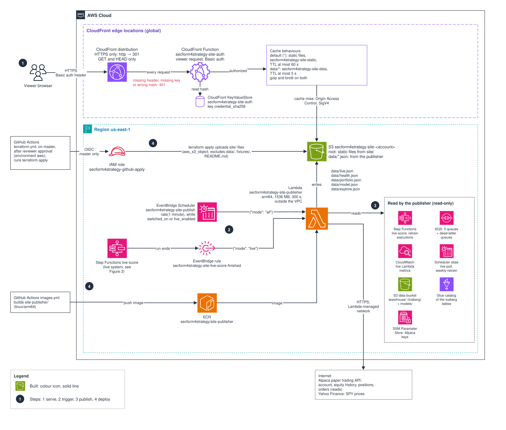
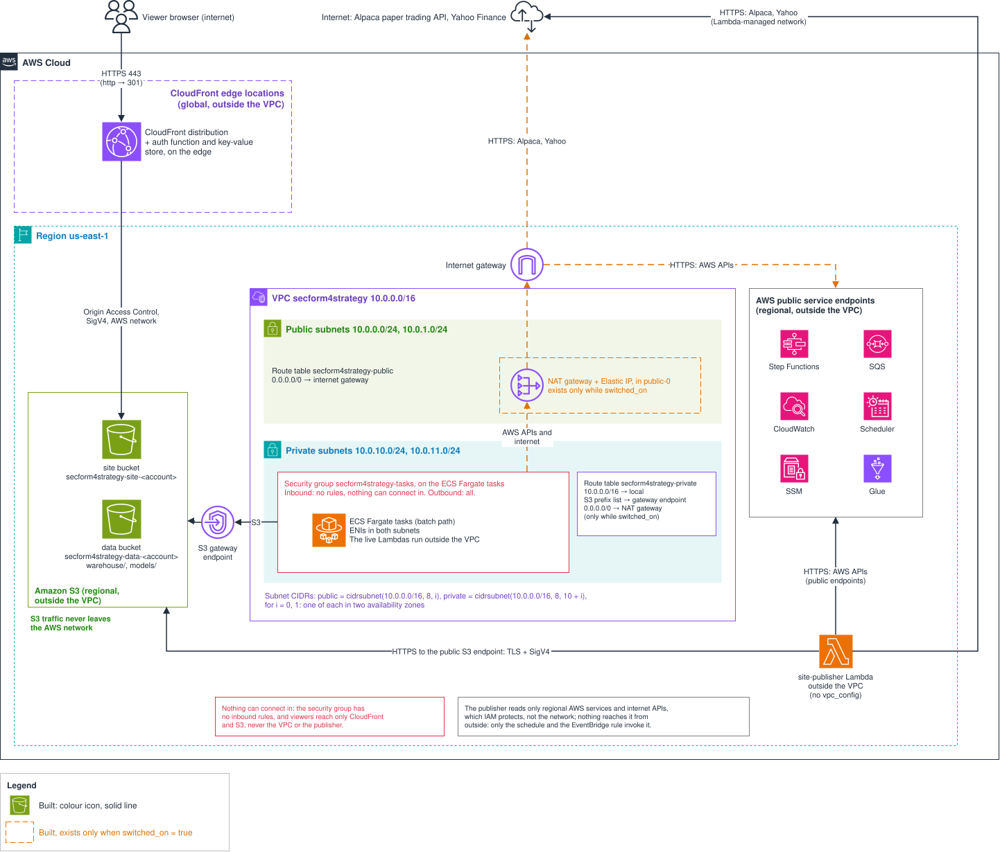
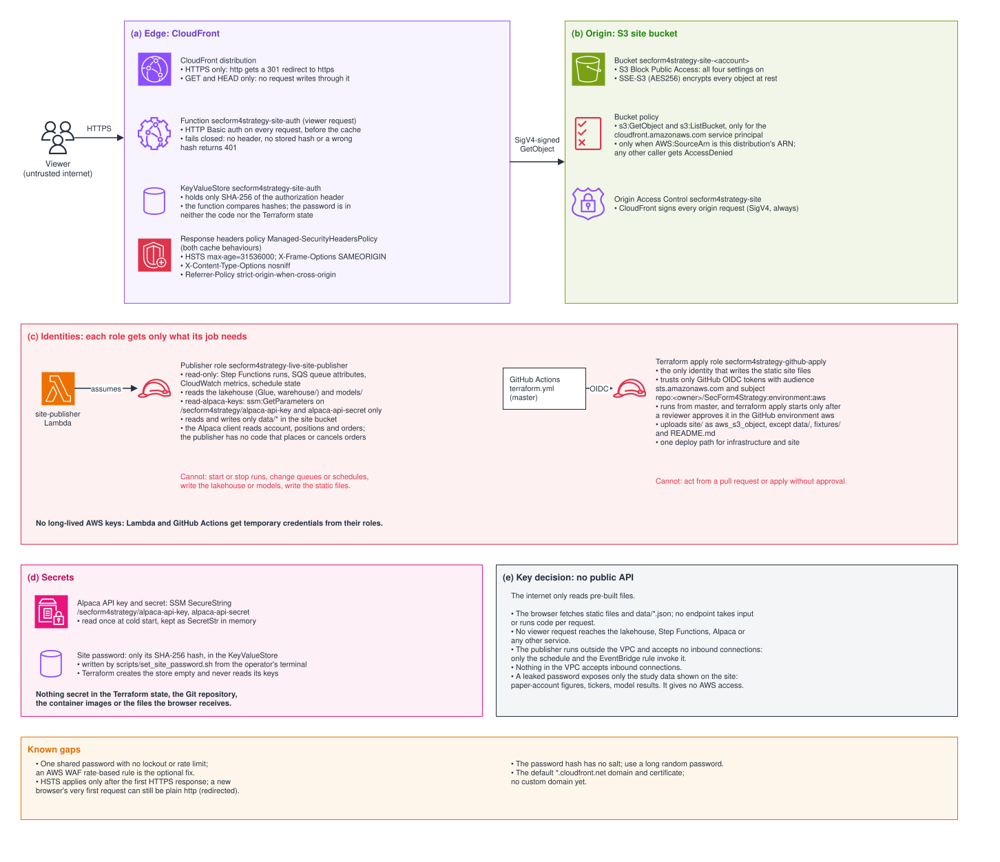

# Site

The site is a password-protected study website about the project. It has five pages:

| Page | Shows |
| --- | --- |
| Story | The presentation deck: the idea, the data, the model and the results |
| Live | The latest `live-score` runs, their filings, each filing's probability of a short winner against the cutoff, and the orders |
| Portfolio | The Alpaca paper account: equity, positions and orders |
| Model | The current classifier: parameters, probability cutoff, fold and holdout average precision (AP) against the base rate, ROC-AUC, median return of the shorts, cutoff results and feature importance |
| Explore | The largest insider sales and the clusters of insider sales of the last 7 days |

The `site` module in `infra/modules/site` defines the AWS resources. The frontend is in `site/`, and the publisher Lambda is in `site-publisher/`.

## Architecture



The site is a set of static files served by CloudFront from a private S3 bucket:

1. The bucket `secform4strategy-site-<account>` holds the static files at its root, and the JSON files under `data/`.
2. The CloudFront distribution reads the bucket through an origin access control. The bucket policy admits only this distribution.
3. The CloudFront Function `secform4strategy-site-auth` checks the password on every request, before CloudFront reads its cache.
4. The Lambda `secform4strategy-site-publisher` reads the lakehouse, the models, Step Functions, SQS, CloudWatch and Alpaca. It writes `data/*.json`.
5. The browser fetches `/data/<name>.json` from the same domain and draws the pages. Each fetch uses `cache: 'no-cache'`, so the browser revalidates its copy with the file's ETag. CloudFront answers 304 Not Modified when the file has not changed.

The site has no API. The browser connects only to CloudFront, and only CloudFront can read the bucket. Through CloudFront, a viewer gets only the static files and the data files that the publisher has already written. These files hold nothing sensitive: no keys, no credentials, and no write access to anything. A static site also costs almost nothing while nobody visits it, and CloudFront serves each file from a nearby edge location.

| Resource | Settings |
| --- | --- |
| Bucket `secform4strategy-site-<account>` | Private, all public access blocked, SSE-S3, versioning off |
| Distribution | HTTPS on the default `*.cloudfront.net` certificate (HTTP redirects to HTTPS), `PriceClass_100`, root object `index.html`, gzip and brotli |
| Cache of `data/*` | Cache policy `secform4strategy-site-data`: at most 5 seconds |
| Cache of everything else | Cache policy `secform4strategy-site-static`: at most 60 seconds, because an apply does not clear the cache |
| Response headers | Managed policy `Managed-SecurityHeadersPolicy` on both cache behaviours |
| Function `secform4strategy-site-auth` | Viewer request, runtime `cloudfront-js-2.0`, on both cache behaviours |

The bucket policy also gives CloudFront `s3:ListBucket`, so a missing file returns 404 instead of 403.

S3 has no directory index, so the function adds the index file to two kinds of path. A path that ends in `/` gets `index.html` appended. A path whose last segment has no extension, such as `/story`, gets `/index.html` appended.

`terraform output site` prints the URL, the bucket and the distribution ID.

## Password

The function implements HTTP Basic authentication. The browser sends the header `authorization: Basic <base64(user:password)>`. The function computes the SHA-256 hash of that header and compares it with the key `credential_sha256` in the CloudFront key-value store `secform4strategy-site-auth`. If the header is missing, the key is missing or the hashes differ, the function returns 401 with `www-authenticate: Basic realm="SecForm4Strategy"`, and the browser asks for the user and password.

Terraform creates the key-value store empty and never reads or writes its keys, so the credential never enters the Terraform state. Until the key is set, the site refuses every request.

To set or change the password, run this script in your own terminal after the first apply. It asks for the user and password without echoing them, and writes only the hash:

```bash
scripts/set_site_password.sh
```

CloudFront applies the new key within about a minute. No apply is needed.

## Publisher

The publisher is a Lambda function on the image `secform4strategy/site-publisher`, which `images.yml` builds from `site-publisher/`.

| Setting | Value |
| --- | --- |
| Function | `secform4strategy-site-publisher`, arm64, 1536 MB, 300 s |
| Command | `/repo/site-publisher/.venv/bin/python -m awslambdaric`, handler `handler.handle`, working directory `/repo/site-publisher/src` |
| Network | Outside the VPC: Lambda's own managed network, with internet access |
| Logs | `/aws/lambda/secform4strategy-site-publisher`, kept 14 days |
| Role | `secform4strategy-live-site-publisher` |

The publisher's code is in `site-publisher/src`:

- `handler.py` is the composition root. It builds every adapter from the shared package `secform4strategy_clients` once per cold start. It caches each model version's metadata for the life of the Lambda environment, because a saved version never changes. In one invocation, the live and portfolio builders share one read of the Alpaca orders.
- `publisher.py` selects the data files that an invocation publishes, and writes each file separately, so that one failed file does not stop the others. It is separate from `handler.py` because the tests import it, and `handler.py` builds every adapter when it is imported.
- `operations.py` builds `live.json`, `health.json` and `portfolio.json`. It reads the state machines, the schedules, the queues, the Lambda metrics and the Alpaca account.
- `research.py` builds `model.json` and `explore.json`. It reads the lakehouse and analyses the rows with pandas and scikit-learn. It replays the model's holdout and lists the recent insider sales.
- Each builder in `operations.py` and `research.py` is a `build_*` function with its `*Spec` parameters. The two modules depend on no concrete adapter. They import only the ports in `secform4strategy_clients.ports`, the records in `secform4strategy_clients.records`, and the local `records.py` and `constants.py`.
- `records.py` holds the published pydantic records of every data file and the timestamp type `UtcTime`. Every record subclasses `Record`, which makes it immutable and writes NaN or infinity as `null`. Each file's top-level record subclasses `DataFile`, which adds `generated_at`.
- `constants.py` holds the enums, and `file_name`, which gives the file name of each section. `config.py` reads the settings, and `paths.py` holds the file locations.

The environment holds the lakehouse and model store settings of the live Lambdas, plus:

| Variable | Value |
| --- | --- |
| `SITE_BUCKET` | The site bucket |
| `ALPACA_BASE_URL` | `https://paper-api.alpaca.markets` |
| `SSM_PARAMETERS` | The two Alpaca key parameters, as for the inference Lambda |
| `LIVE_SCORE_STATE_MACHINE_ARN`, `RETRAIN_STATE_MACHINE_ARN` | The two state machines |
| `POLLER_SCHEDULE_NAME`, `RETRAIN_SCHEDULE_NAME` | `secform4strategy-live-poll` and `secform4strategy-weekly-retrain`, reported as switches |
| `NAME_PREFIX` | `secform4strategy` |
| `HOME` | `/tmp` |

The publisher also reads `AWS_REGION`, which Lambda sets, as the region of its S3 site bucket, Step Functions, Scheduler, SQS and CloudWatch clients.

The role has the `lakehouse-read`, `models-read` and `read-alpaca-keys` capabilities of the `iam` module. `read-alpaca-keys` allows `ssm:GetParameters` on the two Alpaca key parameters only. The `site` module adds the inline policy `site`:

| Actions | Resources |
| --- | --- |
| `s3:GetObject`, `s3:PutObject` | `data/*` in the site bucket |
| `s3:ListBucket` | The site bucket. A `GetObject` request carries no `s3:prefix`, so the grant cannot be narrowed to `data/`; it reveals only the key names of the site files. Without it, S3 answers a read of a missing data file with `AccessDenied` instead of `NoSuchKey`, and the publisher could not tell that a file does not exist yet |
| `states:ListExecutions` | `live-score` and `retrain` |
| `states:DescribeExecution`, `states:GetExecutionHistory` | The executions of `live-score` and `retrain` |
| `sqs:GetQueueAttributes` | The five queues and their dead-letter queues |
| `sqs:ListQueues` | All resources; the action supports no resource-level permissions. The publisher finds the queues by the name prefix `secform4strategy-` |
| `scheduler:GetSchedule` | The poller schedule and the retrain schedule |
| `cloudwatch:GetMetricData` | All resources; the action supports no resource-level permissions |

### Triggers and freshness

| Trigger | Input | When |
| --- | --- | --- |
| Schedule `secform4strategy-site-publish`, `rate(1 minute)` | `{"mode": "all"}` | Enabled while `switched_on` or `live_enabled` is `true` |
| EventBridge rule `secform4strategy-site-live-score-finished` | `{"mode": "live"}` | A `live-score` run ends as `SUCCEEDED`, `FAILED`, `TIMED_OUT` or `ABORTED` |

A finished `live-score` run therefore reaches `data/live.json` within seconds. `health.json` and `portfolio.json` are at most about a minute old. `model.json` changes only when the model version changes, and `explore.json` every 15 minutes. CloudFront adds up to 5 seconds of cache to each file.

Both triggers invoke the function asynchronously. Lambda drops an event older than 60 seconds and retries no failed invocation, so a slow publish does not queue more publishes behind it. The next minute's publish replaces a missed one. The function has no reserved concurrency: the account's concurrency limit is 10, and Lambda keeps at least 10 unreserved.

### Data files

| File | Written | Contents |
| --- | --- | --- |
| `data/live.json` | After each `live-score` run, and every minute | The latest 50 `live-score` runs, with their steps, filings, probabilities, probability cutoff and Alpaca orders |
| `data/health.json` | Every minute | The switches, queue depths, live Lambda metrics, `live-score` outcomes of the last 24 hours, the latest `retrain` run and the model version |
| `data/portfolio.json` | Every minute | The Alpaca paper account, its equity history, positions and latest 100 orders |
| `data/model.json` | When the model version changes | Parameters, probability cutoff, label return, base rate, validation folds, holdout metrics, cutoff results, cumulative return against SPY, feature importance. The rebuild is assumed to finish within a minute; a longer one starts again in each later invocation until one writes the file |
| `data/explore.json` | Every 15 minutes (`every_minutes` must divide 60); optional | The largest insider sales and the insider clusters of the last 7 days |

Each file has a top-level `generated_at` timestamp. The records in `site-publisher/src/records.py` define the fields.

`live.json` gives each scored filing its `probability` and whether it was `shorted`. Each run carries the `probability_cutoff` that inference shorted at, and the file's top-level `probability_cutoff` is the newest run's. Runs that scored nothing have no cutoff.

`model.json` holds these model fields:

| Field | Content |
| --- | --- |
| `probability_cutoff` | The cutoff saved with the model; the model shorts rows at or above it |
| `label_return` | The label: a short winner has a return below this value, `-0.05` |
| `base_rate` | The holdout share of short winners, which is also the AP of a constant predictor |
| `folds` | Per walk-forward fold, the model's validation AP (`model_ap`) and the fold's base rate |
| `metrics` | Per predictor (`model`, `base_rate`, `ticker_history`): `average_precision`, `roc_auc`, `precision`, `n_shorts`, and the mean (`short_return`), median and 5% trimmed mean of the captured returns |
| `cutoffs` | The holdout shorts at each cutoff of the metadata's `cutoff_sweep`: `n_shorts`, `mean_return`, `median_return`. A model without a sweep gets one row, at its cutoff |
| `importance` | Permutation importance: the fall in holdout AP when a feature is shuffled |

The cumulative return series shorts the holdout rows whose probability is at least `probability_cutoff`. The publisher skips a model saved without `probability_cutoff` or `label_return`, a model from before the classifier, and logs a warning.

## Network



The site uses three network paths. Each path has its own entry point and its own controls.

| Path | From | To | Through |
| --- | --- | --- | --- |
| Viewer | A browser on the internet | The site files in S3 | CloudFront |
| Data | The publisher Lambda | AWS services, Alpaca and Yahoo Finance | Lambda's managed network, outside the VPC |
| Deploy | The `terraform` workflow in GitHub Actions | The site bucket | The AWS APIs, with OIDC credentials |

### Viewer path

A browser connects only to a CloudFront edge location. No server of the project accepts connections from the internet, and the bucket has no public endpoint. AWS Shield Standard protects every CloudFront distribution against network-level denial of service at no cost.

1. The browser sends an HTTPS request to the `*.cloudfront.net` domain. CloudFront answers a plain HTTP request with a redirect to HTTPS.
2. The function `secform4strategy-site-auth` checks the password. It runs before the cache, so a cached file also requires the password.
3. CloudFront serves the file from its cache, or requests it from the bucket.
4. CloudFront signs each request to the bucket with SigV4, through the origin access control. The bucket policy accepts a signed request only from this distribution.

Viewers can send only `GET` and `HEAD`. CloudFront refuses every other method.

### Data path

The publisher runs outside the VPC, in the network that Lambda manages. That network has internet access and accepts no inbound connections.

| Destination | Route |
| --- | --- |
| S3: the lakehouse, the models and the site bucket | The public S3 endpoint of `us-east-1`, over TLS |
| Step Functions, SQS, CloudWatch, EventBridge Scheduler, SSM, Glue | The public endpoint of each service, over TLS |
| The Alpaca paper API and Yahoo Finance | The internet, over TLS |

Every request to an AWS service carries a SigV4 signature made with the role's temporary credentials. AWS rejects an unsigned request, and the role decides which signed requests succeed.

The publisher reads only regional AWS services and internet APIs. None of them is inside the VPC, so a place in the VPC would protect nothing that the publisher touches. Outside the VPC, the publisher does not depend on the NAT gateway, and it starts without attaching network interfaces.

Nothing can connect to the publisher. It runs only when one of two callers invokes it: the schedule, through its role `secform4strategy-site-scheduler`, and the EventBridge rule, through a permission on the function.

### Deploy path

The `terraform` workflow uploads the site files, in the same apply as the infrastructure. The workflow runs on each push to master that changes `infra/` or `site/`. Its apply job assumes the role `secform4strategy-github-apply` through OpenID Connect (OIDC), and starts only after a reviewer approves it in the GitHub environment `aws`. No AWS key is stored in GitHub. "Deploys" below describes the upload.

## Security



The site applies its controls in five layers.

### 1. Edge

- CloudFront serves only HTTPS. A request on `http://` gets a redirect before any content.
- The function `secform4strategy-site-auth` checks HTTP Basic authentication on every request ("Password" above).
- The function compares hashes. The password is in neither the function code nor the Terraform state.
- The function refuses every request while the key-value store has no hash, so a missing password locks the site.
- Browsers send saved credentials only to the same scheme and host, so the password never travels over plain HTTP.
- Every response carries the headers of `Managed-SecurityHeadersPolicy`:

  | Header | Value | Effect |
  | --- | --- | --- |
  | `Strict-Transport-Security` | `max-age=31536000` | The browser uses HTTPS for the domain for one year, even if the user types `http://` |
  | `X-Frame-Options` | `SAMEORIGIN` | Only pages of the site itself can frame its pages; the Story page frames the deck from the same domain |
  | `X-Content-Type-Options` | `nosniff` | The browser uses the declared content type and does not guess another one |
  | `Referrer-Policy` | `strict-origin-when-cross-origin` | A link to another site sends only the domain, never the page path |
  | `X-XSS-Protection` | `1; mode=block` | Older browsers block a page when they detect a reflected script |

### 2. Origin

- S3 Block Public Access is on for all four settings of the bucket.
- SSE-S3 encrypts every object at rest.
- The bucket policy allows `s3:GetObject` and `s3:ListBucket` only to the CloudFront service, and only when `AWS:SourceArn` is this distribution.
- A request to the bucket from anywhere else, including another CloudFront distribution, gets `AccessDenied`.

### 3. Identities

Each identity gets only the permissions its job requires.

| Identity | Can | Cannot |
| --- | --- | --- |
| Viewer | Read the site files, with the password | Write anything; call any AWS API |
| Publisher role `secform4strategy-live-site-publisher` | Read state machine runs, queue attributes, metrics, schedules, the lakehouse and the models; read the two Alpaca key parameters and no other parameter; write `data/*` and list the site bucket | Start or stop runs; change queues or schedules; write lakehouse tables or data; write the models; write the static site files. The lakehouse access includes `glue:CreateDatabase`, which `IcebergFeatureStore` needs to create its namespace, so the role can create the Glue database if it is missing |
| Alpaca client of the publisher | Read the account, positions, orders and portfolio history | No limit comes from permissions. The publisher uses the same Alpaca key pair as inference, and those keys can place and cancel orders on the paper account. The publisher calls only read endpoints, so the isolation relies on code, not on permissions |
| Terraform apply role `secform4strategy-github-apply` | Create and change every resource, including the site files | Act from any branch other than `master`, or start before a reviewer approves the apply |

### 4. Secrets

| Secret | Where it is | Who reads it |
| --- | --- | --- |
| Alpaca API key and secret | SSM `SecureString` `/secform4strategy/alpaca-api-key` and `/secform4strategy/alpaca-api-secret` | The publisher at cold start, through `SSM_PARAMETERS` |
| Site password | Only as a SHA-256 hash, in the key-value store `secform4strategy-site-auth` | The auth function, on each request |
| AWS credentials | Nowhere; Lambda and GitHub Actions receive temporary credentials from their roles | |

No secret is in the Terraform state, the Git repository, the container images or the files the browser receives.

The Terraform plan role `secform4strategy-github-plan` has `ReadOnlyAccess`, and pull request branches can assume it. Its inline policy `deny-site-keys` denies `cloudfront-keyvaluestore:GetKey` and `cloudfront-keyvaluestore:ListKeys`, so a pull request cannot read the password hash.

### 5. No public API

The internet can read only files that the publisher has already written. No viewer request reaches the lakehouse, Step Functions, Alpaca or any other service.

An API would accept requests from the internet and run code for each one. Each request could then read the lakehouse or call Alpaca. A static site removes that attack surface. If the password leaks, the reader sees the information on the site: paper-account figures, tickers and model results. The reader gets no access to AWS.

### Known gaps

| Gap | Risk | Fix | Cost |
| --- | --- | --- | --- |
| One shared password, with no lockout and no rate limit | An attacker can try passwords without limit | A long random password; an AWS WAF rate-based rule on the distribution | About $6 per month for WAF |
| HSTS covers a viewer only after the first HTTPS response | The very first request of a new browser can go over plain HTTP, and gets a redirect | HSTS preload requires a custom domain | None |
| The password hash has no salt | Someone with read access to the key-value store can test a weak password offline | A long random password | None |
| No Content-Security-Policy | `Managed-SecurityHeadersPolicy` sends no `Content-Security-Policy` header, so the browser does not restrict where scripts and styles come from | A custom response headers policy with a Content-Security-Policy, tested in browsers against the inline styles that Plotly adds | None |
| The default `*.cloudfront.net` domain | The address does not name the project | A Route 53 domain with an ACM certificate | About $15 per year for a `.com` domain |
| Lambda concurrency limit of 10 | The account allows 10 concurrent Lambda executions in total, and AWS keeps all 10 unreserved, so no function can reserve any. In a burst of filings, the live functions and the publisher share the 10, and a throttled `live-score` step fails its run after two retries, so that filing is not scored | A quota increase to the 1,000 default (Service Quotas `L-B99A9384`, requests must be above 1,000), then reserved concurrency for the scoring steps | None |

## First deploy of a new image-based Lambda

A Lambda that runs a container image needs that image in ECR, and the repository exists only after a Terraform apply. The first deploy of the site therefore took two applies:

1. The first apply created the bucket, the site files, the distribution, the auth function, the ECR repository `secform4strategy/site-publisher` and the publisher role. The `images` job for `site-publisher` failed because the repository did not exist yet, and a manual re-run pushed the image.
2. The second apply created the publisher, its log group, the schedule and the EventBridge rule.

A temporary variable gated the publisher resources for this. It is removed; `moved` blocks in `infra/modules/site/main.tf` record the resources' old `[0]` addresses. A future image-based Lambda needs the same two steps.

The publisher now reads its image at plan time, so building the stack in an empty account needs the image first:

1. Run `terraform apply -target=module.storage` to create the ECR repositories.
2. Run `images.yml` to push every image.
3. Run the full apply.

## Deploys

Terraform uploads the site files. The `site` module creates one `aws_s3_object` for each file under `site/`, except `fixtures/`, `data/` and `README.md`. Each object carries the MD5 hash of its file as its ETag, so an apply uploads a file again only when its content changes. The module sets the content type from the file extension.

A change to `site/` triggers the `terraform` workflow on master. After a reviewer approves the apply, the new files are in the bucket. CloudFront serves the old version for at most 60 seconds more, because the static cache policy keeps a file at most 60 seconds.

`data/` is not in the repository. Only the publisher writes it, and Terraform never touches it.

## Cost

| Item | Cost |
| --- | --- |
| S3 storage and requests | A few cents per month |
| CloudFront | Free tier: 1 TB transfer, 10 million requests and 2 million function invocations per month |
| Publisher, while switched on | About $0.86 per month for each second a publish takes: 43,200 invocations at 1.5 GB, at $0.0000133334 per GB-second, before the free tier of 400,000 GB-seconds |
| Publisher, while switched off | Nothing; the schedule is disabled and no `live-score` run ends |

A local run of one `all` publish took about 7 seconds and peaked at 585 MB of memory. At 7 seconds, a month of publishes uses about 450,000 GB-seconds, close to the free tier, so it costs about $1 per month while switched on.
